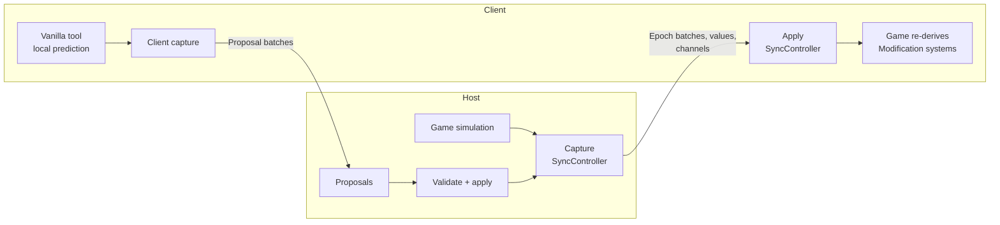
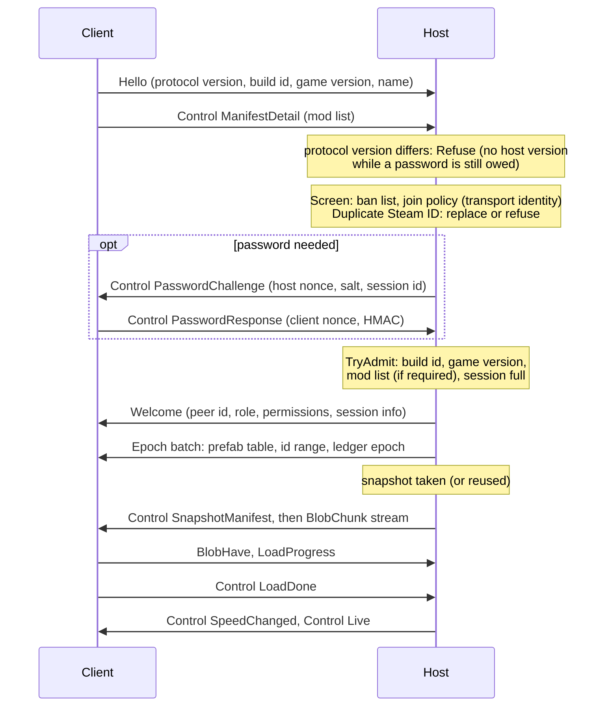
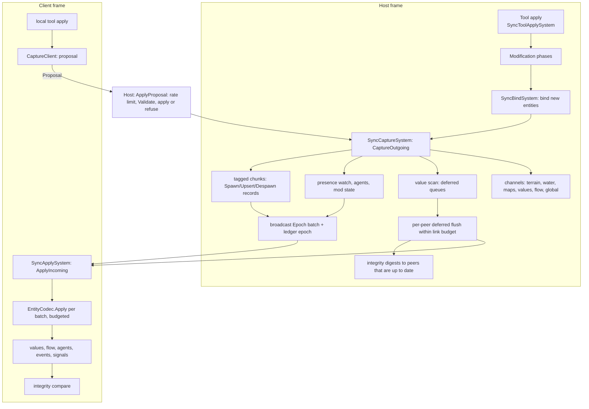
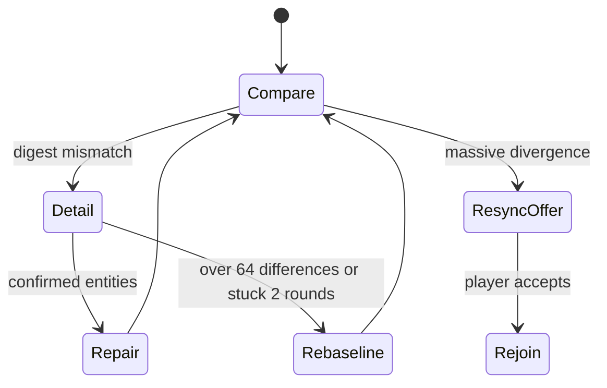

# Skyline Together architecture

This document describes Skyline Together **as built**: what the code in this repository does today. It was written
from the code, and every statement names the file or type it comes from. Where this document and the code disagree,
the code is right and this document has a bug.

The design documents written before the implementation (the original architecture, the implementation plan and the
three competing proposals) are kept in [history/](history/README.md). They explain where many ideas and names come
from, but large parts of them were never built or were built differently; do not treat them as a description of the
code. Research notes on the game's internals are in [research/](research/00-DIGEST.md).

Companion documents that are kept up to date with the code:

- [design/SYNC-COVERAGE.md](design/SYNC-COVERAGE.md): every piece of game state and how it is kept equal.
- [design/ACTION-COVERAGE.md](design/ACTION-COVERAGE.md): every player action and how it travels.
- [design/MOD-COMPATIBILITY.md](design/MOD-COMPATIBILITY.md): third-party mods, per mod.
- [dev/code-map.md](dev/code-map.md): a short orientation for new contributors.

Code comments cite sections of this document as `ARCHITECTURE.md#anchor`.

## Contents

- [Overview](#overview)
- [Processes and threads](#processes-and-threads)
- [Module map](#module-map)
- [Frame order](#frame-order)
- [Session lifecycle](#session-lifecycle)
- [Transport](#transport)
- [Sync pipeline](#sync-pipeline)
- [Identity](#identity)
- [Follower clock and client gating](#follower-clock-and-client-gating)
- [Data channels](#data-channels)
- [Integrity](#integrity)
- [Mod compatibility](#mod-compatibility)
- [Diagnostics](#diagnostics)
- [Performance budgets](#performance-budgets)
- [Security model](#security-model)
- [Known limitations](#known-limitations)
- [Known gaps](#known-gaps)

## Overview

Skyline Together lets several players build one Cities: Skylines II city together. One player **hosts**: their game
runs the simulation and owns the city. The others **join**: their games load a copy of the host's city and from then
on follow the host.

The model is **host-authoritative**:

- **Only the host simulates.** On clients every `GameSimulation` system is switched off; their clock follows the
  host's frame and simulation results arrive from the host ([follower clock](#follower-clock-and-client-gating)).
- **The save format is the wire format.** Entities travel as their components' own `ISerializable` encoding, the same
  bytes the game writes into a save, with entity references rewritten to network ids
  ([batch encoding](#batch-encoding)). Game patches change the format by themselves; the codec has almost no
  per-type code.
- **Derive what the game derives.** Only source state travels (nets, objects, areas, lines, agents, values the
  simulation writes). Everything the game's Modification systems rebuild (geometry, lanes, zone blocks, sub-objects,
  flow graphs) is rebuilt on every client from the replicated source, after the applier tags it `Updated`.
- **Clients predict with vanilla tools and propose the result.** A client's tool applies locally (instant feedback);
  the capture turns the result into a proposal; the host validates it, applies it with the same applier and streams
  the authoritative result to everyone. A refused proposal is rolled back on its originator
  ([client proposals](#client-proposals)).
- **Congestion becomes staleness, not backlog.** Structure always goes out; values that change all the time are
  coalesced per peer and sent only while the peer's link has room ([link pacing](#deferred-values-and-link-pacing)).
- **Fail closed, fail visible, fail into resync.** Every entry point the game calls is guarded; a feature that keeps
  failing switches itself off; a client whose replica may be damaged is offered a rejoin with a fresh snapshot
  ([feature health](#feature-health-and-guards), [integrity](#integrity)).
- **Single player costs nothing.** Every system returns at once without a session; nothing is allocated.

## Processes and threads

There is no server: the host's game is the server, and every player runs the same mod.

Almost everything runs on Unity's **main thread**:

- The ECS systems registered in [`Mod.cs`](../src/SkylineTogether/Mod.cs) call into `SyncController`, `MoverSync`,
  `PresenceSystem` and the UI systems at fixed points of the frame ([frame order](#frame-order)).
- [`SessionDriver`](../src/SkylineTogether/Session/SessionDriver.cs), a `MonoBehaviour` created at load, ticks the
  session once per rendered frame (also in the main menu and while a city loads): `SessionManager.Tick` polls the
  transport, pumps the outboxes, runs the handshake and timeouts, then toasts, Steam invites and the UI probe.
- Steam callbacks (connection state, lobby, invites) arrive inside the game's own `SteamAPI.RunCallbacks` pump, on
  the main thread, and are queued until the next poll
  ([`SteamSocketsTransport`](../src/SkylineTogether/Net/SteamSocketsTransport.cs)).

Exceptions:

- **Snapshot pump.** While a joiner downloads the city, a
  [`BackgroundPump`](../src/SkylineTogether.Core/Transport/BackgroundPump.cs) thread pumps that joiner's
  `BlobSender` and `PeerOutbox` every 2 ms, so a low frame rate never leaves the link idle
  (`HostOptions.BackgroundPump`, only for `IThreadSafeConnection`, which the Steam connection is). `PeerOutbox` and
  `BlobSender` are lock-protected for this.
- **Save and load tasks.** The join snapshot is written and loaded through the game's `TaskManager` queue
  "SaveLoadGame" ([`SnapshotService`](../src/SkylineTogether/Session/SnapshotService.cs),
  [`SnapshotLoader`](../src/SkylineTogether/Session/SnapshotLoader.cs)); their continuations come back to the main
  thread through [`MainThreadQueue`](../src/SkylineTogether/Session/MainThreadQueue.cs).
- **GPU readbacks.** Terrain and water tiles are read back asynchronously
  ([`GpuReadback`](../src/SkylineTogether/Sync/GpuReadback.cs)); Unity calls back on the main thread.

Core types declare their thread with `[ThreadAffinity]`
([`ThreadKind`](../src/SkylineTogether.Core/Contracts/Threading/ThreadKind.cs)).

## Module map

### Projects

| Project | Target | Role |
|---|---|---|
| [`src/SkylineTogether.Core`](../src/SkylineTogether.Core) | net472 (or netstandard2.1 without the game) | Pure .NET, no Unity, Game or Colossal reference: wire formats, codecs, hashing, session state machines, scheduling, integrity bookkeeping, replay checking. Everything testable lives here. |
| [`src/SkylineTogether`](../src/SkylineTogether) | net472 against the game's managed assemblies | The game layer: `IMod`, ECS systems, the entity codec, Steam transport, UI bindings, mod adapters. |
| [`tests/SkylineTogether.Core.Tests`](../tests/SkylineTogether.Core.Tests) | net8.0 console | Compiles the Core sources and tests them with a small own framework ([dev/testing.md](dev/testing.md)). |
| [`ui/SkylineTogether.mjs`](../ui/SkylineTogether.mjs) | ES module, no bundler | The in-game UI ([ui/README.md](../ui/README.md)). |

### Core folders

| Folder | Responsibility |
|---|---|
| `Buffers` | `ByteWriter`/`ByteReader` (little-endian, LEB128 varints, bounded reads that throw `DecodeException`), `BufferPool` |
| `Contracts` | Shared value types and interfaces: identity (`NetId`, `PeerId`, `NetSlot`, ...), transport (`ITransport`, `IConnection`, `Lane`, `Delivery`), taxonomies (`MessageKind`, `Family`, `Permission`, `SessionRole`, `RejectReason`), session models (`HandshakeDigests`, `SnapshotManifest`), logging and clock seams. |
| `Diagnostics` | `FeatureHealth` (trip logic of a feature), `PerfCounters` |
| `Fields` | Terrain, water and cell-map tile codecs and grids, brush strength compensation, stroke settling |
| `Follower` | `FollowerClockModel`, the client's estimate of the host frame |
| `Hashing` | xxHash64, XXH3-64/128, digests, set hashes |
| `Identity` | `FamilyRules` (family classification table), `BuildOrderAllocator`, `SlotBitSet` |
| `Integrity` | `EntityDigest` (bucket arithmetic), `DivergenceTracker`, `RepairEscalation`, `RepairThresholds`, `DetailScheduler`, line-state rows and comparison, `IconSetDigest` |
| `Json` | `MiniJson` reader and `JsonWriter` |
| `Modding` | `ModFacts`, `IlScanner`, `ModDeclarations`, `ModClassifier`, `AdapterCheck`, `ModChannelRouter`/`ModChannelBudget`, `AssetSource`/`MissingAssets` |
| `Motion` | Mover motion encoding: `MotionHostEncoder`, `MotionCodec`, `MotionClientStager`, `InterestSlotTable` |
| `Protocol` | Envelope framing, fragmentation, LZ4 compression, handshake and control messages, `Limits`, `ProtocolVersion`, `ProtocolText` (text sanitising) |
| `Replay` | Solo test: recording format, `RecorderPeer`, `PlaybackTransport`, checkpoints, `ReplayChecker`, `ReplayVerdict` |
| `Scheduling` | `TokenBucket`, `PeerByteBudget`, `CoalescingQueue` + `LinkBudget`, `AttentionPlanner`, `AgentPlanner`, `RollingScan`, `SpatialHashGrid`, infoview topics |
| `Session` | `SessionHost`, `SessionClient`, `PeerChannel`, `JoinSecurity` (bans, join policy, password lockout, moderation rules), `SessionCrypto`, `RejoinController`, `JoinTimeline`, presence and tool-preview codecs, mod-list comparison |
| `Sync` | `SyncBatch` (the replication record format), `NetIdAllocator`, `ProposalGuard` (rate limits, conflict ledger, rules), apply acknowledgements, global-state, terrain, water, mover, flow-status, integrity and agent records |
| `Testing` | Fakes for tests (`ManualClock`, `ListLog`, `NullLog`, `DeterministicRandom`) and `StopwatchClock` |
| `Transport` | `PeerOutbox`, `SendRateController`, blob transfer, `BackgroundPump`, `CompositeTransport`, loopback and network-simulator transports (tests, solo test) |

### Game layer folders

| Folder | Responsibility |
|---|---|
| [`Mod.cs`](../src/SkylineTogether/Mod.cs) | Entry point: `OnLoad` creates the controllers and registers the systems, each step guarded; `OnDispose` |
| `Compat` | Mod compatibility: `ModAdapter` and the built-in adapters, `ModCompat` (registry, gates), `ModAssemblyScanner` + `HarmonyPatches` (automatic scan), `GenericModAdapter`, `ModIntegration` (API for other mods), `ModStateWatcher`, `ModSettingsSync`, `AssetSources` |
| `Data` | Embedded locale tables |
| `Diagnostics` | `Probes` (self-test), `Features` (the feature registry), `Guard`, `Perf`, `GameLog`, `DiagnosticsDump` |
| `Net` | `SteamSocketsTransport` |
| `Presence` | Cursors, name tags and other players' tool previews |
| `Replay` | `ReplayController`: Record test session, Replay & verify |
| `Session` | `SessionManager` (host, join, leave, recovery), `SnapshotService`, `SnapshotLoader`, `JoinAssetTransfer`, `SteamInvites`, toasts |
| `Settings` | `SkylineTogetherSettings` (Options page), `LocaleSource` |
| `Sync` | `SyncController` (one partial class over several files), `EntityCodec`, `NetWriter`/`NetReader`, `TypeHandlers`, `NetIdSystem`, `FamilyClassifier`, `ClientGate`, `FollowerClock`, and one class per data channel |
| `Systems` | `SpeedAuthoritySystem` |
| `UI` | `SessionUISystem`, `ReplayUISystem`, `InviteUISystem` (bindings and triggers of the UI module) |

`SyncController` is split by responsibility: [`SyncController.cs`](../src/SkylineTogether/Sync/SyncController.cs)
(state, diagnostics, sending), `.Session.cs` (session start and end, peers joining and leaving), `.Apply.cs` (frame
start), `.Capture.cs` (tool hook, frame-end capture, value scans, deferred queues), `.Validation.cs` (host validation,
rollback), `.Client.cs` (client proposals, route preview window), `.Zones.cs` and `.Mods.cs`.

### UI module

The UI is one hand-written ES module, [`ui/SkylineTogether.mjs`](../ui/SkylineTogether.mjs), registered with the
game's module registry: a "Multiplayer" main-menu entry and screen, a floating button with the player count, the
session panel, chat overlay, name tags, join progress and error screens. It reads the bindings of group
`skylineTogether` that [`SessionUISystem`](../src/SkylineTogether/UI/SessionUISystem.cs) publishes (`state`, `join`,
`net`, `presence`) and calls its triggers. Every string is a locale key resolved through `cs2/l10n` from
`src/SkylineTogether/Data/locale.<id>.json` ([`LocaleSource`](../src/SkylineTogether/Settings/LocaleSource.cs)).
`tools/ui_smoke.mjs` checks bindings, triggers and keys against the C# side.

### Code rules

Rules the code follows (enforced by review and, where possible, by tests):

- Core has no reference to Unity, Game or Colossal assemblies and reads time only through `IClock`.
- Decoders of network input throw `DecodeException` and nothing else; fuzz tests check every decoder
  (`tests/.../Protocol/ProtocolFuzzTests.cs`).
- Every wire layout change increments [`ProtocolVersion.Current`](../src/SkylineTogether.Core/Protocol/ProtocolVersion.cs)
  (policy: [releasing](dev/releasing.md#protocol-version-policy)); golden byte vectors in the tests pin the layouts.
  Enum values that travel on the wire never change.
- Logging goes through `ILog` with a `LogCategory`; player-facing texts are locale keys, and a test checks that every
  key the game layer uses exists.
- Hot paths reuse buffers and delegates (no allocation per message or per frame where it can be avoided).

## Frame order

The registrations in [`Mod.OnLoad`](../src/SkylineTogether/Mod.cs) are authoritative:

| System | Phase and position | Does |
|---|---|---|
| `NetIdSystem` | MainLoop; `PostDeserialize<NetIdSystem>` in Deserialize | Holds the id tables; its bindings travel in the join snapshot (the game's system serializer) |
| `SyncApplySystem` | MainLoop, right after `EndFrameBarrier` | `SyncController.ApplyIncoming`: everything received is applied before tools, raycast and Modification run |
| `MoverApplySystem` | MainLoop, after `SyncApplySystem` | Client: mover records |
| `ViewerGateSystem` | ToolUpdate, before `ToolOutputSystem` | A viewer's tool apply becomes a clear |
| `SyncToolApplySystem` | first in ApplyTool | Records the tool's `Temp` originals and cost before vanilla consumes them; terrain and resource brush stamps |
| `IconAuthorityFilterSystem` | ModificationEnd, before `IconCommandSystem` | Client: drops local icon decisions, reconciles host icon sets |
| `ChirpDrainSystem` | ModificationEnd, before `CreateChirpSystem` | Client: empties the local chirp queue |
| `SyncBindSystem` | MainLoop, before `SaveGameSystem` | Host: binds entities created this frame (a snapshot taken now carries them); client: warns about local saves |
| `MoverCaptureSystem` | MainLoop, before `SaveGameSystem` | Host: mover existence and motion |
| `SyncCaptureSystem` | MainLoop, before `PrepareCleanUpSystem` | `SyncController.CaptureOutgoing`: every tag of the frame is still visible |
| `SpeedAuthoritySystem` | LateUpdate, before `SimulationSystem` | One speed for everyone; host holds the simulation while someone joins |
| `MoverWriteSystem` | PreCulling, before `PreCullingSystem` | Client: writes mover transform frames just in time for interpolation |
| `PresenceSystem` | Rendering, before `OverlayRenderSystem` | Cursor raycast, presence send, remote cursors and previews into the overlay buffer |
| `SessionUISystem`, `ReplayUISystem`, `InviteUISystem` | UIUpdate | Bindings |

Apply at frame start and capture at frame end means a client's applied changes go through the same Modification
phases as a local edit, and the host captures after every tool apply and Modification phase of its frame.

## Session lifecycle

[`SessionManager`](../src/SkylineTogether/Session/SessionManager.cs) owns the session; the protocol state machines are
Core's [`SessionHost`](../src/SkylineTogether.Core/Session/SessionHost.cs) and
[`SessionClient`](../src/SkylineTogether.Core/Session/SessionClient.cs). Replication attaches through the
`HostStarted`, `ClientStarted` and `SessionEnded` events.

### Hosting

`SessionManager.StartHosting` (only in a loaded city, with Steam logged in) creates a `SteamSocketsTransport` wrapped
in a `CompositeTransport` (the solo-test recorder attaches there) and a `SessionHost` with `HostOptions` from the
settings: session name, password, max players (2-16, counting the host), "require the same mods", join policy
(open, or Steam friends and invited players only), the persisted ban list, and the optional direct-IP socket, which
opens only while a host password is set. A friends-only Steam lobby and rich presence carry the invitation
([`SteamInvites`](../src/SkylineTogether/Session/SteamInvites.cs)); the session itself always runs over a P2P
connection to the host's Steam ID (or the direct address).

On `HostStarted`, `SyncController.BindCity` compacts the net ids (no peer holds any yet), binds every prefab and every
persistent entity of the replicated families, primes the presence watch and the build-order allocator, and starts the
mod state watcher. A solo-test host (`StartSoloHost`) runs the same session without any network part.

### Handshake and admission

The handshake is **password first**: a joiner learns nothing about the host's versions or mods before it has passed
bans, the join policy and the password.

Details ([`SessionHost.Handle`](../src/SkylineTogether.Core/Session/SessionHost.cs)):

- The client sends `Hello` and its mod manifest at once on connect. Only the Steam ID that Steam authenticated on the
  transport is an identity; a Steam ID claimed in `Hello` is logged and ignored.
- A protocol mismatch is refused at once; while the peer still owes a password the refusal names no host version
  (`HelloMessage.PeekProtocolVersion` reads the version before parsing the rest).
- `Screen` checks the ban list (Steam ID, or address for connections without Steam identity) and the join policy.
  `ResolveDuplicate` replaces an older connection of the same Steam user, unless it is still loading (then the new
  attempt is refused with `HostPreparing`, which the client treats as retryable).
- A password is needed when one is set, and always for direct or unauthenticated connections
  (`HostOptions.PasswordForUnauthenticated`; without a password those are refused as `NotInvited`). The proof is
  `HMAC-SHA256(PBKDF2-HMAC-SHA256(password, salt, 10 000), hostNonce ‖ clientNonce ‖ sessionId)`
  ([`SessionCrypto`](../src/SkylineTogether.Core/Session/SessionCrypto.cs)); one answer per challenge; constant-time
  compare. [`PasswordAttemptLimiter`](../src/SkylineTogether.Core/Session/JoinSecurity.cs) keys failures by Steam ID
  and address: three free, then a lockout of 5 s doubling up to 10 minutes, forgotten after 15 minutes; at most two
  open challenges per key.
- `TryAdmit` then compares the build id (first 48 bits of the SHA-256 of the loaded DLL,
  [`BuildId`](../src/SkylineTogether.Core/Session/BuildId.cs)), the game version and, with "require the same mods",
  the mod lists ([`MismatchReport.CompareMods`](../src/SkylineTogether.Core/Session/MismatchReport.cs); mods that are
  client-local on both sides never block). A refusal carries a `MismatchReport` the joiner's error screen shows.
  The other `HandshakeDigests` fields are not filled or compared ([known gaps](#known-gaps)).
- Refuse reasons: `Mismatch`, `Full`, `Banned`, `BadPassword`, `NotInvited`, `HostShuttingDown`, `ProtocolVersion`,
  `HostPreparing`. Before admission a connection may send bodies of at most 1 MiB, and the handshake must finish within
  30 s.
- `Admit` assigns the lowest free peer id (1-254) and the default role (builder), sends `Welcome`, raises
  `PeerJoining` and lengthens the connection timeouts (the joiner's main thread stalls while it loads).

### Snapshot join

A joiner receives the host's city as a save game and loads it through the game's normal load path.

1. **Stream start.** On `PeerJoining` the host's `SyncController` creates the peer's deferred queue and sends the
   prefab table (every prefab's `PrefabID` with its net id; encoded once per session in slices across frames by
   [`PrefabTableCache`](../src/SkylineTogether/Sync/PrefabTableCache.cs), a join only adds prefabs bound since), a
   granted id range and the current ledger epoch. From
   admission on, every broadcast is queued for the joiner too; the client buffers everything it receives until it is
   live.
2. **Snapshot.** The host requests a snapshot after the admission, so it contains everything the joiner's stream does
   not. A snapshot requested within 30 s of a previous one is reused when nothing can have changed since (nothing
   broadcast, simulation held or paused throughout; `HostOptions.SnapshotReuseSeconds`). While any admitted peer is
   not live, `SessionHost.HoldSimulation` is true and `SpeedAuthoritySystem` pauses the host's simulation.
   [`SnapshotService`](../src/SkylineTogether/Session/SnapshotService.cs) writes the city with the game's
   `SaveGameSystem` into a temporary file (no package, preview or "Continue" entry), through a digesting stream
   (XXH3-128 computed while writing). `NetIdSystem.WritingSnapshot` makes this save, and only this save, carry the id
   bindings, so the joiner's loaded entities have the host's net ids without a table transfer. Package-bundled render
   prefabs (climate, water and terrain render prefabs from packages) travel in front of the save data
   ([`JoinAssetTransfer`](../src/SkylineTogether/Session/JoinAssetTransfer.cs)).
3. **Transfer.** The manifest goes as `Control SnapshotManifest`; the file streams as 256 KiB `BlobChunk` messages on
   the bulk lane ([blob transfer](#blob-transfer)). The client acknowledges with have-bitmaps; chunks that arrive
   before the manifest are kept (bounded) and fed in once the receiver exists. The download is verified against the
   digest.
4. **Load.** [`SnapshotLoader`](../src/SkylineTogether/Session/SnapshotLoader.cs) imports the join assets, then loads
   the save from a transient asset database with the host's game mode and city options, achievements off and the
   simulation paused. `ModCompat.OnClientStarted` switches off mod systems that must not run during a joiner's load.
5. **Live.** The client reports `LoadDone`; the host marks it live and sends the current speed and `Live`.
   `SessionClient.GoLive` raises `BecameLive` (the client gate closes, mod client gates, the mod state watcher and the
   integrity check start), then delivers the buffered messages in order.
6. **Catch-up.** Right after going live the client applies the backlog with a larger budget (24 ms and 512 batches
   per frame instead of 6 ms and 64) until it is empty; that ends the join's timeline
   ([`JoinTimeline`](../src/SkylineTogether.Core/Session/JoinTimeline.cs), shown in the UI and logged).

Changes broadcast between the admission and the moment the snapshot was written are applied twice; that is safe
because a `Spawn` of a bound id reconciles in place and a despawn of an unknown id is a no-op.

Timeouts on the host: snapshot not delivered by the save system after 360 s (abandoned; waiting joiners told), a joiner
silent for 180 s, a join longer than 30 minutes in total. On the client: 30 s to connect and handshake, 300 s waiting
for the snapshot, 120 s without a chunk, 20 minutes for the load, 120 s waiting for `Live`.

### Live session

- **Keepalive.** The host pings every admitted peer every second; the client answers, and the round trip is the
  player's ping. A live peer silent for 120 s is dropped (`LiveSilenceTimeoutSeconds`); a client that hears nothing
  from the host for 120 s ends the session. After a stall of the host's own frames (over 5 s) silence and queue-age
  limits wait 15 s. Below that, the connection's own keepalive timeout is 30 s, and 120 s while a player joins
  ([`ConnectionTimeouts`](../src/SkylineTogether.Core/Transport/IConnectionTimeouts.cs)).
- **Slow links.** A peer whose outbox exceeds 64 MiB or holds a message older than 60 s is disconnected ("too slow to
  keep up"); joiners are only held to the size limit until a minute after going live.
- **Stuck peers.** A live peer that has acknowledged no applied batch for 120 s
  ([`AckStallWatch`](../src/SkylineTogether.Core/Sync/ApplyAcks.cs)), or whose proposals and acks queue faster than
  the host applies them (4096 messages or 64 MiB, `InboundQuota`), is kicked with a rejoin hint.
- **Players and speed.** The player list goes out at most four times a second when it changed (every 2 s anyway); the
  speed whenever it changes.

### Leaving, kicks and recovery

A client leaving sends `Disconnecting`; the host's `Stop` sends `SessionEnd` to everyone. Kick and ban are control
messages with a text; a ban also adds the Steam ID (or address) to the host's ban list, which `SessionManager` persists
in the settings (`BannedPlayers`).

When a client session ends unexpectedly while the player is in the host's city,
[`RejoinController`](../src/SkylineTogether.Core/Session/RejoinController.cs) takes over: the city stays paused and
does not autosave. Retryable ends (connection lost, unreachable host, timeout, failed join, `HostPreparing`, accepted resync)
rejoin automatically through the normal join path (fresh snapshot) with backoff 2, 5, 10, 20, 30, 30 s, at most six
attempts; everything else, and the end of the attempts, asks the player: reconnect, main menu, or keep the city as an
offline copy. A local fault that may have damaged the replica (a critical feature tripped) is offered, never
automatic, because a deterministic fault would loop.

### Roles and moderation

Roles are `Host`, `CoHost`, `Builder` (the default) and `Viewer`
([`SessionRole`](../src/SkylineTogether.Core/Contracts/Taxonomy/SessionRole.cs)).
[`RolePermissions`](../src/SkylineTogether.Core/Session/RolePermissions.cs) gives host, co-host and builder every
`Permission` and viewers only `Chat`; the host checks the sender's role on every proposal, intent, global-state edit,
speed request and mod channel message. Viewers' tools never apply locally (`ViewerGateSystem`), which is comfort; the host's check is the
rule. [`Moderation`](../src/SkylineTogether.Core/Session/JoinSecurity.cs): co-hosts may kick builders and viewers and
switch them between builder and viewer; only the host bans, appoints co-hosts and changes session options.

## Transport

### Steam Networking Sockets

[`SteamSocketsTransport`](../src/SkylineTogether/Net/SteamSocketsTransport.cs) implements Core's `ITransport` over
Steam Networking Sockets: P2P by Steam ID through Valve's relays (NAT traversal, encryption, authenticated identity)
and optionally a direct-IP listen socket on a UDP port (default 27015). One poll group receives all messages, at most
8192 messages or 25 ms per frame. Per connection it sets a 16 MiB send buffer, a 32 MiB receive buffer, and a send rate
chosen by [`SendRateController`](../src/SkylineTogether.Core/Transport/SendRateController.cs) (Steam does not
estimate bandwidth): start at 1 MiB/s, every 0.5 s multiply by 1.5 while the link is busy and delivery is clean (to
8 MiB/s while the remote quality is unknown, 48 MiB/s at most), by 0.7 on loss below 93 % or queueing delay, never
below 256 KiB/s.

Steam lanes are not configured: every message goes to the same Steam connection. Reliable messages of lanes R and U
are sent `ReliableNoNagle`, lane B `Reliable`, unreliable ones `Unreliable`; the lane's meaning is the scheduling in
`PeerOutbox`.

### Envelope and message kinds

Every message is an envelope
([`EnvelopeCodec`](../src/SkylineTogether.Core/Protocol/Framing/EnvelopeCodec.cs)):
`u8 kind | u8 flags | body`, with flags `None`, `Compressed | HasUncompressedSize` (then `varint size | u8 codec |
compressed`) or `Fragment`. The decoder checks the declared size against the kind's limit
(`Limits.MaxBodyBytes`) before decompressing, and only canonical flag combinations. `PeerChannel` encodes, compresses,
fragments and queues on the way out and decodes and reassembles on the way in; a broadcast is encoded once for all
peers.

| Kind (value) | Direction | Content |
|---|---|---|
| `Hello` (1), `Welcome` (2), `Refuse` (3) | handshake | see [handshake](#handshake-and-admission) |
| `Control` (4) | both | `ControlKind` + payload: password, manifest, players, speed, snapshot manifest, load progress, live, kick, ban, session end, moderation, toast |
| `Epoch` (5) | host → client | a `SyncBatch`: structure, values, channels ([batch encoding](#batch-encoding)) |
| `Ack` (6), `Motion` (8), `MotionControl` (9), `View` (11) | both | mover motion and its acknowledgements, client view reports |
| `Proposal` (7) | client → host | a `SyncBatch` of the client's edits and requests |
| `Presence` (12) | both, unreliable | cursor, tool, tool preview |
| `BlobChunk` (16), `BlobHave` (17) | both | snapshot transfer |
| `Ping` (18), `Chat` (19) | both | keepalive, chat |
| `Terrain` (20), `Water` (21) | both / host → client | terrain stamps, tiles, tile requests; water tiles |
| `ApplyAck` (60) | client → host | number of `Epoch` messages applied |
| `SimValues` (65), `CellMaps` (66), `Statistics` (67) | host → client (cell maps both) | simulation values, cell-map tiles and paint patches, statistics history |
| `AgentValues` (90), `AgentRefresh` (91) | host → client / client → host | agent values; re-send requests |
| `FlowStatus` (100) | host → client | electricity and water flow values |
| `ModChannel` (110) | both | other mods' messages |

`Clock` (10), `HashDetail` (13), `RepairRequest` (14) and `BlobManifest` (15) have limits but no sender in the game
layer ([known gaps](#known-gaps)). Unknown kinds decode and are ignored by every listener.

### Fragmentation and compression

Bodies of 256 bytes or more are LZ4-compressed when that makes them smaller (a managed LZ4 block codec,
`ManagedLz4Compressor`; the `Welcome` names it). Encoded messages above 480 KiB are split by `Fragmenter` (Steam's cap
is 512 KiB); `Reassembler` accepts at most 64 fragments per message and four partial messages per peer. Uncompressed
bodies are limited to 8 MiB for `Epoch` and most channels, 4 MiB for proposals, 64 KiB for `Hello`, 256 KiB for flow
status, 16 KiB for mod-channel payloads.

### Outbox, lanes and rate control

[`PeerOutbox`](../src/SkylineTogether.Core/Transport/PeerOutbox.cs) is an application-level queue per lane in front of
the connection, so a reliable message is never lost when Steam's send buffer is full: it hands a message over only
while Steam's pending bytes plus the message stay inside a window (R and U: send buffer minus 1 MiB headroom; B: only
while no reliable message is queued and below an adaptive 2-8 MiB window), keeps a refused message at the head of its
queue and retries on the next pump. Unreliable messages go straight to the connection and may be dropped.

| Lane | Used for |
|---|---|
| `Reliable` (R) | control, batches, proposals, values, channels |
| `Unreliable` (U) | presence, mover motion |
| `Bulk` (B) | snapshot chunks, water tiles |

### Blob transfer

[`BlobSender`](../src/SkylineTogether.Core/Transport/BlobSender.cs) streams a seekable source as indexed chunks
(20-byte header with blob id, index, length and chunk hash; at most 256 KiB payload) on lane B, reading each chunk when
it is sent; the bulk bytes queued plus Steam's pending bytes stay within the adaptive window.
[`BlobReceiver`](../src/SkylineTogether.Core/Transport/BlobReceiver.cs) writes chunks into the target file, ignores
duplicates, sends have-bitmaps (the sender re-sends what is missing) and verifies the XXH3-128 digest at the end.
Blobs are limited to 2 GiB.

## Sync pipeline

### Host capture

`SyncController.CaptureOutgoing` runs at the end of the host's MainLoop
([`SyncController.Capture.cs`](../src/SkylineTogether/Sync/SyncController.Capture.cs)):

- **Tagged changes.** A query over `Created`/`Updated`/`Deleted` (without `Temp`) is walked chunk by chunk; each
  archetype is classified once ([families](#families)). Whole chunks of derived or non-replicated families (lanes,
  movers, icons, ...) are skipped. A replicated entity is written as a full record (`Spawn` if created or newly bound,
  otherwise `Upsert`), a deleted bound entity as `Despawn`; zone blocks become zone-cell records; agents are spawned or
  despawned, any other agent tag only moves the agent to the front of its value scan. Ids unbound without a despawn
  (an entity vanished untagged) get their despawn here.
- **Untagged changes.** The presence watch ([events](#events-chirps-and-traffic-lights)) re-sends entities whose replicated
  component set the simulation changed without a tag; entities that intents or the host's own UI changed are in
  `_forceCapture`; agent key links and co-captured owners come from [`AgentSync`](#agents); the
  [`ModStateWatcher`](#mod-compatibility) adds untagged mod state and the mod data entities values reference.
- **Value scan.** `ScanValues` hashes the entities of the value-scanned families (routes, waypoints, segments, events;
  the city singleton once a second) in a 1 ms slice per frame, every 0.25 s; a changed hash marks the entity in every
  peer's deferred queue. An entity of these families written by the capture gets its shadow hash from the record's own
  serialization (`EntityCodec.WriteEntityHashed`).
- **Clock.** Every 0.25 s the batch carries the host's `frameIndex` (`SyncRecordKind.Clock`).
- **Integrity.** Icon sets and line rows go into the broadcast batch, bucket digests into a per-peer digest batch
  ([integrity](#integrity)).
- The batch ends with the ledger epoch (`SyncRecordKind.Epoch`) and is broadcast as one `Epoch` message.

Global state, intents and their results go in a separate batch after the entity batch, so a peer that cannot decode a
global record never loses entity data. Every channel runs in its own guard and feature
([feature health](#feature-health-and-guards)).

### Batch encoding

A [`SyncBatch`](../src/SkylineTogether.Core/Sync/SyncBatch.cs) is `u8 version | u32 record count | records`. Entity
records are `kind | varint netId | u8 family | bool completeSet | u16 count | components`, each component
`u64 StableTypeHash | u8 kind (data, buffer, presence) | varint length | bytes`. Other records: `Prefab`,
`PrefabSource`, `ZoneCells`, `IdRange`, `Cost`, `Clock`, `Request`, `Global`, `IdCeiling`, integrity and icon records (40-46), mover
records (20-22, 120), `EnabledBits` and `ModSettings` (110-111), `Epoch`, `ProposalHeader`, `ProposalResult`
(80-82), and solo-test checkpoint records (160-162). Batches of mover records are recognised by their first record and
handled by `MoverClient` only.

The component bytes are produced by the component's own `Serialize` through
[`NetWriter`](../src/SkylineTogether/Sync/NetWriter.cs), the game's `BinaryWriter` with one addition, and read back by
`Deserialize` through [`NetReader`](../src/SkylineTogether/Sync/NetReader.cs):

- **Entity references** are remapped by the game's own entity table mechanism: the writer's table is
  `NetIdSystem.WriterTable` (index `Entity.Index` → `Entity(netId, version)`), the reader's `ReaderTable` (net id →
  local entity). A reference to an unbound entity becomes a **derived key** (written as `-2 - keyIndex`, keys in a
  side list of the record) when it is a lane or prefab sub-object of a bound owner ([derived keys](#derived-keys)).
  Anything else makes the component unresolved: it travels as presence only, so no peer ever receives a dangling
  reference (events, chirps and agents send such references as null instead of dropping the component).
- The serialization contexts have every `FormatTags` bit enabled, like a save of the running game version.
- [`TypeHandlers`](../src/SkylineTogether/Sync/TypeHandlers.cs) map each serializable component type (game or mod) to
  a handler; a few ordered reference buffers that the save marks as derived but that are source data during play
  (a line's waypoint and segment lists) are sent as lists of net ids. Decoded floats are checked
  ([`FloatSanity`](../src/SkylineTogether.Core/Sync/FloatSanity.cs): no NaN or infinity, unit quaternions).

### Deferred values and link pacing

Structure records always go into the broadcast. Values that change all the time wait per peer in a
[`CoalescingQueue`](../src/SkylineTogether.Core/Scheduling/CoalescingQueue.cs) (one mark per id, latest value wins,
serialised from the current state when sent). `FlushDeferred` sends each live peer as many records as
`LinkBudget.DeferredBytes` allows: only while the peer's reliable backlog (outbox plus Steam's pending bytes) stays
below 0.25 s at its send rate and below 512 KiB, within 1.5 ms of CPU per frame for all peers. A record is encoded
once per frame and appended byte for byte to every other peer's batch that needs it
([`EncodedRecordCache`](../src/SkylineTogether.Core/Sync/EncodedRecordCache.cs); repair re-sends use one too). Link
statistics come from one transport query per peer and frame (`PeerOutbox.Stats` under `StatsFrame`). The integrity digests
of the frame go only to peers whose deferred queue is empty, because a digest is only comparable once everything it
covers was sent. A client's request for a full re-send (`ResendRoutes`, `ResendAll`) is queued the same way; a full
re-send marks 20 000 ids per frame.

The value channels ([simulation values](#simulation-values), [agents](#agents), [cell maps](#zone-cells-cell-maps-terrain-and-water),
[flow status](#statistics-icons-and-flow-status)) each have their own `PeerByteBudget` (a token bucket per peer) and also stop while the
link is backlogged; mover motion yields to all of them.

### Client apply

`SyncController.ApplyIncoming` ([`SyncController.Apply.cs`](../src/SkylineTogether/Sync/SyncController.Apply.cs))
applies queued batches within 6 ms per frame (with carry-over; at least one batch per frame; a batch is never split),
then simulation values, flow status, agent values, event fix-ups and traffic lights, so values find the entities
spawned this frame. [`EntityCodec.Apply`](../src/SkylineTogether/Sync/EntityCodec.cs) does, per batch:

0. prefab bindings and channel records (id ranges, cost, clock); a host applying a client's batch ignores every
   record kind that `SyncBatch.AcceptedFromClient` does not allow;
1. despawns of the batch first (their entities count as dying for every reference read below; a despawn before a
   spawn of the same id is applied first);
2. creates the entities of spawns, from the prefab's own archetype, all before any value is written, so references
   inside the batch resolve; records of missing prefabs are skipped and reported ([missing assets](#mod-compatibility));
3. drops new entities whose structural references (owner, edge nodes, parent) do not resolve here;
4. reconciles the replicated component set (complete records remove components the host no longer has);
5. writes the values; enabled bits of enableable components;
6. tags: created entities carry `Created`/`Updated` from their archetype; edits get `Updated` with the net closure (an
   edge's nodes and their edges); edges whose nodes are missing stay untagged; agents are never tagged;
7. applies despawns with `Deleted`, and on clients
   [`DeletionCascade`](../src/SkylineTogether/Sync/DeletionCascade.cs) removes references to the despawned entity
   (renters, workers, students, ...) that the gated vanilla cleanup systems would have removed.

The game's Modification systems then rebuild geometry, lanes, zone blocks and sub-objects. On a client the applied
entities are recorded so its own capture never proposes them back: their converged state becomes the baseline of the
player's edits, hashed lazily ([`PendingBaselines`](../src/SkylineTogether.Core/Sync/PendingBaselines.cs)): all of it
at the start of ApplyTool and at frame start while a tool other than the default one is selected, otherwise a slice per
frame. Batches decode into pooled records ([`SyncRecordPool`](../src/SkylineTogether.Core/Sync/SyncRecordPool.cs)). Entities the player deleted locally wait for the
host's despawn for up to 20 s (records the host sent before it applied the deletion do not bring them back); an
entity the player is dragging with a direct-write mod tool is held against the host's echoes for 0.6 s
(`EditHold`). An apply failure on a client counts against `Features.Replication`; repeated failures end the session
with a rejoin offer.

### Client proposals

A live client's capture ([`SyncController.Client.cs`](../src/SkylineTogether/Sync/SyncController.Client.cs)) collects
what its own tool apply changed: entities tagged `Applied` and the `Temp` originals recorded at the start of ApplyTool,
deletions from the vanilla UI outside any tool (districts, service upgrades, lines), changes made while a direct-write
mod tool is active, and untagged mod state. It writes them as `Spawn`/`Upsert`/`Despawn`/`ZoneCells` records with a
`Cost` record (what the local apply charged) and a `ProposalHeader` (sequence number, base ledger epoch, flags), and
sends the batch as `MessageKind.Proposal`. New entities get ids from ranges the host granted (4096 per grant; the
client asks for more below 1024, with backoff).

Actions whose vanilla handlers write without a capturable tag travel as intents ([player actions](#player-actions));
UI edits of global state as global-state deltas ([global state](#global-state-and-panels)).

While the route tool is active, the client runs the local route path pipeline so the preview follows the roads; when
the window closes (2 s after the tool), it asks the host to re-send every line (`ResendRoutes`), so no locally derived
line state survives.

### Host validation and commit

`SyncController.ApplyProposal` ([`SyncController.Apply.cs`](../src/SkylineTogether/Sync/SyncController.Apply.cs),
[`SyncController.Validation.cs`](../src/SkylineTogether/Sync/SyncController.Validation.cs)):

0. **Sender**: a proposal whose sender is no longer live (it left, or a reconnect replaced it, while the proposal
   waited in the inbox) is dropped as `NotLive` (`ProposalRules.CheckSender`; logged, never delivered: there is nobody
   to roll back). A departing peer's queued proposals are removed from the inbox at once (`DropQueuedProposals`), so a
   peer id handed to the next joiner never inherits them.
1. **Rate limit**: 120 proposals per second per player, burst 240 (`ProposalRateLimiter`); request-only batches have
   their own limits (`RequestThrottle`: id grants, re-sends).
2. **Validate**, in this order (Core: [`ProposalGuard.cs`](../src/SkylineTogether.Core/Sync/ProposalGuard.cs),
   [`PlacementRules.cs`](../src/SkylineTogether.Core/Sync/PlacementRules.cs)):
   - **header**: a batch that changes the world (entity, zone or cost records) carries exactly one `ProposalHeader`
     (`ProposalRules.CheckHeader`), otherwise `Invalid`; every client capture writes one, and without it the conflict
     check would have no base. Request-only and global-state batches need none;
   - **role**: the sender's role must allow the categories (`ProposalRules.Required`: build, demolish, zoning, mod
     tools), otherwise `NoPermission`; at most 200 000 entities;
   - **base epoch**: a base the host never broadcast is `Invalid`; a base older than the ledger reaches back
     (`AuthoredLedger.Horizon` = 16 384 epochs, minutes of applying nothing) is `Timeout`
     (`AuthoredLedger.CheckBase`), because the changes made since may already be pruned and a conflict would go
     unnoticed;
   - **records**: no spawn, edit or deletion of host-only families (events, chirps, journal entries: `HostOnly`); a
     creation needs an unused id of the sender's own grants; an edited entity must exist (deleting a missing one is a
     no-op); a conflict is an entity whose last authored change (by somebody else) is newer than the proposal's base
     epoch ([`AuthoredLedger`](../src/SkylineTogether.Core/Sync/ProposalGuard.cs)); records naming a prefab the host
     lacks are refused (`HostError`);
   - **placement** ([below](#placement-checks)): prefab classes and unlocks, owned map tiles, geometry;
   - **money**: the cost must be affordable unless money is unlimited.
3. **Apply** with the same `EntityCodec.Apply`. On existing entities a proposal never writes the host-owned types
   (`EntityCodec.HostOwnedTypes`: line state, vehicle models, colours, simulation buffers of buildings, ...). The host
   charges the client's cost within its own bounds (`ProposalRules.EffectiveCost`: at least the construction cost of
   what was created minus the most the removed or changed entities may refund, from their `Recent` costs; a vanilla
   client's amount is never changed), rebases build orders of committed edges, marks the entities authored by the sender and lets the
   next capture stream them to everyone. The construction cost counts objects, service upgrades and free-standing trees
   (by growth stage) at once, and nets at the end of the frame, when the host's game has composed the new edges
   ([`ConstructionCosts`](../src/SkylineTogether.Core/Sync/ConstructionCosts.cs): units of 8 m at the composition's
   price, one unit of slack, minus the edges the proposal removed, plus real upgrades); a shortfall is charged then. A
   mod tool's proposal pays for the priced objects and edges it adds beyond those it removes, so moving stays free.
4. **Refuse**: a `ProposalResult` record and a rollback to the originator: every touched entity as the host has it
   (alive: full record; unknown: despawn, which removes the client's predicted creations) and the host's cells of every
   painted zone block. The client shows one toast per reason and second in its own language
   (`st.toast.rejected` with the reason's `st.reject.*` text, `ProposalRules.LocaleKey`). Rate, size, malformed and
   host-only refusals count as violations (`ViolationTracker`); 20 within 10 s kick the player. Placement, conflict,
   money and permission refusals never count (a vanilla client meets them in ordinary play, or through a mod the
   rules do not know). A peer whose proposals keep failing to apply is removed (`FeatureHealth` per peer).

Two counters must not be confused: **ledger epochs** number the host's structural broadcasts (conflict bases), and
**release frames** number host frames for id reuse ([quarantine](#quarantine-and-reuse)).

#### Placement checks

**Enforcement is off by default** (host option *Enforce build checks on other players*, `EnforcePlacementChecks`): until
the rules are confirmed in real sessions, a failed placement check is only logged (`placement check would refuse …; kept,
enforcement is off`, at most 200 lines per session, then counted) and the build is kept. With the option on, a failure
refuses the proposal as described below. Header, base-epoch, host-only and cost checks are always enforced.

The host applies proposals with the codec, not through the game's tool pipeline, so the game's own validation
(`Game.Tools.ValidationSystem`, which only judges `Temp` entities of the local tool) never sees them; re-running it would
mean recreating the proposal as `Temp` entities next to the host player's own tool. Instead the host reads each spawn
and edit from its record without applying it (`EntityCodec.BeginPeek`, `TryPeek`, `TryPeekBuffer`, `TryPeekRefs`,
`PeekPrefab`; [`EntityCodec.Peek.cs`](../src/SkylineTogether/Sync/EntityCodec.Peek.cs)), fills a
`PlacementCandidate` with the host's facts ([`SyncController.Placement.cs`](../src/SkylineTogether/Sync/SyncController.Placement.cs))
and lets Core's `PlacementValidator` decide. Every limit is looser than the game's own check, so a vanilla tool's
result always passes; the rules only test points, chords and outlines:

| Check | Refuses | Reason | Not checked |
|---|---|---|---|
| Class | a prefab of another class than the entity (object, net, area, line), or an edit that swaps the prefab across classes | `PrefabClass` | mod entities, aggregates; never relaxed |
| Unlocks | a new free-standing object, edge, area or line whose prefab has `Locked` enabled on the host, or an edit that swaps such a prefab in; a painted zone type that is locked unless the host's block already has it | `Locked` | owned entities (a building's own sub-nets may use any net), nodes, new edges of a prefab the proposal also edits or deletes (splitting a pre-placed highway) |
| Tiles | a new or moved (more than 0.5 m) free-standing object, node or area node inside a map tile with `Native` (not bought), farther than 2 m from every owned tile | `OutsideTiles` | owned entities, edges (their nodes are checked), markers, outside connections, airspace paths, maps without tiles |
| Geometry | positions more than 1 m outside the playable area or 1 024 m beyond the terrain's height range; an edge from a node to itself, whose curve ends lie more than 1 m (horizontally) from its nodes, or whose chord exceeds the net's longest edge × 1.1 + 64 m; a closed area outline with fewer than three nodes, no area, or crossing edges | `Geometry` | owned entities, edits that do not move anything, curvature (needs the composition the host computes after the apply) |

Unlock-all, the game's "unlock all map tiles" option and tile or unlock mods (529 Tiles, Historical Start) work
through the same `Locked` and `Native` components, so they need no special case. Mods whose rules legitimately allow
more relax checks while they are loaded on the host (`ModAdapter.RelaxedPlacementChecks`, logged at session start):
Anarchy and Line Tool the tile and geometry checks, Find It and Plop the Growables the unlock check. A direct-write mod
tool's proposal (`DirectTool`: Move It, Tree Controller's brush) skips every check but the class check, but only when
the host runs a code mod at all (`PlacementPolicy.For`); on a host without mods the flag cannot be genuine. A refusal
is logged on the host as `placement check refused #<id> (<reason>): <detail>`.

## Identity

### Net ids

[`NetIdSystem`](../src/SkylineTogether/Sync/NetIdSystem.cs) keeps dense side tables (never a component, so binding
costs no structural change): `WriterTable` (by `Entity.Index`), `ReaderTable` (by net id) and a family per id, plus
index sets of the value-scanned, agent and structure ids. Ids are 24-bit (`NetSlot.MaxValue`) and carry an 8-bit
generation that increments on reuse. The system is an `IDefaultSerializable` game system: the bindings are saved into
the join snapshot only (`WritingSnapshot`); every other save, including the host's own saves during a session,
carries an empty block. Loaded bindings are kept only by a joining client. A game without the mod skips the block when it
loads such a save (by its size).

The host is the id authority ([`NetIdAllocator`](../src/SkylineTogether.Core/Sync/NetIdRanges.cs)): it binds at
session start (`BindCity`, after compacting), every frame before `SaveGameSystem` (`BindCreated`, so a snapshot of
this frame already has the ids) and at capture. Clients create entities only with ids from their grants. The host
announces its id frontier (in the snapshot, with every grant and as an `IdCeiling` record when it moved); a client
refuses ids more than 2^20 above it ([`NetIdCeiling`](../src/SkylineTogether.Core/Sync/NetIdCeiling.cs)), so a
corrupted or hostile record cannot grow its id tables to the full 24-bit range.

### Quarantine and reuse

A released id is not reused until nobody can still name it:

1. the despawn is written: `Release` parks the id in the open release frame;
2. `Seal`, once per frame after the frame's batches were queued, stamps it with the release frame number
   ([`ApplyAckBook`](../src/SkylineTogether.Core/Sync/ApplyAcks.cs) records each peer's `Epoch` watermark);
3. `Update` frees it once every peer acknowledged (`MessageKind.ApplyAck`, sent at most every 0.1 s, in order with
   the proposals) applying that frame, no join is in progress (the join barrier: a snapshot may still contain the
   old binding) and at least 3 s have passed.

Free ids are reused lowest first. Ids granted to a client that leaves unused return through the quarantine.

### Families

[`FamilyClassifier`](../src/SkylineTogether/Sync/FamilyClassifier.cs) builds a marker mask per archetype and applies
Core's [`FamilyRules`](../src/SkylineTogether.Core/Identity/FamilyRules.cs); the result
([`Family`](../src/SkylineTogether.Core/Contracts/Taxonomy/Family.cs)) decides what happens to an entity:

| Treatment | Families |
|---|---|
| Replicated structure (host and client proposals) | `NetNode`, `NetEdge`, `Aggregate`, `Object`, `Area`, `Route`, `Waypoint`, `Segment`, `WaterSource`, `ModEntity` |
| Host-only replicated | `Event` (events, journal entries, chirps; while `Features.Events` is available), `Agent` (while `Features.Agents` is available; decided at host session start) |
| Bound, value-scanned | `Singleton` (the City entity and friends) |
| Own channel | `Mover` ([movers](#movers)), `ZoneBlock` (zone cells), `Icon` ([icons](#statistics-icons-and-flow-status)), `Statistic` ([statistics](#statistics-icons-and-flow-status)) |
| Derived on every peer | `Lane`, `PrefabSubObject`, `SecondaryObject`, `FlowGraph`, `OwnedRoute`; lanes and owned objects are named by [derived keys](#derived-keys) when a value references them |
| Prefab table | `Prefab` ([prefabs](#prefabs)) |
| Never | `ToolLocal`, `TransientAgent`, `Generic` |

Value-scanned families: `Route`, `Waypoint`, `Segment`, `Singleton`, `Event`.

### Derived keys

Entities every peer regenerates have no net id. When a replicated value references one, the reference becomes a
[`DerivedKey`](../src/SkylineTogether/Sync/NetWriter.cs) (`EntityCodec.BuildKey`): kind (lane or sub-object), the
owner's net id, the prefab's net id, the index among the owner's `SubLane`/`SubObject` children and the position
(lane: curve middle; sub-object: transform) quantised to 1/64 m. `ResolveKey` takes the child at the index when it is
within 1 m, otherwise the nearest child of the same prefab within 4 m. The same keys name icon targets, sub-element
deletions and station stops. Zone blocks are keyed by owner edge and quantised geometry (`ZoneBlockKey`), flow edges by
their flow nodes' owners and roles (`FlowNodeKey`).

### Prefabs

Prefabs get net ids too: at session start the host binds every prefab, encodes the table in the background of the
frame budget (`PrefabTableCache`) and sends each joiner the cached `Prefab` records (the encoded `PrefabID`); a prefab
bound later is sent in front of its first use (`EnsurePrefab`). A
non-base-game prefab is preceded by a `PrefabSource` record (package and id, local asset, or the mod creating it), so a
client lacking it can say what is missing. A client resolves the `PrefabID` in its own prefab system, falling back to
the name for deterministic runtime prefabs of mods. Presence and tool previews use prefab **ranks** instead (position
in the sorted `PrefabID` list, [`PrefabRankIndex`](../src/SkylineTogether/Presence/PrefabRankIndex.cs)), which only
mislabels cosmetics when prefab sets differ.

## Follower clock and client gating

### Follower clock

[`FollowerClock`](../src/SkylineTogether/Sync/FollowerClock.cs) disables every system registered in the
`GameSimulation` phase on a client (found through `UpdateSystem`'s private registration lists, so systems of patches
and other mods are off as well), except a cosmetic allow-list: time, climate, snow, wind, zone and spawnable ambience,
wetness, dirt, effect flags, and the government subsidy and budget systems that the budget UI reads. Mods can ask for a
system to stay on ([mod compatibility](#mod-compatibility)). Vanilla `SimulationSystem` keeps running at the mirrored
host speed, so time of day, weather, interpolation and movers stay alive.

[`FollowerClockModel`](../src/SkylineTogether.Core/Follower/FollowerClockModel.cs) estimates the host frame from
samples (the batch's `Clock` record every 0.25 s and the tick of every motion datagram); small errors are corrected
by skipping up to 4 ticks per frame or holding a frame, errors above 120 ticks by setting `frameIndex`; up to 2 ticks
are tolerated. When a probe fails (registration lists, frame setter) the clock stays off and the client stays paused
(`SpeedAuthoritySystem`).

### Gated systems

[`ClientGate`](../src/SkylineTogether/Sync/ClientGate.cs) closes when the client goes live and switches off, by name,
systems outside `GameSimulation` that would overwrite, append to or randomise host data: initializers of agents,
routes, events and buildings, progression writers (XP, milestones, dev tree), `AutoSaveSystem`, connection warnings,
the reference cleanup systems (replaced by `DeletionCascade`), `GroundHeightSystem` (it re-sampled heights from each
peer's own terrain cascade and fought the host's values), and the line systems `RoutePathSystem` and
`WaypointConnectionSystem` (on only inside the route preview window). [`SystemSwitch`](../src/SkylineTogether/Sync/SystemSwitch.cs)
counts holders, so the gate, the follower clock, the mover client and the recovery hold restore the original state in
any order. Everything is restored when the session ends.

### Speed authority

[`SpeedAuthoritySystem`](../src/SkylineTogether/Systems/SpeedAuthoritySystem.cs): the host's speed is the session's,
sent as `Control SpeedChanged`; a client player's speed change becomes a `SpeedRequest` (needs `Permission.Speed`;
a token bucket per player, bursts of 4, then 2 per second, because each accepted request is broadcast).
While a player joins, the host's simulation is held and resumes afterwards; the pause menu's forced pause is respected.

## Data channels

| Channel | Carrier | Direction | Cadence, budget | Code |
|---|---|---|---|---|
| Structure | `Epoch` entity records | host → all; client → host as `Proposal` | every frame with changes | `SyncController`, `EntityCodec` |
| Scanned values | `Epoch` `Values`/`Upsert` records, deferred | host → peer | scan 1 ms/frame, link-paced | `SyncController.ScanValues` |
| Agents | `Epoch` records + `AgentValues` | host → peer | scan 0.8 ms/frame, 16 KB/s per peer | [`AgentSync`](../src/SkylineTogether/Sync/AgentSync.cs) |
| Movers | mover records + `Motion` | host → peer | 72 KB/s motion per peer (×2 at speed ≥ 2) | [`MoverHost`](../src/SkylineTogether/Sync/MoverHost.cs), [`MoverClient`](../src/SkylineTogether/Sync/MoverClient.cs) |
| Simulation values | `SimValues` | host → peer | scan 1 ms/frame, 24 KB/s per peer | [`AttentionValues`](../src/SkylineTogether/Sync/AttentionValues.cs) |
| Global state, panels | `Global` records | both | 1 s, 30 s keyframe | [`GlobalStateSync`](../src/SkylineTogether/Sync/GlobalStateSync.cs) |
| Player actions | `Global` records (action channel) | both | on change | [`ActionSync`](../src/SkylineTogether/Sync/ActionSync.cs) |
| Zone cells | `ZoneCells` records | both | with the owner edge | [`SyncController.Zones.cs`](../src/SkylineTogether/Sync/SyncController.Zones.cs) |
| Cell maps | `CellMaps` | host → peer; client paint → host | one map per frame, every 2 s; 8 KB/s per peer | [`CellMapSync`](../src/SkylineTogether/Sync/CellMapSync.cs) |
| Terrain | `Terrain` | both | stamps per stroke, tiles on settle, audit 4 s | [`TerrainSync`](../src/SkylineTogether/Sync/TerrainSync.cs) |
| Water | `Water` (bulk lane) | host → all | one tile per second | [`WaterSync`](../src/SkylineTogether/Sync/WaterSync.cs) |
| Statistics | `Statistics` | host → all | poll 1 s | [`StatisticsSync`](../src/SkylineTogether/Sync/StatisticsSync.cs) |
| Icons | `IconSet`/`IconControl` records | host → all | scan 0.5 s | [`IconSync`](../src/SkylineTogether/Sync/IconSync.cs) |
| Flow status | `FlowStatus` | host → peers with the topic | pass ≥ 1 s, 0.75 ms/frame, 16 KB/s per peer | [`FlowStatusSync`](../src/SkylineTogether/Sync/FlowStatusSync.cs) |
| Events, chirps | structure records + presence watch | host → all | watch 0.25 s | [`EventSync`](../src/SkylineTogether/Sync/EventSync.cs) |
| Traffic lights | node `TrafficLights` in simulation values | host → peer | attention | [`SignalFollower`](../src/SkylineTogether/Sync/SignalFollower.cs) |
| Presence, previews | `Presence` (unreliable) | all, relayed by host | ≤ 10 Hz | [`PresenceSystem`](../src/SkylineTogether/Presence/PresenceSystem.cs) |
| Chat | `Chat` | all, via host | 2 lines/s per player | `SessionHost` |
| Mod settings | `ModSettings` records | host → all | poll 1 s | [`ModSettingsSync`](../src/SkylineTogether/Compat/ModSettingsSync.cs) |
| Mod channel | `ModChannel` | all, relayed by host | 64 KiB/s, 30 msg/s per sender | [`ModIntegration`](../src/SkylineTogether/Compat/ModIntegration.cs) |

### Structure and transport lines

Nets, objects (buildings, props, trees, upgrades), areas, aggregates, water sources and mod entities travel as entity
records ([sync pipeline](#sync-pipeline)); the host rebases the build orders of committed edges
(`BuildOrderAllocator`). **Transport lines** are host data end to end: routes, waypoints and segments are
value-scanned with their paths (lanes as derived keys) and waypoint and segment lists, the line systems are gated on
clients except in the route preview window, and proposals never write host-owned line types. The
[line check](#line-check-and-icon-digest) compares what the line UI shows.

### Agents

Citizens, households, pets and companies ([`AgentSync`](../src/SkylineTogether/Sync/AgentSync.cs)). **Existence**
is part of the structure stream: bound at session start and in the snapshot; births, arrivals, new companies, deaths
and departures are spawn and despawn records; clients create agents from the prefab's `ArchetypeData`. **Key links**
(household membership, property) are promoted to the structure stream together with the reverse buffers of the old
and new owner, which are replicated as data (`Renter`, `HouseholdCitizen`, `Student`, ...) because their maintainers
are off on clients. **Values** are found by a rolling hash scan and sent per peer by
[`AgentPlanner`](../src/SkylineTogether.Core/Scheduling/AgentPlanner.cs) as `AgentValues`: the closure of the peer's
selected or followed entity first, then agents around its camera, then the rest oldest first. Clients request agents
whose values referenced something unknown (`AgentRefresh`). Clients never propose agents.

### Movers

Every vehicle, trailer, train car and creature has a net id; spawns, despawns and discrete state changes (moving or
parked, entering or leaving a vehicle) are mover records in batches of their own, with the agents they refer to.
**Motion** is interest-managed: clients report their camera (`View`, every 0.1 s);
[`MoverHost`](../src/SkylineTogether/Sync/MoverHost.cs) samples, per simulated tick, the movers whose update frame
matches and streams those within a client's radius (200-1000 m, at most 2500) as unreliable `Motion` datagrams
([`MotionHostEncoder`](../src/SkylineTogether.Core/Motion/MotionHostEncoder.cs)); movers leaving interest are pinned
with a rare pose refresh. [`MoverClient`](../src/SkylineTogether/Sync/MoverClient.cs) applies the records after the
structure apply, stages motion and writes the transform frames the interpolation reads just in time before
`PreCullingSystem`. Movers are never tagged `Updated` for motion.

### Simulation values

[`AttentionValues`](../src/SkylineTogether/Sync/AttentionValues.cs) keeps the simulation values of structure entities
(building condition, efficiency, consumers, resources, service state, road traffic, land value, coverage, area amounts,
tree growth, ...) current: a time-sliced hash scan (camera surroundings and selections first) marks changes in each
peer's [`AttentionPlanner`](../src/SkylineTogether.Core/Scheduling/AttentionPlanner.cs), and `SimValues` messages carry
them without tags, in view first. Structure and identity types never use this path
([`EntityCodec.SimValues.cs`](../src/SkylineTogether/Sync/EntityCodec.SimValues.cs)). The view report carries camera,
selection and infoview topics. **Time-aligned inspection:** when the host frame crosses a multiple of 256, each peer's
selected entity is sampled and stamped with the tick; the client writes it when its clock reaches the tick and
refreshes the info panel.

### Global state and panels

[`GlobalStateSync`](../src/SkylineTogether/Sync/GlobalStateSync.cs) sends changed channels about once a second (30 s
keyframe): tax rates, service budgets, custom names, city name, the demand systems' state and, in
[`GlobalStateSync.Panels.cs`](../src/SkylineTogether/Sync/GlobalStateSync.Panels.cs), the system state info panels
read (production, trade, garbage, mail, weather amounts, chirper names, placed signature buildings). Money, loan, fees,
city policies, XP and population live on the City entity and travel with its value scan. A client's UI edits are
detected against the last converged state and sent as deltas; the host checks permission and ranges
([`GlobalProposalRules`](../src/SkylineTogether.Core/Sync/GlobalProposalRules.cs): tax limits, adjustable budgets and
fees, one loan entry, policy slider ranges and locks, sanitised names) and applies them through the vanilla entry
points (last writer wins). A panel channel that fails its exact-length decode is off for the session. The client reads
the state it compares at most three times a frame and usually once: before the first host write that may change it (a
global channel, a singleton or agent record, a spawn or despawn), after the apply when there was one, and at the
capture.

### Player actions

[`ActionSync`](../src/SkylineTogether/Sync/ActionSync.cs) carries actions whose vanilla handlers write without a
capturable tag as [`ActionIntent`](../src/SkylineTogether.Core/Sync/ActionIntent.cs)s: dev-tree and map-tile
purchases, the historical toggle, vehicle models, service districts, mesh and line colours, bulldozer sub-element
deletions. The host checks permission, money and unlock state, prices map tiles itself
([`MapTilePricing`](../src/SkylineTogether.Core/Sync/MapTilePricing.cs), the client's observed cost is only logged)
and executes them through vanilla data paths; its
unlocked-prefab set reaches clients on change (at most once a second) and is replayed as `Unlock` events. See
[design/ACTION-COVERAGE.md](design/ACTION-COVERAGE.md).

### Zone cells, cell maps, terrain and water

- **Zone cells** travel keyed by owner edge and geometry (`ZoneCells`, both directions); a block not yet derived on
  the receiver is retried briefly.
- **Cell maps** ([`CellMapSync`](../src/SkylineTogether/Sync/CellMapSync.cs)): pollution, groundwater, resources, land
  value, coverage, attractiveness, population and availability grids, traffic ambience, soil water. Changed 16×16-cell
  tiles go to each peer within its budget (more while its infoview shows the map); every 10 s the host sends a
  per-map digest of what it sent the peer, and a client whose copy differs requests that map again (paced with
  back-off, `CellMapResync`). Resource painting is predicted locally and sent to the host as patches, which the host
  clamps to the brushes' range before merging.
- **Terrain** ([`TerrainSync`](../src/SkylineTogether/Sync/TerrainSync.cs)): brush stamps are captured at ApplyTool; a
  client's stroke is predicted, replayed by the host (frame-time compensated, at most 600 stamps per second and peer)
  and forwarded. When a stroke settles the
  host reads back the touched 64×64 tiles without blocking and broadcasts the changed ones; a rolling audit of tile
  hashes catches the rest. Without GPU readback only stamp replay runs.
- **Water** ([`WaterSync`](../src/SkylineTogether/Sync/WaterSync.cs)) is a per-machine GPU simulation; the host sends
  one changed 256×256 tile per second (near edits first), quantised, on the bulk lane. This corrects visuals; water
  gameplay replicates through ECS.

### Statistics, icons and flow status

- **Statistics** ([`StatisticsSync`](../src/SkylineTogether/Sync/StatisticsSync.cs)): changed series keyed by
  (statistic, parameter), written into the entities the client's own lookup names (none created or destroyed).
- **Icons** ([`IconSync`](../src/SkylineTogether/Sync/IconSync.cs)) are host data: complete icon sets of changed
  owners (targets by net id or derived key) plus a periodic digest. On clients `IconAuthorityFilterSystem` drops local
  icon decisions from the vanilla command queues and reconciles changed owners through one command buffer; repeated
  digest mismatches request a full sync.
- **Flow status** ([`FlowStatusSync`](../src/SkylineTogether/Sync/FlowStatusSync.cs)): electricity and water flow
  values, keyed by flow-node owner and role, only to peers whose view has that infoview topic; clients write them into
  their own derived flow edges.

### Events, chirps and traffic lights

Events (fires, accidents, weather, floods, health and crime), journal entries and chirps are host-only structure.
[`EventSync`](../src/SkylineTogether/Sync/EventSync.cs) adds the host's **presence watch** (components the simulation
adds or removes without a tag, such as `OnFire` or `Damaged`, re-sent as full records) and client fix-ups (weather
hotspot buffers, target lists, per-player chirp likes; `ChirpDrainSystem` empties the local chirp queue). Junction
`TrafficLights` travel with the simulation values; [`SignalFollower`](../src/SkylineTogether/Sync/SignalFollower.cs)
derives lane signals, signal heads and moveable bridges with the game's public functions.

### Presence and tool previews

[`PresenceSystem`](../src/SkylineTogether/Presence/PresenceSystem.cs) sends cursor, tool, prefab rank, colour, brush
radius and the live tool preview (read from the game's `Temp` output by
[`ToolPreviewCapture`](../src/SkylineTogether/Presence/ToolPreviewCapture.cs)) in one unreliable datagram of at most
1200 bytes, at most every 0.1 s while something changes, every second otherwise
([`PresenceThrottle`](../src/SkylineTogether.Core/Session/PresenceThrottle.cs)). The host relays it to live peers
(setting the sender, dropping updates faster than 40 ms). Remote cursors and previews are drawn into the overlay buffer,
never as entities, and expire after 5 s of silence.

### Chat and mod channel

Chat goes through the host: sanitised, at most 500 characters, a token bucket per player (bursts of 5, then 2 lines
per second), distributed to every admitted peer with system messages for joins and leaves. The
[mod channel](MOD-INTEGRATION.md) ([`ModIntegration`](../src/SkylineTogether/Compat/ModIntegration.cs)) carries other
mods' opaque messages (channel = assembly name, at most 16 KiB); the host routes them
([`ModChannelRouter`](../src/SkylineTogether.Core/Modding/ModChannelRouter.cs)) to itself, everyone or one player,
never back to the sender, and enforces the budget again before relaying. Viewers receive everything but may send only
the message kinds the mod declares with `viewer-message` (first payload byte); the host drops anything else a viewer
sends ([`ModChannelPermissions`](../src/SkylineTogether.Core/Modding/ModChannelPermissions.cs)).

## Integrity

[`IntegritySync`](../src/SkylineTogether/Sync/IntegritySync.cs) verifies continuously that clients hold what the host
holds, and repairs what differs.

### Bucket digests

Net ids are grouped into buckets of 128 ([`EntityDigest`](../src/SkylineTogether.Core/Integrity/EntityDigest.cs)); a
bucket's digest is the count of its bound entities and the wrapping sum of a mix of (id, entity hash), so it does not
depend on order and one differing, missing or extra entity changes it. The host hashes one slice of all bound ids per
frame (0.5 ms) and emits a digest per completed bucket, empty buckets included. The entity hash
([`IntegrityHasher`](../src/SkylineTogether/Sync/IntegrityHasher.cs)) covers only what replication keeps equal:
lines with every replicated component; other structure with its structural source types (prefab, owner, transform,
net geometry and topology, area nodes); agents with existence and key links; values that travelled as presence only
and values each peer derives itself as presence; derived references reduced to kind, owner and prefab. Events are left
out.

### Divergence tracking and repair

A client compares a digest with its own hashes right after applying the batch that carried it, once it has been live
for 10 s and has at most 8 batches waiting. A mismatch asks for the bucket's per-entity hashes (`BucketDetail`).
[`DivergenceTracker`](../src/SkylineTogether.Core/Integrity/DivergenceTracker.cs) confirms an entity only when it
mismatches in two details at least 1.5 s apart (longer for agents) and the client's own hash did not change in between;
a confirmed entity is re-sent (`ResendEntities`; ids the host lacks are answered with a despawn). After two repairs that
did not help, an entity is tolerated for 10 minutes (logged with the components that differ, from the host's
`ExplainEntities` answer); an entity tolerated twice is given up for the session. Storm guards: a per-entity history
with exponential backoff (10 s doubled per repair), at most 120 repairs per minute, at most 64 per detail.

### Escalation and resync offer

[`RepairEscalation`](../src/SkylineTogether.Core/Integrity/RepairEscalation.cs): a bucket with more differences than
object repair is meant for (64), or still differing after two detail rounds, is **rebaselined** (every object of it
re-sent; once per bucket per 10 minutes, at most 4 a minute). **Massive divergence** (more than 10 % of at least 20
compared buckets mismatching in two consecutive cycles, 8 rebaselines within 10 minutes, or 50 given-up entities)
offers the player a resync: a rejoin with a fresh snapshot through `SessionManager.Resync`. It is never forced, at
most once per 30 minutes, and not again after two accepted resyncs within an hour.

### Line check and icon digest

[`LineCheck`](../src/SkylineTogether/Sync/LineCheck.cs): every 10 s the host broadcasts per transport line exactly what
the vanilla line UI shows (stop count, length, schedule and active state, flags, broken segments, icon hashes),
computed with the UI's own functions; clients compare their own rows and re-send or tolerate lines through
[`LineCheckTracker`](../src/SkylineTogether.Core/Integrity/LineCheckTracker.cs). Icons are checked by the icon digest
([icons](#statistics-icons-and-flow-status)).

## Mod compatibility

[design/MOD-COMPATIBILITY.md](design/MOD-COMPATIBILITY.md) has the per-mod details; the mechanism:

- **Generic codec.** Every serializable component of every mod replicates like a vanilla one; mod entities are a
  family of their own.
- **Automatic scan.** [`ModAssemblyScanner`](../src/SkylineTogether/Compat/ModAssemblyScanner.cs) reads each loaded
  code mod's metadata and IL (component types, systems and their phases, tools, prefab types, runtime prefab creation,
  settings, Harmony patches via [`HarmonyPatches`](../src/SkylineTogether/Compat/HarmonyPatches.cs)) without running
  its code. Core's [`ModClassifier`](../src/SkylineTogether.Core/Modding/ModClassifier.cs) turns the facts and the
  mod's own declarations into decisions: scope (client-local only when declared or provably unable to touch shared
  state; a failed scan is world-affecting), component treatment, system treatment on clients, tool capture
  (direct-write unless declared pipeline) and host settings. The result becomes a
  [`GenericModAdapter`](../src/SkylineTogether/Compat/GenericModAdapter.cs).
- **Built-in adapters** ([`ModAdapter`](../src/SkylineTogether/Compat/ModAdapter.cs), names resolved by reflection and
  checked at startup, an adapter whose names no longer match turns itself off): Traffic, Move It, Anarchy, Better
  Bulldozer, Plop the Growables, Tree Controller, Water Features, 529 Tiles, Historical Start, Zoning Toolkit, Line
  Tool, Find It ([`ModCompat`](../src/SkylineTogether/Compat/ModCompat.cs)).
- **Gates.** Mod systems that must not run on a joining or live client are switched off and restored at session end;
  mod systems declared as simulation can stay on.
- **Untagged mod state.** [`ModStateWatcher`](../src/SkylineTogether/Compat/ModStateWatcher.cs) finds mod components
  written without an update tag (chunk change versions plus a slow re-hash sweep) on the host and on clients; mod data
  entities referenced by replicated values are bound and sent with them (dependency binding).
- **Edit hold** for direct-write tools ([client apply](#client-apply)).
- **Mod settings.** [`ModSettingsSync`](../src/SkylineTogether/Compat/ModSettingsSync.cs) applies the host's values of
  listed settings on clients for the session and restores the player's own values afterwards.
- **Join check.** The mod lists are compared at admission ([handshake](#handshake-and-admission)); client-local mods
  never block.
- **Missing assets.** Records whose prefab a client lacks are never applied; the player is told which package or mod
  is missing ([`AssetSources`](../src/SkylineTogether/Compat/AssetSources.cs)). The host refuses proposals naming
  prefabs it lacks.
- **Integration API** for other mods: declarations by attribute or a static `SkylineTogetherIntegration` class, session
  callbacks and the [mod channel](#chat-and-mod-channel) ([MOD-INTEGRATION.md](MOD-INTEGRATION.md)).

## Diagnostics

### Logs

[`GameLog`](../src/SkylineTogether/Diagnostics/GameLog.cs) writes `Logs/SkylineTogether.log` through the game's logger
and keeps recent lines for the dump. Every line has a
[`LogCategory`](../src/SkylineTogether.Core/Contracts/Environment/LogCategory.cs).

### Probes and self-test

[`Probes`](../src/SkylineTogether/Diagnostics/Probes.cs) checks at startup every non-public member and assumption the
mod relies on (for example `P-CTX` serialization context tags, `P-CLOCK` frame setter, `P-SYSTEMS` update system
layout, `P-ICONQUEUES`, `P-STATS`, `P-JOINASSETS`, `P-STEAM`, `P-STEAMSOCKETS`, `P-RELAY`), and again with the world
once a city is loaded (gated systems present, readable queues). A failed probe turns off the feature it belongs to, or
only warns; the summary is in the log, the panel and the dump.

### Feature health and guards

Every entry point the game calls runs inside [`Guard`](../src/SkylineTogether/Diagnostics/Guard.cs) for one feature of
the registry ([`Features`](../src/SkylineTogether/Diagnostics/Features.cs)): session, Steam, replication, speed, gate,
clock, global state, icons, movers, terrain, water, integrity, simulation values, agents, flow status, actions,
events, presence, previews, invites, mod integration, UI. [`FeatureHealth`](../src/SkylineTogether.Core/Diagnostics/FeatureHealth.cs)
logs the first failure with its stack, then at most one line per 10 s, and switches the feature off after 5 failures
within 30 s (with a toast). Critical features (session, Steam, replication, speed) cannot be degraded: a failed probe
blocks hosting and joining, and a run-time trip ends the session (a client is offered a rejoin). Features are re-armed
when a session starts.

### Diagnostics dump

"Write diagnostics" ([`DiagnosticsDump`](../src/SkylineTogether/Diagnostics/DiagnosticsDump.cs)) writes a text file next
to the log: session state, players, link numbers, replication counters (id tables, quarantine, deferred queues, apply
acks, reference safety, input validation), mod analysis, perf counters, versions and recent log lines; never passwords
or chat. `SyncController.Status` is the one-line summary in the panel; [`Perf`](../src/SkylineTogether/Diagnostics/Perf.cs)
and [`PerfCounters`](../src/SkylineTogether.Core/Diagnostics/PerfCounters.cs) time each component per frame and count
bytes per channel; [`PerfOverlay`](../src/SkylineTogether/UI/PerfOverlay.cs) shows the frame budget per feature,
bytes per peer and the apply queue in game. See [dev/debugging.md](dev/debugging.md).

### Reference audit

[`ReferenceAudit`](../src/SkylineTogether/Sync/ReferenceAudit.cs) walks, on clients, one reference type at a time a few
chunks per frame and logs references to destroyed entities that the game's jobs would follow unchecked, so a log that
ends in a native crash names the dangling reference. It changes nothing.

### Solo test (record and replay)

[`ReplayController`](../src/SkylineTogether/Replay/ReplayController.cs): **Record test session** joins a
[`RecorderPeer`](../src/SkylineTogether.Core/Replay/RecorderPeer.cs) to the running (or a network-less) host session
like a real player and records everything it receives, with verification checkpoints (bucket hashes, members of changed
entities, line rows, icon digests, global-channel hashes) in its stream only. **Replay & verify** plays a recording into
the normal client path through [`PlaybackTransport`](../src/SkylineTogether.Core/Replay/PlaybackTransport.cs) and
compares every checkpoint ([`ReplayChecker`](../src/SkylineTogether.Core/Replay/ReplayChecker.cs)); the verdict is
written next to the recording. See [guide/testing.md](guide/testing.md#solo-test-one-pc).

## Performance budgets

Per-frame main-thread work draws from one shared budget of 10 ms
([`FrameBudgetService`](../src/SkylineTogether.Core/Diagnostics/FrameBudgetService.cs), registered in
[`Perf`](../src/SkylineTogether/Diagnostics/Perf.cs)). Each feature has a cap; a normal frame clips nothing. When a frame
is already over budget, lower priorities get less (never below their floor) and wait for later frames; overruns carry
over for at most two frames. The dump and the performance overlay show average, 95th percentile and maximum per
feature.

| Priority | Feature (cap per frame) |
|---|---|
| Apply (never clipped) | client apply of host batches 6 ms with carry-over, ≤ 64 batches (catch-up 24 ms, ≤ 512); mover apply 4 ms |
| Critical sends (floor 50 %) | value scan 1 ms (every 0.25 s); deferred sends 1.5 ms; agent scan 0.8 ms; attention values 1 ms; mover sampling 2 ms (≤ 16 ticks); terrain and water measured |
| Integrity | digest pass 0.5 ms (detail answers 1 ms); presence watch 0.25 ms; client edit baselines 0.5 ms |
| Statistics | flow status 0.75 ms; cell maps and statistics 2 ms; prefab table 1 ms |

Per-peer byte budgets: simulation values 24 KB/s (burst 48 KB), agents 16 KB/s, flow status 16 KB/s, cell maps
8 KB/s (burst 64 KB), motion 72 KB/s (doubled at speed 2 and above), mod channel 64 KiB/s per sender; deferred
structure values only while the link backlog is below 0.25 s. The transport poll delivers at most 8192 messages or
25 ms per frame. Memory: the outbox may hold up to 64 MiB per peer before the peer is dropped; the id tables grow with
the most ids alive at once plus the quarantine and are released at session end.

## Security model

### Trust boundaries

- **Between players.** The host trusts no client message. Clients trust the host: a joiner loads the host's save
  through the game's own loader, which was not built for hostile files, and applies whatever the host streams. Only
  join hosts you trust ([SECURITY.md](../SECURITY.md)).
- **Transport.** Steam P2P connections are encrypted and carry a Steam-authenticated identity; that identity is the
  only one used for bans, duplicates, the join policy and password lockout. Direct-IP connections may be
  unauthenticated and unencrypted, so they always need the password, and the port opens only while one is set.
- **Admission.** Before admission only handshake messages are handled (1 MiB body limit, 30 s timeout); chat needs
  admission; presence and application messages need a live player.

### What the host validates

- Every decoder works against hard limits ([`Limits`](../src/SkylineTogether.Core/Protocol/Limits.cs), per-kind body
  limits before decompression, record and component counts in `SyncBatch`) and throws `DecodeException`; a malformed
  envelope disconnects the sender, a batch that fails to apply counts against the sender until it is removed.
- Proposals: record kinds (`AcceptedFromClient`), a mandatory header, role permissions, size, the age of the base
  epoch, host-only families, id grants, existence and conflicts, prefab classes and unlocks, owned map tiles, cheap
  geometry limits ([placement checks](#placement-checks)), money and cost bounds, host-owned types, unknown prefabs,
  float sanity (including water sources); rate limits and violation kicks ([validation](#host-validation-and-commit)). Intents are permission-checked, map tiles priced by the
  host; global-state edits are permission- and range-checked; terrain stamps and paint patches are rate-limited and
  clamped. All execute through vanilla entry points.
- A client refuses net ids far above the host's announced frontier (`NetIdCeiling`).
- Inbound queues per peer (4096 messages, 64 MiB), chat, presence and speed-request rates, id-grant and re-send
  throttles, mod channel budget and roles. Texts are sanitised (`ProtocolText.Sanitize`).
- Moderation requests are checked against the sender's role (`Moderation`).

### What it does not validate

- A builder can do anything a player can do, including demolishing the city.
- The placement checks are coarse: points instead of footprints, no collisions, no curvature, no slope or water
  rules, and owned entities, direct-write mod tools and mods that relax them are not checked
  ([placement checks](#placement-checks), [known gaps](#known-gaps)). Within those limits the host still trusts the
  client's vanilla tool.
- The mod list a client reports is a compatibility check, not a security barrier.
- Passwords are stored in plain text in each player's settings file.

## Known limitations

- **Snapshot join pauses the host.** The host's simulation is held from a joiner's admission until it is live.
- **Water and weather are approximate.** Water is corrected tile by tile on a visual basis; snow, wind, wetness and dirt
  are simulated locally.
- **Values are eventually consistent.** Simulation values, agents, flow status and cell maps follow by attention and
  rolling refresh within byte budgets; far from every camera they lag. Mover motion is shown only inside interest;
  outside it movers are pinned.
- **Local saves on clients** are allowed (the game offers no clean way to refuse) and produce a copy of the host's city
  without net ids; the player is warned.
- **Rejoin is the catch-up path** for a client that falls behind, stalls or loses its connection; changes made while
  disconnected are lost.
- **Assets must match.** Objects of assets a client lacks are not created on that client.
- See [design/SYNC-COVERAGE.md](design/SYNC-COVERAGE.md#remaining-justified-exclusions) for state that is deliberately
  not synced.

## Known gaps

Open design gaps and inconsistencies found while writing this document.

### Open design gaps

- **Handshake digests.** `HandshakeDigests` has fields for format tags, type catalog, prefab set, content, mod settings
  and data files, but [`GameInfoProvider.GetDigests`](../src/SkylineTogether/Session/GameInfoProvider.cs) fills only
  protocol version, build id, game versions and locale, and the host compares only build id, game version and mods.
  Prefab or DLC differences show up later as missing assets.
- **Placement checks are partial** ([placement checks](#placement-checks)): the game's validation is not re-run
  (it judges only the local tool's `Temp` entities), so collisions, slopes, water, clearance, curvature and whole
  footprints are not checked. Owned spawns are exempt, and the owner a spawn names is not verified, so a forged owner
  reference exempts a structure from the unlock, tile and geometry checks. Line Tool and Find It relax checks because
  their behaviour towards the game's errors and locks is unconfirmed; tighten them once confirmed in game.
- **NotLive is never delivered.** A proposal of a peer that is no longer live is dropped with a log line; the peer
  cannot receive a result.
- **Permissions are per role.** There are no per-player overrides (`RolePermissions.Of` depends on the role only).
- **Steam lanes.** Lanes are an outbox scheduling concept; Steam's own lanes are not configured, so lane B traffic
  shares Steam's single reliable stream with lane R (the outbox only hands B over while R is empty).
- **Blob resume across reconnects** (`BlobSender.Rebind`) exists but is unused: a rejoin downloads a fresh snapshot.
### Core code the game layer does not reach

[`tools/reachability.py`](../tools/reachability.py) lists it ([dev/testing.md](dev/testing.md#what-the-mod-never-reaches)).
What remains is kept on purpose:

- **Test infrastructure.** The `Testing/` fakes (`ManualClock`, `ListLog`, `NullLog`, `DeterministicRandom`) and the
  network simulator `Transport/NetSimTransport` (with `NetSimConnection`, `NetSimOptions`, `NetSimCounters` and the
  `Transport/RateMeter` it measures links with), which the multi-peer session simulation and the outbox tests run on
  ([dev/testing.md](dev/testing.md)).
- **Members of live types** that only tests or diagnostics read (counters and statistics properties), `BlobSender.Rebind`
  (above) and the [reserved wire values](#reserved-wire-values).

The rest of the original design that the game layer never used (the proposal and semantic-intent format of `Intents/`,
the beacon-based repair ladder, the bandwidth controllers `HostUploadBudget`, `LinkEstimator`, `AutoSpeedCap` and
`DegradationController`, the replication-engine contracts and Core's own seven-kind `DerivedKey`) has been removed;
[history/ARCHITECTURE-original.md](history/ARCHITECTURE-original.md) still describes it. The game layer's
[`DerivedKey`](#derived-keys) is the only derived-key type.

### Reserved wire values

`MessageKind.Clock`, `HashDetail`, `RepairRequest` and `BlobManifest`, and `ControlKind.ManifestRequest`,
`SessionSettings`, `Roles`, `HostBusy`, `HostReady`, `SessionReset`, `ResyncRequest`, `ResyncStart`, `ResumeRequest`,
`ResumeResult`, `ProposalReceived`, `RepairThrottled`, `LineRowsRequest` and `LineRows` are defined but never sent.
Keep their values reserved.
