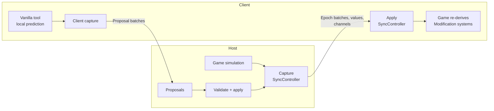
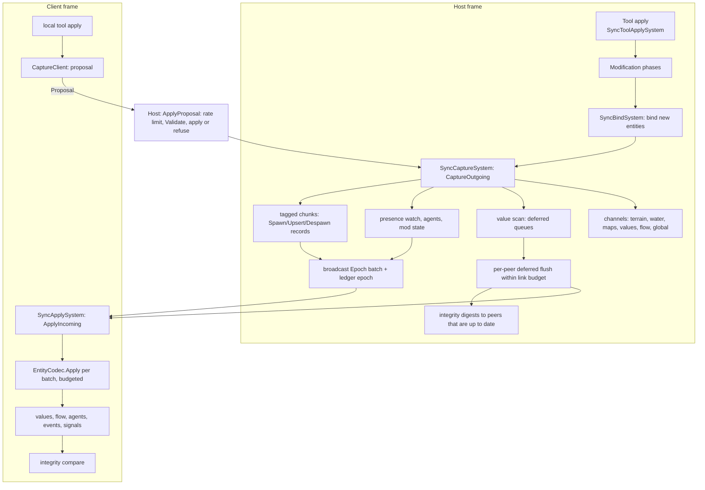
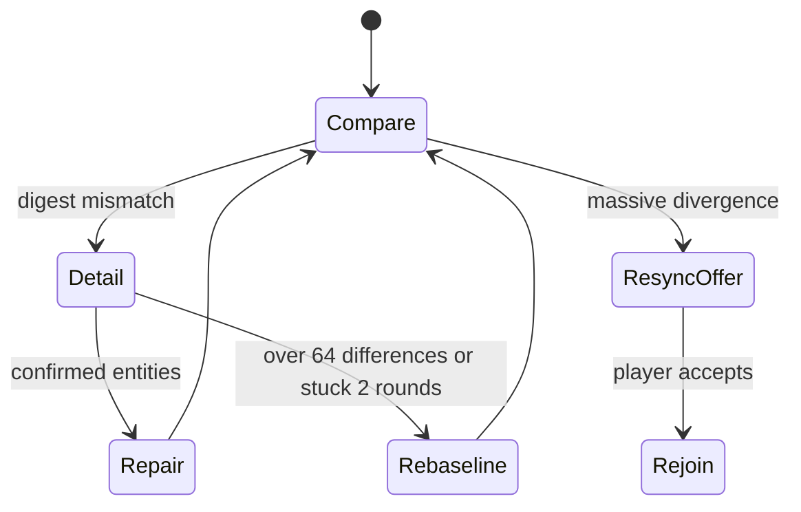

# Skyline Together architecture

This document describes Skyline Together **as built**: what the code in this repository does today. It was written
from the code and names the files and types it describes. Where this document and the code disagree,
the code is right and this document has a bug.

The design documents written before the implementation (the original architecture, the implementation plan and the
three competing proposals) are kept in [history/](history/README.md). They explain where many ideas and names come
from, but large parts of them were never built or were built differently; do not treat them as a description of the
code. Research notes on the game's internals are in [research/](research/00-DIGEST.md).

Companion documents that are kept up to date with the code:

- [design/SYNC-COVERAGE.md](design/SYNC-COVERAGE.md): every piece of game state and how it is kept equal.
- [design/ACTION-COVERAGE.md](design/ACTION-COVERAGE.md): every player action and how it travels.
- [design/MOD-COMPATIBILITY.md](design/MOD-COMPATIBILITY.md): third-party mods, per mod.
- [dev/code-map.md](dev/code-map.md): a short orientation for new contributors.

Code comments cite sections of this document as `ARCHITECTURE.md#anchor`.

## Contents

- [Overview](#overview)
- [Processes and threads](#processes-and-threads)
- [Module map](#module-map)
- [Frame order](#frame-order)
- [Session lifecycle](#session-lifecycle)
- [Transport](#transport)
- [Sync pipeline](#sync-pipeline)
- [Identity](#identity)
- [Follower clock and client gating](#follower-clock-and-client-gating)
- [Data channels](#data-channels)
- [Integrity](#integrity)
- [Mod compatibility](#mod-compatibility)
- [Diagnostics](#diagnostics)
- [Performance budgets](#performance-budgets)
- [Security model](#security-model)
- [Known limitations](#known-limitations)
- [Known gaps](#known-gaps)

## Overview

Skyline Together lets several players build one Cities: Skylines II city together. One player **hosts**: their game
runs the simulation and owns the city. The others **join**: their games load a copy of the host's city and from then
on follow the host.

The model is **host-authoritative**:

- **Only the host simulates.** On clients every `GameSimulation` system is switched off; their clock follows the
  host's frame and simulation results arrive from the host ([follower clock](#follower-clock-and-client-gating)).
- **The save format is the wire format.** Entities travel as their components' own `ISerializable` encoding, the same
  bytes the game writes into a save, with entity references rewritten to network ids
  ([batch encoding](#batch-encoding)). Game patches change the format by themselves; the codec has almost no
  per-type code.
- **Derive what the game derives.** Only source state travels (nets, objects, areas, lines, agents, values the
  simulation writes). Everything the game's Modification systems rebuild (geometry, lanes, zone blocks, sub-objects,
  flow graphs) is rebuilt on every client from the replicated source, after the applier tags it `Updated`.
- **Clients predict with vanilla tools and propose the result.** A client's tool applies locally (instant feedback);
  the capture turns the result into a proposal; the host validates it, applies it with the same applier and streams
  the authoritative result to everyone. A refused proposal is rolled back on its originator
  ([client proposals](#client-proposals)).
- **Congestion becomes staleness, not backlog.** Structure always goes out; values that change all the time are
  coalesced per peer and sent only while the peer's link has room ([link pacing](#deferred-values-and-link-pacing)).
- **Fail closed, fail visible, fail into resync.** Every entry point the game calls is guarded; a feature that keeps
  failing switches itself off; a client whose replica may be damaged is offered a rejoin with a fresh snapshot
  ([feature health](#feature-health-and-guards), [integrity](#integrity)).
- **Single player costs nothing.** Every system returns at once without a session; nothing is allocated.



## Processes and threads

There is no server: the host's game is the server, and every player runs the same mod.

Almost everything runs on Unity's **main thread**:

- The ECS systems registered in [`Mod.cs`](../src/SkylineTogether/Mod.cs) call into `SyncController`, `MoverSync`,
  `PresenceSystem` and the UI systems at fixed points of the frame ([frame order](#frame-order)).
- [`SessionDriver`](../src/SkylineTogether/Session/SessionDriver.cs), a `MonoBehaviour` created at load, ticks the
  session once per rendered frame (also in the main menu and while a city loads): `SessionManager.Tick` polls the
  transport, pumps the outboxes, runs the handshake and timeouts, then toasts, Steam invites and the UI probe.
- Steam callbacks (connection state, lobby, invites) arrive inside the game's own `SteamAPI.RunCallbacks` pump, on
  the main thread, and are queued until the next poll
  ([`SteamSocketsTransport`](../src/SkylineTogether/Net/SteamSocketsTransport.cs)).

Exceptions:

- **Snapshot pump.** While a joiner downloads the city, a
  [`BackgroundPump`](../src/SkylineTogether.Core/Transport/BackgroundPump.cs) thread pumps that joiner's
  `BlobSender` and `PeerOutbox` every 2 ms, so a low frame rate never leaves the link idle
  (`HostOptions.BackgroundPump`, only for `IThreadSafeConnection`, which the Steam connection is). `PeerOutbox` and
  `BlobSender` are lock-protected for this.
- **Save and load tasks.** The join snapshot is written and loaded through the game's `TaskManager` queue
  "SaveLoadGame" ([`SnapshotService`](../src/SkylineTogether/Session/SnapshotService.cs),
  [`SnapshotLoader`](../src/SkylineTogether/Session/SnapshotLoader.cs)); their continuations come back to the main
  thread through [`MainThreadQueue`](../src/SkylineTogether/Session/MainThreadQueue.cs).
- **GPU readbacks.** Terrain and water tiles are read back asynchronously
  ([`GpuReadback`](../src/SkylineTogether/Sync/GpuReadback.cs)); Unity calls back on the main thread.

Core types declare their thread with `[ThreadAffinity]`
([`ThreadKind`](../src/SkylineTogether.Core/Contracts/Threading/ThreadKind.cs)).

## Module map

### Projects

| Project | Target | Role |
|---|---|---|
| [`src/SkylineTogether.Core`](../src/SkylineTogether.Core) | net472 (or netstandard2.1 without the game) | Pure .NET, no Unity, Game or Colossal reference: wire formats, codecs, hashing, session state machines, scheduling, integrity bookkeeping, replay checking. Everything testable lives here. |
| [`src/SkylineTogether`](../src/SkylineTogether) | net472 against the game's managed assemblies | The game layer: `IMod`, ECS systems, the entity codec, Steam transport, UI bindings, mod adapters. |
| [`tests/SkylineTogether.Core.Tests`](../tests/SkylineTogether.Core.Tests) | net8.0 console | Compiles the Core sources and tests them with a small own framework ([dev/testing.md](dev/testing.md)). |
| [`ui/SkylineTogether.mjs`](../ui/SkylineTogether.mjs) | ES module, no bundler | The in-game UI ([ui/README.md](../ui/README.md)). |

### Core folders

| Folder | Responsibility |
|---|---|
| `Buffers` | `ByteWriter`/`ByteReader` (little-endian, LEB128 varints, bounded reads that throw `DecodeException`), `BufferPool` |
| `Contracts` | Shared value types and interfaces: identity (`NetId`, `PeerId`, `NetSlot`, ...), transport (`ITransport`, `IConnection`, `Lane`, `Delivery`), taxonomies (`MessageKind`, `Family`, `Permission`, `SessionRole`, `RejectReason`), session models (`HandshakeDigests`, `SnapshotManifest`), logging and clock seams. |
| `Diagnostics` | `FeatureHealth` (trip logic of a feature), `PerfCounters`, `FrameBudgetService` (the shared per-frame budget), `LogFloodGuard` (log rate limit and size cap), `PeerFaultBook` (per-peer failure counts), `PathRedactor` and `AddressMask` (no user name or full address in logs) |
| `Fields` | Terrain, water and cell-map tile codecs and grids, brush strength compensation, stroke settling |
| `Follower` | `FollowerClockModel`, the client's estimate of the host frame |
| `Hashing` | xxHash64, XXH3-64/128, digests, set hashes |
| `Identity` | `FamilyRules` (family classification table), `BuildOrderAllocator`, `SlotBitSet` |
| `Integrity` | `EntityDigest` (bucket arithmetic), `DivergenceTracker`, `RepairEscalation`, `RepairThresholds`, `DetailScheduler`, line-state rows and comparison, `IconSetDigest` |
| `Json` | `MiniJson` reader and `JsonWriter` |
| `Modding` | `ModFacts`, `IlScanner`, `ModDeclarations`, `ModClassifier`, `AdapterCheck`, `ModChannelRouter`/`ModChannelBudget`, `AssetSource`/`MissingAssets` |
| `Motion` | Mover motion encoding: `MotionHostEncoder`, `MotionCodec`, `MotionClientStager`, `InterestSlotTable` |
| `Protocol` | Envelope framing, fragmentation, LZ4 compression, handshake and control messages, `Limits`, `ProtocolVersion`, `ProtocolText` (text sanitising) |
| `Replay` | Solo test: recording format, `RecorderPeer`, `PlaybackTransport`, checkpoints, `ReplayChecker`, `ReplayVerdict` |
| `Scheduling` | `TokenBucket`, `PeerByteBudget`, `CoalescingQueue` + `LinkBudget`, `AttentionPlanner`, `AgentPlanner`, `RollingScan`, `SpatialHashGrid`, infoview topics |
| `Session` | `SessionHost`, `SessionClient`, `PeerChannel`, `JoinSecurity` (bans, join policy, password lockout, moderation rules), `SessionCrypto`, `PasswordKeyCache`, `InboundQuota`, `LocalText` (texts shown in the receiver's language), `CityDataRule`, `LoadGeneration`, `RejoinController`, `JoinTimeline`, presence and tool-preview codecs, mod-list comparison |
| `Sync` | `SyncBatch` (the replication record format), `NetIdAllocator`, `ProposalGuard` (rate limits, conflict ledger, rules), `StructureIntegrity` (referential integrity of proposals and batches), apply acknowledgements, global-state, terrain, water, mover, flow-status, integrity and agent records |
| `Testing` | Fakes for tests (`ManualClock`, `ListLog`, `NullLog`, `DeterministicRandom`) and `StopwatchClock` |
| `Transport` | `PeerOutbox`, `SendRateController`, blob transfer, `BackgroundPump`, `CompositeTransport`, loopback and network-simulator transports (tests, solo test) |

### Game layer folders

| Folder | Responsibility |
|---|---|
| [`Mod.cs`](../src/SkylineTogether/Mod.cs) | Entry point: `OnLoad` creates the controllers and registers the systems, each step guarded; `OnDispose` |
| `Compat` | Mod compatibility: `ModAdapter` and the built-in adapters, `ModCompat` (registry, gates), `ModAssemblyScanner` + `HarmonyPatches` (automatic scan), `GenericModAdapter`, `ModIntegration` (API for other mods), `ModStateWatcher`, `ModSettingsSync`, `AssetSources` |
| `Data` | Embedded locale tables |
| `Diagnostics` | `Probes` (self-test), `Features` (the feature registry), `Guard`, `Perf`, `GameLog`, `DiagnosticsDump`, `InstallInfo` (installed copies, build ID source) |
| `Net` | `SteamSocketsTransport` |
| `Presence` | Cursors, name tags and other players' tool previews |
| `Replay` | `ReplayController`: Record test session, Replay & verify |
| `Session` | `SessionManager` (host, join, leave, recovery), `SnapshotService`, `SnapshotLoader`, `JoinAssetTransfer`, `SteamInvites`, toasts |
| `Settings` | `SkylineTogetherSettings` (Options page), `LocaleSource` |
| `Sync` | `SyncController` (one partial class over several files), `EntityCodec`, `NetWriter`/`NetReader`, `TypeHandlers`, `NetIdSystem`, `FamilyClassifier`, `ClientGate`, `FollowerClock`, and one class per data channel |
| `Systems` | `SpeedAuthoritySystem` |
| `UI` | `SessionUISystem`, `ReplayUISystem`, `InviteUISystem` (bindings and triggers of the UI module) |

`SyncController` is split by responsibility: [`SyncController.cs`](../src/SkylineTogether/Sync/SyncController.cs)
(state, diagnostics, sending), `.Session.cs` (session start and end, peers joining and leaving), `.Apply.cs` (frame
start), `.Capture.cs` (tool hook, frame-end capture, value scans, deferred queues), `.Validation.cs` (host validation,
rollback), `.Client.cs` (client proposals, route preview window), `.Zones.cs` and `.Mods.cs`.

### UI module

The UI is one hand-written ES module, [`ui/SkylineTogether.mjs`](../ui/SkylineTogether.mjs), registered with the
game's module registry: a "Multiplayer" main-menu entry and screen, a floating button with the player count, the
session panel, chat dock, name tags, join progress and error screens. It reads the bindings of group
`skylineTogether` that [`SessionUISystem`](../src/SkylineTogether/UI/SessionUISystem.cs) (`state`, `join`, `net`,
`presence`, `perf`), [`ReplayUISystem`](../src/SkylineTogether/UI/ReplayUISystem.cs) (`replay`) and
[`InviteUISystem`](../src/SkylineTogether/UI/InviteUISystem.cs) (`friends`, `overlayAvailable`) publish, and calls
their triggers ([ui/README.md](../ui/README.md) lists them). Every string is a locale key resolved through `cs2/l10n` from
`src/SkylineTogether/Data/locale.<id>.json` ([`LocaleSource`](../src/SkylineTogether/Settings/LocaleSource.cs)); texts
the C# side builds for the UI (the self-test line, the network line, feature names) are resolved there in the player's
language too.
`tools/ui_smoke.mjs` checks bindings, triggers and keys against the C# side.

### Code rules

Rules the code follows (enforced by review and, where possible, by tests):

- Core has no reference to Unity, Game or Colossal assemblies and reads time only through `IClock`.
- Decoders of network input throw `DecodeException` and nothing else; fuzz tests check every decoder
  (`tests/.../Protocol/ProtocolFuzzTests.cs`).
- Every wire layout change increments [`ProtocolVersion.Current`](../src/SkylineTogether.Core/Protocol/ProtocolVersion.cs)
  (policy: [releasing](dev/releasing.md#protocol-version-policy)); golden byte vectors in the tests pin the layouts.
  Enum values that travel on the wire never change; values without a sender stay reserved
  ([reserved wire values](#reserved-wire-values)).
- Logging goes through `ILog` with a `LogCategory`; player-facing texts are locale keys, and a test checks that every
  key the game layer uses exists.
- Hot paths reuse buffers and delegates (no allocation per message or per frame where it can be avoided).

## Frame order

The registrations in [`Mod.OnLoad`](../src/SkylineTogether/Mod.cs) are authoritative:

| System | Phase and position | Does |
|---|---|---|
| `NetIdSystem` | MainLoop; `PostDeserialize<NetIdSystem>` in Deserialize | Holds the id tables; its bindings travel in the join snapshot (the game's system serializer) |
| `SyncApplySystem` | MainLoop, right after `EndFrameBarrier` | `SyncController.ApplyIncoming`: everything received is applied before tools, raycast and Modification run |
| `MoverApplySystem` | MainLoop, after `SyncApplySystem` | Client: mover records |
| `ViewerGateSystem` | ToolUpdate, before `ToolOutputSystem` | A viewer's tool apply becomes a clear |
| `SyncToolApplySystem` | first in ApplyTool | Records the tool's `Temp` originals and cost before vanilla consumes them; terrain and resource brush stamps |
| `IconAuthorityFilterSystem` | ModificationEnd, before `IconCommandSystem` | Client: drops local icon decisions, reconciles host icon sets |
| `ChirpDrainSystem` | ModificationEnd, before `CreateChirpSystem` | Client: empties the local chirp queue |
| `UpdateFrameGuardSystem` | Modification5, before `UpdateGroupSystem` | No created entity reaches the game's update groups without its marker ([client apply](#client-apply)) |
| `RemovalCascadeSystem` | ModificationEnd | Client: the reference clean-up of entities deleted on this client this frame, riders out of deleted vehicles, deleted owners noted for the next frame's orphan sweep ([reference safety](#reference-safety)) |
| `SyncBindSystem` | MainLoop, before `SaveGameSystem` | Host: binds entities created this frame (a snapshot taken now carries them); client: warns about local saves |
| `MoverCaptureSystem` | MainLoop, before `SaveGameSystem` | Host: mover existence and motion |
| `SyncCaptureSystem` | MainLoop, before `PrepareCleanUpSystem` | `SyncController.CaptureOutgoing`: every tag of the frame is still visible |
| `SpeedAuthoritySystem` | LateUpdate, before `SimulationSystem` | One speed for everyone; host holds the simulation while someone joins |
| `MoverWriteSystem` | PreCulling, before `PreCullingSystem` | Client: writes mover transform frames just in time for interpolation |
| `PresenceSystem` | Rendering, before `OverlayRenderSystem` | Cursor raycast, presence send, remote cursors and previews into the overlay buffer |
| `SessionUISystem`, `ReplayUISystem`, `InviteUISystem` | UIUpdate | Bindings |

Apply at frame start and capture at frame end means a client's applied changes go through the same Modification
phases as a local edit, and the host captures after every tool apply and Modification phase of its frame.

## Session lifecycle

[`SessionManager`](../src/SkylineTogether/Session/SessionManager.cs) owns the session; the protocol state machines are
Core's [`SessionHost`](../src/SkylineTogether.Core/Session/SessionHost.cs) and
[`SessionClient`](../src/SkylineTogether.Core/Session/SessionClient.cs). Replication attaches through the
`HostStarted`, `ClientStarted` and `SessionEnded` events.

### Hosting

`SessionManager.StartHosting` (only in a loaded city, with Steam logged in) creates a `SteamSocketsTransport` wrapped
in a `CompositeTransport` (the solo-test recorder attaches there) and a `SessionHost` with `HostOptions` from the
settings: session name, password, max players (2-16, counting the host; changeable while hosting, the transport's cap follows), "require the same mods", "require the same
asset packs" (off by default), "let players join with different mods" (on by default), join policy
(open, or Steam friends and invited players only), new players as viewers (off by default), the persisted ban list,
and the optional direct-IP socket, which opens only while a session password is set. A friends-only Steam lobby and rich presence carry the invitation
([`SteamInvites`](../src/SkylineTogether/Session/SteamInvites.cs)); the session itself always runs over a P2P
connection to the host's Steam ID (or the direct address).

On `HostStarted`, `SyncController.BindCity` compacts the net ids (no peer holds any yet), binds every prefab and every
persistent entity of the replicated families, primes the presence watch and the build-order allocator, and starts the
mod state watcher. A solo-test host (`StartSoloHost`) runs the same session without any network part.

### Handshake and admission

The handshake is **password first**: a joiner learns nothing about the host's versions or mods before it has passed
bans, the join policy and the password.

```mermaid
sequenceDiagram
  participant C as Client
  participant H as Host
  C->>H: Hello (protocol version, build ID, game version, name, join flags)
  Note over H: Screen: ban list, join policy (transport identity)
  Note over H: protocol version differs: Refuse (no host version<br/>while a password is still owed)
  opt password needed
    H->>C: Control PasswordChallenge (host nonce, salt, session id)
    C->>H: Control PasswordResponse (client nonce, client proof)
  end
  H->>C: Control Authenticated (host proof; empty without a password)
  Note over C: checks the host proof
  C->>H: Control ManifestDetail (mods, DLC, asset packs, mod settings)
  Note over H: TryAdmit: build ID, game version, old multiplayer mod, DLC,<br/>mods with city data (always), mods (if required),<br/>asset packs (if required), join cooldown,<br/>duplicate Steam ID (replace or refuse), session full;<br/>"join anyway" passes only the other mods and asset packs
  H->>C: Welcome (peer id, role, permissions, session info)
  H->>C: Control JoinNotice (differences that do not block, if any)
  H->>C: Epoch batch: prefab table, id range, ledger epoch
  Note over H: snapshot taken (or reused)
  H->>C: Control SnapshotManifest, then BlobChunk stream
  C->>H: BlobHave, LoadProgress
  C->>H: Control LoadDone
  H->>C: Control SpeedChanged, Control Live
```

Details ([`SessionHost.Handle`](../src/SkylineTogether.Core/Session/SessionHost.cs)):

- The client sends `Hello` on connect, and its manifest (`Control ManifestDetail`) only after the host's
  `Control Authenticated` (since protocol 6). Only the Steam ID that Steam authenticated on the transport is an identity (the
  Steam transport ignores the Steam ID of a connection flagged unauthenticated); a Steam ID claimed in `Hello` is
  logged and ignored. Display names are made unique and never equal the host's
  ([`PlayerNames`](../src/SkylineTogether.Core/Session/PlayerNames.cs)).
- `Screen` checks the ban list (Steam ID, and the address, an IPv6 address by its /64 network, for direct and
  unauthenticated connections) and the join policy first; then a protocol mismatch is refused; while the peer still
  owes a password the refusal names no host version (`HelloMessage.PeekProtocolVersion` reads the version before
  parsing the rest).
- A password is needed when one is set, and always for direct or unauthenticated connections
  (`HostOptions.PasswordForUnauthenticated`; without a password those are refused as `NotInvited`). Both sides derive
  `key = PBKDF2-HMAC-SHA256(password, salt, 200 000)` on a worker thread
  ([`PasswordKeyCache`](../src/SkylineTogether.Core/Session/PasswordKeyCache.cs)); the client answers with
  `HMAC-SHA256(key, "client" label ‖ sessionId ‖ hostNonce ‖ clientNonce ‖ salt ‖ host Steam ID as dialled)`, the host
  checks it (one answer per challenge, constant-time compare) and sends the same with the "host" label in
  `Control Authenticated`, which the client checks before it sends its manifest
  ([`SessionCrypto`](../src/SkylineTogether.Core/Session/SessionCrypto.cs)). On a direct connection, whose real host
  always challenges, and for a session known to have a password (`ClientOptions.ExpectPassword`) the client also ends a
  join whose host authenticates it without a challenge (`HostNotProven`); over Steam P2P the dialled host is the Steam
  account Steam authenticated, and a password kept in the join settings does not stop joins of a session without one.
  Until the host authenticated it the client reads only refusals, pings and the password controls; the welcome is
  accepted once, at the end of the handshake. The session id is random (`SessionCrypto.RandomBytes`). The host binds
  direct and in-process connections to Steam ID 0. [`PasswordAttemptLimiter`](../src/SkylineTogether.Core/Session/JoinSecurity.cs) keys
  failures by Steam ID and address (IPv6 by /64): three free, then a lockout of 5 s doubling up to 10 minutes, forgotten
  after 15 minutes; at most two open challenges per key. A lockout refusal carries a "retry-after" report record. A
  challenged connection that does not answer within 15 s is dropped, and a remote (Steam ID or address) that opens more
  than 20 connections a minute is closed before its hello
  ([`ConnectionRateLimiter`](../src/SkylineTogether.Core/Session/ConnectionRateLimiter.cs)); lines about connections that
  are not admitted are logged at most 60 times a minute at info level.
- After the compatibility checks, a player whose last joins did not finish waits (`HostOptions.JoinCooldownSeconds`:
  the first is free, then 30 s, 2, 10 and 30 minutes; a drop by a join watchdog or deadline is never the free one; once
  the failed joins held everyone's game for more than 30 minutes in total, at least as long as the excess, at most
  4 hours, `FailedJoinHoldAllowanceSeconds`; refused with `HostPreparing` and a "retry-after" record; forgotten an hour
  after the wait ended, and after a join that completes). Failures of the host itself (its snapshot cannot be saved or
  read, the transfer cannot start, a newer connection of the same player replaces an older one) cost the joiner
  nothing. `ResolveDuplicate` replaces an
  older connection of the same Steam user, unless it is still loading (then the new attempt is refused with
  `HostPreparing`, which the client treats as retryable). The duplicate is resolved only here, after the password.
- `TryAdmit` then compares the build ID (first 48 bits of the SHA-256 of the loaded DLL,
  [`BuildId`](../src/SkylineTogether.Core/Session/BuildId.cs)) and the game version, and hands the rest to
  [`CompatibilityCheck`](../src/SkylineTogether.Core/Session/CompatibilityCheck.cs). The hello carries one digest per
  category ([`CompatibilityDigests`](../src/SkylineTogether.Core/Session/CompatibilityDigests.cs): XXH64 of the sorted
  list); only a category whose digests differ has its lists from the manifest compared item by item. The lists come
  from [`GameInfoProvider`](../src/SkylineTogether/Session/GameInfoProvider.cs):

  | Category | Listed | On a difference |
  |---|---|---|
  | Code mods | name, version (`ModManager`) | a host mod that stores data in the city and the joiner lacks: always refused (below); otherwise refused with "require the same mods" ([`MismatchReport.CompareMods`](../src/SkylineTogether.Core/Session/MismatchReport.cs); client-local mods never count; overridable, see below), otherwise told |
  | DLC and content packs | DLC id and name of every available `ContentPrefab` with a `DlcRequirement` (or a Paradox login requirement) | refused when the joiner lacks one the host has (the host's city can contain its objects); content only the joiner has is told |
  | Asset packs | every Paradox Mods id among the loaded prefabs with package name, version, prefab count and the digest of its prefab ids ([`AssetSources.Packages`](../src/SkylineTogether/Compat/AssetSources.cs)) | told (objects of packs the joiner lacks are left out on its side); refused with "require the same asset packs" (overridable) |
  | Mod settings | current values of the settings the host pushes ([`ModSettingsSync.CurrentValues`](../src/SkylineTogether/Compat/ModSettingsSync.cs)) | told; the host's values apply for the session |

  DLC is compared first, so a joiner is never offered "join anyway" for its mods only to be refused for its DLC next.
- **Rules no option relaxes** ([`CityDataRule`](../src/SkylineTogether.Core/Session/CityDataRule.cs), checked inside
  `CompatibilityCheck` before every option):
  - *The old multiplayer mod.* An assembly named `CS2MultiplayerMod` or Paradox Mods id 150432 in either side's mod
    list (detected by name and id only) refuses with a report of kind `conflict` (`conflict-host` / `conflict-you`
    records): "Disable the 'CS2 Multiplayer Mod' – two multiplayer mods at once conflict" for the side that has it.
    The host's panel shows a warning while it is loaded (`GameInfoProvider.ConflictingMod`).
  - *Mods that store data in the city.* The game's loader cannot read a save whose saved types belong to a mod it lacks
    (observed: "Not serializable type: ZoningToolkit.Components.ZoningInfo …", then a native crash). So when the mod
    lists differ, every host mod that stores city data must be in the joiner's list (by Paradox Mods id or name),
    whatever "require the same mods", "let players join with different mods" and the joiner's "join anyway" say. The
    host decides from its own mods: the analysis of each loaded mod ([`CityDataEvidence`](../src/SkylineTogether.Core/Modding/CityDataEvidence.cs):
    component types saved with entities, `ISerializable`/`IEmptySerializable` of any storage kind, and systems that
    save state, `ISerializable`/`IDefaultSerializable`; a failed scan counts; declarations never hide it) or the
    built-in list (Traffic, Anarchy, Better Bulldozer, Water Features, Zoning Toolkit, Plop the Growables, Tree
    Controller). [`CityDataProbe`](../src/SkylineTogether/Compat/CityDataProbe.cs) also counts, when the manifest is
    built, the city's entities with each saved type (one entity query per type) and the mod's saved systems in the
    world: that only changes the wording ("this city contains its data" or "it can store data in a city"), because a
    mod without data in this city cannot be proven harmless (its saved systems, the save's type table). These facts
    are local to the host (`ModEntry.StoresCityData`, `CityDataInCity`, `CityDataDetail`), never sent. The refusal is
    a `mods` report whose `city-data` records name the required mods (each also in `missing`, so readers without the
    record still list it) with `overridable` never set; `rest-overridable` says that the other differences could be
    passed with "join anyway" once those are enabled. The joiner's screen is **Mods required for this city** with the
    list "Enable these mods to join" and no **Join anyway**; the host raises `SessionHost.JoinerBlocked` (notification
    and chat line). A joiner whose mod list was too long to send cannot show that it has them and is refused too. A
    city-data mod only the joiner has is no difference to this rule.
  - When the mods differ and the joiner is admitted, the join notice carries `city-data-checked` and one
    `host-city-data` record per host mod with city data, for the joiner's own check before the load
    ([snapshot join](#snapshot-join)).
  A refusal carries a `MismatchReport` (kind `mods`, `content` or `assets`) whose lists the joiner's error screen
  shows. Differences that do not block go to the admitted joiner right after `Welcome` as `Control JoinNotice` (a
  report of kind `notice`): one notification and one chat line per category
  ([`JoinNoticeText`](../src/SkylineTogether/Session/JoinNoticeText.cs)); the host gets a notification and a log line
  (`SessionHost.JoinerDiffers`). The manifest must fit the 1 MiB body limit before admission: a client with too many
  asset packs sends that list as null, and the host reports "the asset packs differ" without names. Local assets
  (unpublished) and runtime prefabs of mods are not compared here; the snapshot's per-city check names the ones the
  city uses ([missing assets](#mod-compatibility)).
- **Join anyway.** With `HostOptions.AllowModMismatchOverride` (setting "let players join with different mods", on by
  default, read live) a refusal for code mods or asset packs is overridable: its report carries an `overridable` record
  (`MismatchReport.Overridable`) and the detail text says so. The joiner's error screen keeps the lists and adds
  **Join anyway**; that reconnects at once with `HelloJoinFlags.AcceptModMismatch` in the hello's join flags byte, and
  `SessionManager` remembers the host (`Endpoint`) for the rest of the game session, so rejoins send it too. The host
  then admits the joiner with a join notice marked `joined-anyway` (`MismatchReport.JoinedAnyway`): the joiner's
  notification and chat line say it joined with different mods, the host gets a notification and a chat line naming
  the player and the differences, and the host logs the accepted mismatch and lists it per peer in the diagnostics
  (`DescribePeers`). The flag changes nothing but the code mod and asset pack verdict of
  [`CompatibilityCheck`](../src/SkylineTogether.Core/Session/CompatibilityCheck.cs): protocol version, bans, join
  policy and password come before it, build ID, game version, the old multiplayer mod, DLC and mods that store city
  data are refused whatever it says, and capacity is checked after it. With the option off the flag is ignored (logged) and the refusal is final. Nothing after the
  admission assumes identical mods: records of prefabs or component types the joiner lacks are skipped, the
  `ModSettings` channel only touches settings of loaded adapters, mod channel messages for a mod the receiver lacks are
  dropped and counted, and integrity repair works as for any other divergence. A rejoin from the recovery hold that is
  refused for different mods (the host changed its options meanwhile, so no choice was remembered) is not offered
  "join anyway": the recovery panel asks as for any other refusal.
  Wire: `Refuse` keeps its layout (the mark is a report record, which readers of every version skip when unknown); the
  hello's join flags byte (since protocol 4) is rejected when it has undefined bits. The city-data and conflict records were
  added to the report the same way, so they changed no layout and need no protocol version.
- Refuse reasons: `Mismatch`, `Full`, `Banned`, `BadPassword`, `NotInvited`, `HostShuttingDown`, `ProtocolVersion`,
  `HostPreparing`. Every refusal (since protocol 6) carries a report with a "text" record: the detail's locale key and
  parameters ([`LocalText`, `NetText`](../src/SkylineTogether.Core/Session/LocalText.cs)), so the joiner shows it in its
  own language; the `Refuse` layout itself is unchanged. A wait travels as `SECONDS`, which each receiver words as
  `{WAIT}` ("40 s", "about 10 minutes", "about 4 hours"); a feature travels as its English title plus `FEATURE_ID`,
  which the receiver turns into its own `st.feature.<id>` name. The joining game's own end reasons (timeouts, a failed
  download or load) are `st.net.client.*` texts too, so the end screen's details are in the player's language. Before admission a connection may send only `Hello`, `Control`
  and `Ping` (anything else ends it unread), bodies of at most 64 KiB until the password is proven and 1 MiB after it,
  4 MiB of decompressed data in total; it must send its hello within 10 s and finish the handshake within 30 s.
- `Admit` assigns the lowest free peer id (1-254) and the role the player had earlier in the session, else builder (or
  viewer with `HostOptions.NewPlayersJoinAsViewer`), sends `Welcome`, tells the transport (`IAdmissionAware`: the
  player slot and the large receive buffer), raises `PeerJoining` and lengthens the connection timeouts (the joiner's
  main thread stalls while it loads).

### Snapshot join

A joiner receives the host's city as a save game and loads it through the game's normal load path.

1. **Stream start.** On `PeerJoining` the host's `SyncController` creates the peer's deferred queue and sends the
   prefab table (every prefab's `PrefabID` with its net id; encoded once per session in slices across frames by
   [`PrefabTableCache`](../src/SkylineTogether/Sync/PrefabTableCache.cs), a join only adds prefabs bound since), a
   granted id range and the current ledger epoch. From
   admission on, every broadcast is queued for the joiner too; the client buffers everything it receives until it is
   live.
2. **Snapshot.** The host requests a snapshot after the admission, so it contains everything the joiner's stream does
   not. A snapshot requested within 30 s of a previous one is reused when nothing can have changed since (nothing
   broadcast, simulation held or paused throughout; `HostOptions.SnapshotReuseSeconds`). While any admitted peer is
   not live, `SessionHost.HoldSimulation` is true and `SpeedAuthoritySystem` pauses the host's simulation.
   [`SnapshotService`](../src/SkylineTogether/Session/SnapshotService.cs) writes the city with the game's
   `SaveGameSystem` into a temporary file (no package, preview or "Continue" entry), through a digesting stream
   (XXH3-128 computed while writing). `NetIdSystem.WritingSnapshot` makes this save, and only this save, carry the id
   bindings, so the joiner's loaded entities have the host's net ids without a table transfer. Package-bundled render
   prefabs (climate, water and terrain render prefabs from packages) travel in front of the save data
   ([`JoinAssetTransfer`](../src/SkylineTogether/Session/JoinAssetTransfer.cs)). The joiner adds only `PrefabAsset` and
   `TextureAsset` entries with a plain file name (no path, no `..`, no device name, at most 128 characters) and a
   32-hex-digit guid, at most 64 entries and 256 MiB (`JoinAssetBundle`).
3. **Transfer.** The manifest goes as `Control SnapshotManifest`; the file streams as 256 KiB `BlobChunk` messages on
   the bulk lane ([blob transfer](#blob-transfer)). The client acknowledges with have-bitmaps. The host hands the
   manifest over first, but with Steam lanes (and in the network simulator) lanes are ordered independently, so a
   resent manifest can arrive after chunks; those are kept (up to 16 MiB) and fed in once the receiver exists. The
   download is verified against the digest.
4. **Load.** First the client repeats the city-data check
   ([`CityDataRule.CheckBeforeLoad`](../src/SkylineTogether.Core/Session/CityDataRule.cs)): when the join notice
   names a host mod that stores city data and this game has not loaded it (its mods are read again), or this game
   runs the old multiplayer mod, the join ends as refused with the same report the host would have sent, instead of
   loading a city the game cannot read. A notice of an older host without `city-data-checked` counts every mod the
   host has and the joiner lacks (fail closed). The same check already runs when the notice arrives, so normally
   nothing is downloaded. [`SnapshotLoader`](../src/SkylineTogether/Session/SnapshotLoader.cs) imports the join assets, then loads
   the save from a transient asset database with the host's game mode and city options, achievements off and the
   simulation paused. `ModCompat.OnClientStarted` switches off mod systems that must not run during a joiner's load.
5. **Live.** The client reports `LoadDone`; the host marks it live and sends the current speed and `Live`.
   `SessionClient.GoLive` raises `BecameLive` (the client gate closes, mod client gates, the mod state watcher and the
   integrity check start), then delivers the buffered messages in order.
6. **Catch-up.** Right after going live the client applies the backlog with a larger budget (24 ms and 512 batches
   per frame instead of 6 ms and 64) until it is empty; that ends the join's timeline
   ([`JoinTimeline`](../src/SkylineTogether.Core/Session/JoinTimeline.cs), shown in the UI and logged).

Changes broadcast between the admission and the moment the snapshot was written are applied twice; that is safe
because a `Spawn` of a bound id reconciles in place and a despawn of an unknown id is a no-op.

Timeouts on the host: snapshot not delivered by the save system after 360 s (abandoned; waiting joiners told), a joiner
silent for 180 s, a download without progress on the host's side (no snapshot bytes leave it, and the joiner does not
move on to loading) for 180 s, a load that shows no sign of work for 300 s or that takes more than 20 minutes, re-sends
of more than twice the snapshot (have-bitmaps), a join longer than 30 minutes in total. The game's own load progress
stands still through a saved game's whole deserialization (1 before the load, 0 throughout, 1 at the first simulation
step), so the joiner's `LoadProgress` reports also carry a load heartbeat: the frames its game ran while loading. The
load watchdog counts the growth of either; an honest slow load ends only at the 20-minute limit. A dropped joiner gets
`Control Dropped` (a technical removal; its game may rejoin, except after a join that ran out of time: that one would
take as long again), and a join that ends before the player is live counts towards the join cooldown. On the client:
30 s to connect and handshake, 420 s waiting for the snapshot (longer than the host's own 360 s, so the host gives up
first and says why), 120 s without a chunk, 20 minutes for the load (not retried automatically), 120 s waiting for
`Live`.

### Live session

- **Keepalive.** The host pings every admitted peer every second; the client answers, and the round trip is the
  player's ping. A live peer silent for 120 s is dropped (`LiveSilenceTimeoutSeconds`); a client that hears nothing
  from the host for 120 s ends the session. After a stall of the host's own frames (over 5 s) silence and queue-age
  limits wait 15 s. Below that, the connection's own keepalive timeout is 30 s, and 120 s while a player joins
  ([`ConnectionTimeouts`](../src/SkylineTogether.Core/Transport/IConnectionTimeouts.cs)).
- **Slow links.** A peer whose outbox exceeds 64 MiB or holds a message older than 60 s is disconnected ("too slow to
  keep up"); joiners are only held to the size limit until a minute after going live.
- **Stuck peers.** A live peer that has acknowledged no applied batch for 120 s
  ([`AckStallWatch`](../src/SkylineTogether.Core/Sync/ApplyAcks.cs)), or whose proposals and acks queue faster than
  the host applies them (4096 messages or 64 MiB, `InboundQuota`), is kicked with a rejoin hint.
- **Players and speed.** The player list goes out at most four times a second when it changed (every 2 s anyway); the
  speed whenever it changes.

### Leaving, kicks and recovery

A client leaving sends `Disconnecting`; the host's `Stop` sends `SessionEnd` to everyone. Kick and ban are control
messages with a text; a ban adds the authenticated Steam ID to the host's ban list, or the address of a connection
without one (an IPv6 address as its /64 network); a player connected over direct IP is banned by both. `SessionManager`
persists the list in the settings (`BannedPlayers`).

When a client session ends unexpectedly while the player is in the host's city,
[`RejoinController`](../src/SkylineTogether.Core/Session/RejoinController.cs) takes over: the city stays paused and
does not autosave. Retryable ends (connection lost, unreachable host, timeout, failed join, `HostPreparing`, accepted resync)
rejoin automatically through the normal join path (fresh snapshot) with backoff 2, 5, 10, 20, 30, 30 s, at most six
attempts; a refusal with a "retry-after" record waits that long instead and spends no attempt (a wait of more than
30 minutes asks the player); everything else, and the end of the attempts, asks the player: reconnect, main menu, or keep the city as an
offline copy. A local fault that may have damaged the replica (a critical feature tripped) is offered, never
automatic, because a deterministic fault would loop.

### Roles and moderation

Roles are `Host`, `CoHost`, `Builder` (the default) and `Viewer`
([`SessionRole`](../src/SkylineTogether.Core/Contracts/Taxonomy/SessionRole.cs)).
[`RolePermissions`](../src/SkylineTogether.Core/Session/RolePermissions.cs) gives host, co-host and builder every
`Permission` and viewers only `Chat`; the host checks the sender's role on every proposal, intent, global-state edit,
speed request and mod channel message. Viewers' tools never apply locally (`ViewerGateSystem`), which is comfort; the host's check is the
rule. [`Moderation`](../src/SkylineTogether.Core/Session/JoinSecurity.cs): co-hosts may kick builders and viewers and
switch them between builder and viewer; only the host bans, appoints co-hosts and changes session options. Roles are
remembered for the session: under an authenticated Steam ID any role, under an address (direct or unauthenticated
connections, an IPv6 address by its /64 network) only the viewer role, because an address is shared behind one router,
carrier NAT or VPN (`SessionHost.MayRememberRole`).

## Transport

### Steam Networking Sockets

[`SteamSocketsTransport`](../src/SkylineTogether/Net/SteamSocketsTransport.cs) implements Core's `ITransport` over
Steam Networking Sockets: P2P by Steam ID through Valve's relays (NAT traversal, encryption, authenticated identity)
and optionally a direct-IP listen socket on a UDP port (default 27015). One poll group receives all messages, at most
8192 messages or 25 ms per frame. Per connection it sets a 16 MiB send buffer, a 32 MiB receive buffer, and a send rate
chosen by [`SendRateController`](../src/SkylineTogether.Core/Transport/SendRateController.cs) (Steam does not
estimate bandwidth): start at 1 MiB/s, every 0.5 s multiply by 1.5 while the link is busy and delivery is clean (to
8 MiB/s while the remote quality is unknown, 48 MiB/s at most), by 0.7 on loss below 93 % or queueing delay, never
below 256 KiB/s.

**Lanes.** Every connection gets one Steam lane per `Lane` when it is reported connected
([`SteamLanes`](../src/SkylineTogether/Net/SteamLanes.cs), [`LanePlan`](../src/SkylineTogether.Core/Transport/LanePlan.cs)):
R on Steam lane 0, U on 1, B on 2, all with the same priority and weights 4, 2 and 1. Each lane has its own reliable
ordering, so a lost packet of snapshot chunks does not hold back a control message, a chat line or presence, and
when every lane has data R gets 4/7 of the send rate; equal priorities mean bulk is never starved. The game's
Steamworks.NET declares `ConfigureConnectionLanes` with single values instead of per-lane arrays and `SendMessages`
with an array of structs instead of message pointers, so `SteamLanes` calls the same `steam_api64` exports with the
native signatures. It does so only after the startup probe `P-STEAMLANES` passed (64-bit, the expected
`SteamNetworkingMessage_t` layout, and a loopback socket pair that configures three lanes and receives a message on
lane 2 intact); otherwise, or when Steam refuses a connection's lanes, every message uses lane 0. Reliable
messages of lanes R and U are sent `ReliableNoNagle`, lane B `Reliable`, unreliable ones `Unreliable`.

### Envelope and message kinds

Every message is an envelope
([`EnvelopeCodec`](../src/SkylineTogether.Core/Protocol/Framing/EnvelopeCodec.cs)):
`u8 kind | u8 flags | body`, with flags `None`, `Compressed | HasUncompressedSize` (then `varint size | u8 codec |
compressed`) or `Fragment`. The decoder checks the declared size against the kind's limit
(`Limits.MaxBodyBytes`) before decompressing, and only canonical flag combinations. `PeerChannel` encodes, compresses,
fragments and queues on the way out and decodes and reassembles on the way in; a broadcast is encoded once for all
peers.

| Kind (value) | Direction | Content |
|---|---|---|
| `Hello` (1), `Welcome` (2), `Refuse` (3) | handshake | see [handshake](#handshake-and-admission) |
| `Control` (4) | both | `ControlKind` + payload: password challenge and answer, authenticated (host proof), manifest, join notice, players, speed, snapshot manifest, load progress, live, kick, ban, dropped, session end, moderation, toast |
| `Epoch` (5) | host → client | a `SyncBatch`: structure, values, channels ([batch encoding](#batch-encoding)) |
| `Ack` (6), `Motion` (8), `MotionControl` (9), `View` (11) | both | mover motion and its acknowledgements, client view reports |
| `Proposal` (7) | client → host | a `SyncBatch` of the client's edits and requests |
| `Presence` (12) | both, unreliable | cursor, tool, tool preview |
| `BlobChunk` (16), `BlobHave` (17) | both | snapshot transfer |
| `Ping` (18), `Chat` (19) | both | keepalive, chat |
| `Terrain` (20), `Water` (21) | both / host → client | terrain stamps, tiles, tile requests; water tiles |
| `ApplyAck` (60) | client → host | number of `Epoch` messages applied |
| `SimValues` (65), `CellMaps` (66), `Statistics` (67) | host → client (cell maps both) | simulation values, cell-map tiles and paint patches, statistics history |
| `AgentValues` (90), `AgentRefresh` (91) | host → client / client → host | agent values; re-send requests |
| `FlowStatus` (100) | host → client | electricity and water flow values |
| `ModChannel` (110) | both | other mods' messages |

`Clock` (10), `HashDetail` (13), `RepairRequest` (14) and `BlobManifest` (15) are reserved: they have limits but no
sender ([reserved wire values](#reserved-wire-values)). Unknown and reserved kinds decode, and the session layer drops
them before any listener sees them (`Limits.IsDeliverable`); a client does not buffer them while it loads.

### Fragmentation and compression

Bodies of 256 bytes or more are LZ4-compressed when that makes them smaller (a managed LZ4 block codec,
`ManagedLz4Compressor`; the `Welcome` names it). Encoded messages above 480 KiB are split by `Fragmenter` (Steam's cap
is 512 KiB); `Reassembler` accepts at most 64 fragments per message and four partial messages per peer. Uncompressed
bodies are limited to 8 MiB for `Epoch` and most channels, 4 MiB for proposals, 64 KiB for `Hello`, 256 KiB for flow
status, 16 KiB for mod-channel payloads.

### Outbox, lanes and rate control

[`PeerOutbox`](../src/SkylineTogether.Core/Transport/PeerOutbox.cs) is an application-level queue per lane in front of
the connection, so a reliable message is never lost when Steam's send buffer is full: it hands a message over only
while Steam's pending bytes plus the message stay inside a window (R and U: send buffer minus 1 MiB headroom; B: only
while no reliable message is queued and below an adaptive 2-8 MiB window), keeps a refused message at the head of its
queue and retries on the next pump. Unreliable messages go straight to the connection and may be dropped. This
scheduling is all the fairness there is when Steam lanes are unavailable: lane B then shares Steam's one reliable
stream with lane R, and a control message can wait behind the bulk bytes already handed over (at most the bulk window).

| Lane | Used for |
|---|---|
| `Reliable` (R) | control, batches, proposals, values, channels |
| `Unreliable` (U) | presence, mover motion |
| `Bulk` (B) | snapshot chunks, water tiles |

### Blob transfer

[`BlobSender`](../src/SkylineTogether.Core/Transport/BlobSender.cs) streams a seekable source as indexed chunks
(20-byte header with blob id, index, length and chunk hash; at most 256 KiB payload) on lane B, reading each chunk when
it is sent; the bulk bytes queued plus Steam's pending bytes stay within the adaptive window.
[`BlobReceiver`](../src/SkylineTogether.Core/Transport/BlobReceiver.cs) writes chunks into the target file, ignores
duplicates, sends have-bitmaps (the sender re-sends what is missing) and verifies the XXH3-128 digest at the end.
Blobs are limited to 2 GiB.

## Sync pipeline



### Host capture

`SyncController.CaptureOutgoing` runs at the end of the host's MainLoop
([`SyncController.Capture.cs`](../src/SkylineTogether/Sync/SyncController.Capture.cs)):

- **Tagged changes.** A query over `Created`/`Updated`/`Deleted` (without `Temp`) is walked chunk by chunk; each
  archetype is classified once ([families](#families)). Whole chunks of derived or non-replicated families (lanes,
  movers, icons, ...) are skipped. A replicated entity is written as a full record (`Spawn` if created or newly bound,
  otherwise `Upsert`), a deleted bound entity as `Despawn`; zone blocks become zone-cell records; agents are spawned or
  despawned, any other agent tag only moves the agent to the front of its value scan. Ids unbound without a despawn
  (an entity vanished untagged) get their despawn here.
- **Untagged changes.** The presence watch ([events](#events-chirps-and-traffic-lights)) re-sends entities whose replicated
  component set the simulation changed without a tag; entities that intents or the host's own UI changed are in
  `_forceCapture`; agent key links and co-captured owners come from [`AgentSync`](#agents); the
  [`ModStateWatcher`](#mod-compatibility) adds untagged mod state and the mod data entities values reference.
- **Value scan.** `ScanValues` hashes the entities of the value-scanned families (routes, waypoints, segments, events;
  the city singleton once a second) in a 1 ms slice per frame, every 0.25 s; a changed hash marks the entity in every
  peer's deferred queue. An entity of these families written by the capture gets its shadow hash from the record's own
  serialization (`EntityCodec.WriteEntityHashed`).
- **Clock.** Every 0.25 s the batch carries the host's `frameIndex` (`SyncRecordKind.Clock`).
- **Integrity.** Icon sets and line rows go into the broadcast batch, bucket digests into a per-peer digest batch
  ([integrity](#integrity)).
- The batch ends with the ledger epoch (`SyncRecordKind.Epoch`) and is broadcast as one `Epoch` message. The ids it
  despawns enter the quarantine only after this broadcast ([quarantine](#quarantine-and-reuse)).

Each step of the capture (every changed entity, the untagged changes, agents, dependencies, mod state, the value scan)
runs in its own guard: a step that throws rolls the batch back to the record boundary before it
(`SyncBatch.Writer.RollBack`; a half-written record would make the batch undecodable), writes the despawns it had staged
again, and the rest of the frame's batch still goes out. A deleted entity whose capture threw still gets its despawn.

Global state, intents and their results go in a separate batch after the entity batch, so a peer that cannot decode a
global record never loses entity data. Every channel runs in its own guard and feature
([feature health](#feature-health-and-guards)).

### Batch encoding

A [`SyncBatch`](../src/SkylineTogether.Core/Sync/SyncBatch.cs) is `u8 version | u32 record count | records`. Entity
records are `kind | varint netId | u8 family | bool completeSet | u8 generation | u16 count | components` (the
generation of the id on the sender, [net ids](#net-ids)), each component
`u64 StableTypeHash | u8 kind (data, buffer, presence) | varint length | bytes`. Other records: `Prefab`,
`PrefabSource`, `ZoneCells`, `IdRange`, `Cost`, `Clock`, `Request`, `Global`, `IdCeiling`, integrity and icon records (40-46), mover
records (20-23, 120), `EnabledBits` and `ModSettings` (110-111), `Epoch`, `ProposalHeader`, `ProposalResult`
(80-82), and solo-test checkpoint records (160-162). Batches of mover records are recognised by their first record and
handled by `MoverClient` only.

The component bytes are produced by the component's own `Serialize` through
[`NetWriter`](../src/SkylineTogether/Sync/NetWriter.cs), the game's `BinaryWriter` with one addition, and read back by
`Deserialize` through [`NetReader`](../src/SkylineTogether/Sync/NetReader.cs):

- **Entity references** are remapped by the game's own entity table mechanism: the writer's table is
  `NetIdSystem.WriterTable` (index `Entity.Index` → `Entity(netId, version)`), the reader's `ReaderTable` (net id →
  local entity). A reference to an unbound entity becomes a **derived key** (written as `-2 - keyIndex`, keys in a
  side list of the record) when it is a lane or prefab sub-object of a bound owner ([derived keys](#derived-keys)).
  Anything else makes the component unresolved: it travels as presence only, so no peer ever receives a dangling
  reference (events, chirps and agents send such references as null instead of dropping the component).
- The serialization contexts have every `FormatTags` bit enabled, like a save of the running game version.
- [`TypeHandlers`](../src/SkylineTogether/Sync/TypeHandlers.cs) map each serializable component type (game or mod) to
  a handler; a few ordered reference buffers that the save marks as derived but that are source data during play
  (a line's waypoint and segment lists) are sent as lists of net ids. Decoded floats are checked
  ([`FloatSanity`](../src/SkylineTogether.Core/Sync/FloatSanity.cs): no NaN or infinity, unit quaternions).

### Deferred values and link pacing

Structure records always go into the broadcast. Values that change all the time wait per peer in a
[`CoalescingQueue`](../src/SkylineTogether.Core/Scheduling/CoalescingQueue.cs) (one mark per id, latest value wins,
serialised from the current state when sent). `FlushDeferred` sends each live peer as many records as
`LinkBudget.DeferredBytes` allows: only while the peer's reliable backlog (outbox plus Steam's pending bytes) stays
below 0.25 s at its send rate and below 512 KiB, within 1.5 ms of CPU per frame for all peers. A record is encoded
once per frame and appended byte for byte to every other peer's batch that needs it
([`EncodedRecordCache`](../src/SkylineTogether.Core/Sync/EncodedRecordCache.cs); repair re-sends use one too). Link
statistics come from one transport query per peer and frame (`PeerOutbox.Stats` under `StatsFrame`). The integrity digests
of the frame go only to peers whose deferred queue is empty, because a digest is only comparable once everything it
covers was sent. A client's request for a full re-send (`ResendRoutes`, `ResendAll`) is queued the same way; a full
re-send marks 20 000 ids per frame.

The value channels ([simulation values](#simulation-values), [agents](#agents), [cell maps](#zone-cells-cell-maps-terrain-and-water),
[flow status](#statistics-icons-and-flow-status)) each have their own `PeerByteBudget` (a token bucket per peer) and also stop while the
link is backlogged; mover motion yields to all of them.

### Client apply

`SyncController.ApplyIncoming` ([`SyncController.Apply.cs`](../src/SkylineTogether/Sync/SyncController.Apply.cs))
applies queued batches within 6 ms per frame (with carry-over; at least one batch per frame; a batch is never split),
then simulation values, flow status, agent values, event fix-ups and traffic lights, so values find the entities
spawned this frame. [`EntityCodec.Apply`](../src/SkylineTogether/Sync/EntityCodec.cs) does, per batch:

0. prefab bindings and channel records (id ranges, cost, clock); a host applying a client's batch ignores every
   record kind that `SyncBatch.AcceptedFromClient` does not allow. Before the apply, a client judges a host batch that
   deletes or writes nodes and edges with the host's [referential-integrity rule](#host-validation-and-commit) on its
   own world (`CheckHostBatch`): the host's world is consistent, so a problem means this client differs (an edge of its
   own prediction at a node the host deleted, a node it lacks). It logs one line (`host batch would leave dangling
   references here ...`, at most every 10 s), the steps below keep nothing dangling, and the ids involved are asked for
   again (`IntegritySync.RequestRepair`);
1. despawns of the batch first (their entities count as dying for every reference read below; a despawn before a
   spawn of the same id is applied first);
2. creates the entities of spawns, from the prefab's own archetype, all before any value is written, so references
   inside the batch resolve; records of missing prefabs are skipped and reported ([missing assets](#mod-compatibility)).
   A client first checks a record whose id is already bound here
   ([`BoundRecordCheck`](../src/SkylineTogether.Core/Sync/IdGenerations.cs)): by the id's generation when this client
   knows it (from the host's records and the join snapshot), else by the family the id was bound with and the class of
   the two prefabs. A stale binding (the host reused the id after a despawn this client never applied) is never written
   into: the old entity is despawned with the full clean-up of step 6 and the record creates the new one (a values
   record, which cannot create, asks for the id again);
3. drops new entities whose structural references (owner, edge nodes, parent) do not resolve here, a new edge whose
   `Edge` value is missing or presence only (the sender could not name a node) or does not name two nodes that exist and
   are not being deleted, and a new entity whose owner travelled as presence only; new entities that reference a dropped
   one go too. An agent is created only with its marker (citizen, household, pet or company, as a value) and, for a
   citizen or pet, with its household here ([`AgentSpawnRules`](../src/SkylineTogether.Core/Sync/SpawnCompleteness.cs));
   otherwise it is asked for again, after its household;
4. reconciles the replicated component set (complete records remove components the host no longer has). A new entity
   that has `UpdateFrame` but none of the update-group markers afterwards is not kept (destroyed before any value names
   it, logged with its family, prefab and component types, asked for again): the game's `UpdateGroupSystem`
   (Modification5) picks a table of group sizes by marker (`Moving`, `Stopped`, `CurrentVehicle`, `Plant`, `Building`,
   `Extension`, `Node`, `Edge`, `Lane`, `CompanyData`, `Household`, `Citizen`, `HouseholdPet`:
   [`UpdateGroupMarkers`](../src/SkylineTogether.Core/Sync/SpawnCompleteness.cs)), logs "UpdateFrame added to unsupported
   type" when there is none, gives a created entity an update frame out of range and indexes its Burst job with it.
   `UpdateFrameGuardSystem` checks every created entity once more right before that system (any source: the applier,
   the mover channel, the player's tools): it deletes such an entity (a client releases the id and asks the host) and
   logs each archetype once with its component type names;
5. writes the values; enabled bits of enableable components. New entities are atomic
   ([`SpawnTransaction`](../src/SkylineTogether.Core/Sync/ApplyTransaction.cs)): one whose component set or values
   failed is destroyed and unbound right after that step and asked for again, and when the apply throws outside the
   per-record guards every new entity whose values were not written is destroyed (never a new entity with default
   values, a null `PrefabRef` or zero edge nodes). An existing entity keeps its value when the new one names something
   not here, unless the kept value itself names an entity that is gone, deleted or despawned by this batch (its own
   `Serialize` names its references, `EntityRefCollector`): then the new value is written with the unresolved
   references null. Required links (an object's `Owner`, an edge's nodes,
   [`UnresolvedValueRule`](../src/SkylineTogether.Core/Sync/UnresolvedValueRule.cs)) are never written as null over an
   existing value: the old value stays, and when it names something gone or deleted the dangling pass deletes the entity
   and asks the host for it. When the apply throws, a new entity that was written but would dangle (its node's spawn was
   dropped earlier in the same apply) is rolled back too;
6. applies despawns with `Deleted`, and on clients
   [`DeletionCascade`](../src/SkylineTogether/Sync/DeletionCascade.cs) removes references to the despawned entity
   (renters, workers, students, household members, hotel guests, ...) that the gated vanilla cleanup systems would have
   removed ([reference safety](#reference-safety)). A despawned node takes every edge that still ends at it and that
   the batch does not despawn itself with it;
7. **never keeps a dangling entity**: every entity of the touch set (the records' entities and their net closure) that
   would dangle after the batch, an edge whose start or end node is missing, no node or being deleted, an entity
   whose owner is gone, or a line whose (kept) waypoint or segment list names an element that is gone or deleted, is
   deleted the way a despawn is (references made safe for the game's reference systems, the
   client's removal clean-up, a client unbinds the id and asks for it again; the host keeps the binding, so its capture
   broadcasts the despawn), repeatedly, since a deletion adds its surviving node's closure. The game's Burst jobs follow
   `Edge`, `ConnectedEdge` and `Owner` unchecked whether an entity is tagged or not, so leaving such an edge untagged
   would crash the game. Middle connections (`ConnectedNode`) of a kept edge to a node that is
   gone are dropped;
8. tags: created entities carry `Created`/`Updated` from their archetype; edits get `Updated` with the net closure (an
   edge's nodes and their edges); agents are never tagged.

Right after each batch (and each agent value message) the client repairs the agent links of every entity the apply
wrote, tagged or cascaded ([reference safety](#reference-safety)), so no link the batch left dangling reaches the game
systems of the same frame. The apply runs before every game system of the frame, and each write goes through the
`EntityManager`, which completes the jobs that read or write the type first (a structural change completes all of
them), so no job reads these buffers while they change.

The game's Modification systems then rebuild geometry, lanes, zone blocks and sub-objects. On a client the applied
entities are recorded so its own capture never proposes them back: their converged state becomes the baseline of the
player's edits, hashed lazily ([`PendingBaselines`](../src/SkylineTogether.Core/Sync/PendingBaselines.cs)): all of it
at the start of ApplyTool and at frame start while a tool other than the default one is selected, otherwise a slice per
frame. Batches decode into pooled records ([`SyncRecordPool`](../src/SkylineTogether.Core/Sync/SyncRecordPool.cs)). Entities the player deleted locally wait for the
host's despawn for up to 20 s (records the host sent before it applied the deletion do not bring them back); an
entity the player is dragging with a direct-write mod tool is held against the host's echoes for 0.6 s
(`EditHold`). An apply failure on a client counts against `Features.Replication`; repeated failures end the session
with a rejoin offer. Acknowledging a batch tells the host it may reuse the ids the batch despawned, so a batch whose
apply threw is acknowledged only once its despawns are applied
([`FailedBatchRecovery`](../src/SkylineTogether.Core/Sync/ApplyTransaction.cs): every despawn except one followed by a
record of the same id; the rest of the batch is asked for again). A despawn counts as applied when its id is unbound
and its entity is gone or tagged `Deleted` (`FailedBatchRecovery.CountNotApplied`; a client's despawn whose clean-up
throws finishes it best effort and tags the entity anyway, and a batch that leaves an untagged entity behind is handled
as a failed one). A batch that cannot be decoded, or whose despawns cannot be applied, is never acknowledged:
replication is switched off, which ends the session with a rejoin offer. Mover batches follow the same rule, and their
despawns are applied (and only then acknowledged) even while the movers feature is off, including batches that arrive
after it switched off. Value messages wait for queued structure batches at most
10 s ([`ValueHoldRule`](../src/SkylineTogether.Core/Sync/ValueHoldRule.cs)): their acknowledgement holds block every
later acknowledgement.
On the host, a proposal that throws while being committed is rolled back on its client like a refused one
(`RejectReason.HostError`).

### Reference safety

The game's jobs and panels follow many entity references without a check; a reference to a destroyed entity (or a null
where the game never keeps one) is a native crash in a Burst job. The applier never writes such a reference: an
unknown, destroyed or deleted target resolves to nothing (`NetReaderState.CheckLiveness`, `Dying` for the batch's own
despawns); an existing entity keeps its value (unless that value itself names something gone or despawned by the
batch, [client apply](#client-apply)), a new one gets a null; a buffer element that does not resolve is left out.

Agents need more, because the game's removal systems are off on clients and several reverse lists are only pruned by
the simulation. [`AgentLinkGraph`](../src/SkylineTogether.Core/Sync/AgentLinkGraph.cs) lists the links of the agent
graph, each with the clean-up the game applies when its target goes:

| Link | On | Target gone |
|---|---|---|
| `Renter.m_Renter` | buildings, hotel companies | element dropped |
| `Employee.m_Worker` | companies, service buildings | element dropped |
| `Buildings.Student`, `Patient`, `Occupant` | schools, hospitals, prisons and shelters | element dropped |
| `HouseholdCitizen`, `HouseholdAnimal` | households | element dropped |
| `PropertyRenter.m_Property` | households, companies | component removed (null is normal) |
| `Worker.m_Workplace`, `Citizens.Student.m_School` | citizens | component removed with the work or school `TravelPurpose` |
| `TouristHousehold.m_Hotel`, `HomelessHousehold.m_TempHome` | households | reference cleared |
| `CurrentBuilding` | citizens | component removed (null is normal) |
| `HouseholdMember`, `HouseholdPet` | citizens, pets | the holder is deleted with its household, as the game does (null is a passing state the game repairs itself) |

A citizen or pet is never left without its household link: removing it would leave a pet without `HouseholdPet`, its
update-group marker, and the game logs "UpdateFrame added to unsupported type" for it before a crash. The game deletes the members of a removed household (`HouseholdAndCitizenRemoveSystem`,
`HouseholdPetRemoveSystem`) and a citizen whose household is gone (`CitizenBehaviorSystem`); the client does the same
and releases their ids, which it asks from the host again unless the batch despawns them anyway.

**Referrers.** The lists do not lead to every link: a citizen inside a building has `CurrentBuilding` and no list names
it (a demolished building can be named by hundreds of citizens, which only the sweep would find seconds later),
and on a client a household's list, a workplace's list and the members' own links travel on different streams. So the
client keeps a [`AgentReferrerIndex`](../src/SkylineTogether.Core/Sync/AgentReferrerIndex.cs): for every entity, the
entities that may name it through an agent link (both ways) and the movers whose owner, citizen or pet it is. It is built
when the client goes live (`ReferenceAudit`, one pass over every link type and mover, logged as `referrer index built:
...`), and every holder the apply writes, every chunk the sweep visits and every mover the mover channel links is noted
again. The index is a superset (entries are pruned when their referrer is gone, never when a link changes): the cascade
reads each referrer's real link before it changes anything. A target with many referrers (a large workplace) has a hash
set, so noting a referrer again costs one lookup. It stays bounded: indexing a mover prunes gone referrers of the same
target, a deleted mover's pairs are removed, and a background lap prunes the chains of 256 targets a frame (so a
depot's chain does not hold every vehicle it ever owned).

The client deletes cleanly in these places, all through [`AgentLinkAccess`](../src/SkylineTogether/Sync/AgentLinkAccess.cs):

- **Despawns** ([`DeletionCascade`](../src/SkylineTogether/Sync/DeletionCascade.cs), `AgentLinkGraph.PlanDeletion`):
  as an owner, every member its lists name loses its link to it (a renter its `PropertyRenter`, a worker its `Worker`,
  a guest its hotel) unless the member names another live owner (a list out of date here), and a household's members
  are deleted with it; as a member, it leaves the lists of the owners its links name (a tourist its hotel's renters, a
  citizen its household, workplace, school and hospital, a company its building); every referrer of the index loses the
  links that really name it. This includes what the game only prunes later (`WorkProviderSystem` for employees,
  `LodgingProviderSystem` for hotel guests, `HouseholdBehaviorSystem` for the hotel of a closed hotel). The movers that
  name a deleted entity go too: a vehicle it owns (`SubElementDeleteSystem`), the creature of a deleted citizen or pet
  (`HouseholdAndCitizenRemoveSystem`), through the mover channel (riders released, trailers along, id released; the
  roster asks for a mover the host still has); a personal car loses a deleted keeper. It raises no trigger or icon. The
  planning is linear in the lists, links and referrers read.
- **Local deletions** (`RemovalCascadeSystem`, ModificationEnd, where `RemovedSystem` runs on the host): the same for
  every agent, building and holder of an agent list deleted on this client in the frame and not already handled by the
  applier: the player's own bulldozing, snapshot agents without a host id, mod tools. A vehicle the game deleted here
  (the vehicles of a demolished building, `SubElementDeleteSystem`) lets its riders out the way the game's
  `ObjectEmergeSystem` (off on clients) does: without it they kept `CurrentVehicle` and `Relative` naming the destroyed
  vehicle, which `RelativeObjectSystem` indexes unchecked; a creature that leaves a vehicle gets its moving state back
  (without `CurrentVehicle` and `Moving` it had no update-group marker). At the end of the mover apply, riders still
  attached (`Relative`, `CurrentVehicle`) to a vehicle deleted here that its passenger list did not name are released
  too. Every building, net, area and owner of sub-objects or vehicles deleted in the frame
  is noted for the orphan sweep, with the children its own lists name.
- **Orphan sweep** ([`OrphanSweep`](../src/SkylineTogether/Sync/OrphanSweep.cs), the start of the next frame, before
  any game system): an owned object (lanes excepted, the game regenerates them) whose `Owner` is one of them and no
  longer exists is made safe and deleted with it, an owned vehicle through the mover channel; an object whose
  `Attached.m_Parent` is gone is deleted, or, when it is replicated, detached and asked from the host. The game deletes
  children through their owner's lists, which on a client can be out of step with the children's own `Owner`. The
  children the deleted entities' lists name (sub-objects, sub-nets, sub-areas, owned vehicles, installed upgrades) are
  checked the next frame; the scan over every owned and attached object, which finds the children those lists missed,
  runs at most once a second (on every frame it would cost milliseconds in big cities).
- **After every apply** (`ReferenceAudit.AfterApply`): the agent links of the entities the batch or agent value message
  wrote, tagged or cascaded are checked and repaired (an existing entity kept its old link while the new one did not
  resolve; a new entity got a null; a despawn missed a list that was out of date here), and noted in the referrer index.
- **Background sweep** ([reference audit](#reference-audit)): every link type, chunk by chunk, within a bounded lap.

The wire never brings a null into these lists: `Renter`, `Student`, `HouseholdCitizen` and `HouseholdAnimal` travel as
id lists that drop nulls, and the generic buffer handler drops an `Employee`, `Patient` or `Occupant` element naming
nobody (a save writes a worker that is already gone as null, so the join snapshot can carry such elements; the sweep
removes them). References to ids this client has no entity for are collected while it applies host data
(`NetReaderState.MissingIds`); every holder whose link was cleared or removed, every agent whose list lost an element
that named an entity that is gone (`RepairRequestPolicy`: a list that only named nobody is what the host's record carries
as well) and every id still missing after 3 s (once nothing is queued for apply) is asked from the host with the
integrity check's repair request (`IntegritySync.RequestRepair`; at most three times per id in five minutes), so the
host's own state replaces the clean-up.

**Normalised links** ([`AgentLinkNormalization`](../src/SkylineTogether.Core/Sync/SpawnCompleteness.cs)). The host's own
state may still hold agent links to targets that are gone (a save writes a worker that is gone as nobody; the game prunes
some lists lazily). Sent and hashed as they were, they made a repaired client differ from the host forever: every repair
asked the host, which sent the same record again (a repair loop: the same companies on every join).
Both sides therefore leave the same things out: agent lists (`Employee`, `Patient`, `Occupant` and the id lists) never
write a member that is nobody or gone, and their integrity hash covers live members only; an agent's forward link whose
target is gone or cannot be named travels the way the reader's repair leaves it (a workplace, school, property or
current building that is gone: the component is left out of the record and of the agent's values, so the reader
removes it; a hotel or temporary home: nobody), and a household link to a household that is gone is hashed as presence
on both sides.

### Client proposals

A live client's capture ([`SyncController.Client.cs`](../src/SkylineTogether/Sync/SyncController.Client.cs)) collects
what its own tool apply changed: entities tagged `Applied` and the `Temp` originals recorded at the start of ApplyTool,
deletions from the vanilla UI outside any tool (districts, service upgrades, lines), changes made while a direct-write
mod tool is active, and untagged mod state. It writes them as `Spawn`/`Upsert`/`Despawn`/`ZoneCells` records with a
`Cost` record (what the local apply charged) and a `ProposalHeader` (sequence number, base ledger epoch, flags), and
sends the batch as `MessageKind.Proposal`. New entities get ids from ranges the host granted (4096 per grant; the
client asks for more below 1024, with backoff).

The capture works in two passes: every new entity of the frame is bound first, then the records are written, so a new
edge always names its new nodes (written in chunk order, an edge whose node came in a later chunk sent its `Edge` value
as presence only, and the host created an edge with null nodes). The ids the proposal deletes stay bound until it is
written and checked. Before sending, the client judges its own proposal with the host's
[referential-integrity rule](#host-validation-and-commit) on its own world (where the change is already applied;
`CheckOwnProposal`); a proposal that fails is still sent (the host refuses it and its rollback restores the host's
state) and the client logs `own change <seq> would leave dangling references on the host (<reason>; ...): <problems>`.

A bulldozer proposal is complete when every deleted node comes with the deletion of every edge that ends at it: the
game deletes a node left without edges and merges the two remaining edges of a node into one new edge (node reduction:
both edges and the node are deleted, the merged edge is created), and every one of those entities is in the proposal.
`ConnectedEdge` lists, lanes, pillars and other prefab sub-objects are derived: every peer's own systems rebuild them
from the edges and nodes, and the game's sub-object system deletes them with their owner, so they never travel.

Actions whose vanilla handlers write without a capturable tag travel as intents ([player actions](#player-actions));
UI edits of global state as global-state deltas ([global state](#global-state-and-panels)).

While the route tool is active, the client runs the local route path pipeline so the preview follows the roads; when
the window closes (2 s after the tool), it asks the host to re-send every line (`ResendRoutes`), so no locally derived
line state survives.

### Host validation and commit

`SyncController.ApplyProposal` ([`SyncController.Apply.cs`](../src/SkylineTogether/Sync/SyncController.Apply.cs),
[`SyncController.Validation.cs`](../src/SkylineTogether/Sync/SyncController.Validation.cs)):

0. **Sender**: a proposal whose sender is no longer live (it left, or a reconnect replaced it, while the proposal
   waited in the inbox) is dropped as `NotLive` (`ProposalRules.CheckSender`; logged, never delivered: there is nobody
   to roll back). A departing peer's queued proposals are removed from the inbox at once (`DropQueuedProposals`), so a
   peer id handed to the next joiner never inherits them.
1. **Rate limit**: 120 proposals per second per player, burst 240 (`ProposalRateLimiter`); request-only batches have
   their own limits (`RequestThrottle`: id grants, re-sends).
2. **Validate**, in this order (Core: [`ProposalGuard.cs`](../src/SkylineTogether.Core/Sync/ProposalGuard.cs),
   [`PlacementRules.cs`](../src/SkylineTogether.Core/Sync/PlacementRules.cs)):
   - **header**: a batch that changes the world (entity, zone or cost records) carries exactly one `ProposalHeader`
     (`ProposalRules.CheckHeader`), otherwise `Invalid`; every client capture writes one, and without it the conflict
     check would have no base. Request-only and global-state batches need none;
   - **role**: the sender's role must allow the categories (`ProposalRules.Required`: build, demolish, zoning, mod
     tools), otherwise `NoPermission`; at most 200 000 entities;
   - **base epoch**: a base the host never broadcast is `Invalid`; a base older than the ledger reaches back
     (`AuthoredLedger.Horizon` = 16 384 epochs, minutes of applying nothing) is `Timeout`
     (`AuthoredLedger.CheckBase`), because the changes made since may already be pruned and a conflict would go
     unnoticed;
   - **records**: no spawn, edit or deletion of host-only families (events, chirps, journal entries: `HostOnly`); a
     creation needs an unused id of the sender's own grants; an edited entity must exist (deleting a missing one is a
     no-op); a conflict is an entity whose last authored change (by somebody else) is newer than the proposal's base
     epoch ([`AuthoredLedger`](../src/SkylineTogether.Core/Sync/ProposalGuard.cs)); records naming a prefab the host
     lacks are refused (`HostError`);
   - **referential integrity**, judged on the host's world after the proposal (Core:
     [`StructureIntegrity`](../src/SkylineTogether.Core/Sync/StructureIntegrity.cs), the records read with
     `EntityCodec.PeekStructure`, the host's facts from [`StructureFacts`](../src/SkylineTogether/Sync/StructureFacts.cs)):
     every kept edge ends at two nodes that exist and are not deleted, or that the proposal creates (an edit without the
     `Edge` value keeps the host's nodes); a new edge must name its nodes; every node the proposal deletes leaves no edge
     behind that still ends there (the proposal deletes it or re-points it); every kept entity's owner survives and a new
     one's owner is named. A proposal that fails is refused as a whole, never applied partially or sanitized:
     `Invalid` when it contradicts itself (an edge kept at a node it deletes, a new edge or owned entity whose reference
     the sender could not name), `Conflict` when the host's world differs (a node or owner the host lacks, an edge the
     host has at a deleted node and the client did not know of). The refusal line names the problems, for example
     `peer:1: refused proposal 17 (Invalid; 9 entities, 0 zone blocks): would leave dangling references: new edge #835
     names no nodes (its Edge value was not sent: the sender could not name a node)`;
   - **placement** ([below](#placement-checks)): prefab classes and unlocks, owned map tiles, geometry;
   - **money**: the cost must be affordable unless money is unlimited.
3. **Apply** with the same `EntityCodec.Apply`. On existing entities a proposal never writes the host-owned types
   (`EntityCodec.HostOwnedTypes`: line state, vehicle models, colours, simulation buffers of buildings, ...). The host
   charges the client's cost within its own bounds (`ProposalRules.EffectiveCost`: at least the construction cost of
   what was created minus the most the removed or changed entities may refund, from their `Recent` costs; a vanilla
   client's amount is never changed), rebases build orders of committed edges, marks the entities authored by the sender and lets the
   next capture stream them to everyone. The construction cost counts objects, service upgrades and free-standing trees
   (by growth stage) at once, and nets at the end of the frame, when the host's game has composed the new edges
   ([`ConstructionCosts`](../src/SkylineTogether.Core/Sync/ConstructionCosts.cs): units of 8 m at the composition's
   price, one unit of slack, minus the edges the proposal removed, plus real upgrades); a shortfall is charged then. A
   mod tool's proposal pays for the priced objects and edges it adds beyond those it removes, so moving stays free.
4. **Refuse**: a `ProposalResult` record and a rollback to the originator: every touched entity as the host has it
   (alive: full record; unknown: despawn, which removes the client's predicted creations) and the host's cells of every
   painted zone block. The client shows one toast per reason and second in its own language
   (`st.toast.rejected` with the reason's `st.reject.*` text, `ProposalRules.LocaleKey`). Rate, size, malformed
   (including a self-contradicting referential-integrity refusal) and host-only refusals count as violations (`ViolationTracker`); 20 within 10 s kick the player. Placement, conflict,
   money and permission refusals never count (a vanilla client meets them in ordinary play, or through a mod the
   rules do not know). A peer whose proposals keep failing to apply is removed (`FeatureHealth` per peer).

Two counters must not be confused: **ledger epochs** number the host's structural broadcasts (conflict bases), and
**release frames** number host frames for id reuse ([quarantine](#quarantine-and-reuse)).

#### Placement checks

**Enforcement is off by default** (host option *Enforce build checks on other players*, `EnforcePlacementChecks`):
with it off, a failed placement check is only logged, so a check that misjudges legitimate play never undoes a build. It is logged (`placement check would refuse …; kept,
enforcement is off`, at most 200 lines per session, then counted) and the build is kept. With the option on, a failure
refuses the proposal as described below. Header, base-epoch, host-only and cost checks are always enforced.

The host applies proposals with the codec, not through the game's tool pipeline, so the game's own validation
(`Game.Tools.ValidationSystem`, which only judges `Temp` entities of the local tool) never sees them; re-running it would
mean recreating the proposal as `Temp` entities next to the host player's own tool. Instead the host reads each spawn
and edit from its record without applying it (`EntityCodec.BeginPeek`, `TryPeek`, `TryPeekBuffer`, `TryPeekRefs`,
`PeekPrefab`; [`EntityCodec.Peek.cs`](../src/SkylineTogether/Sync/EntityCodec.Peek.cs)), fills a
`PlacementCandidate` with the host's facts ([`SyncController.Placement.cs`](../src/SkylineTogether/Sync/SyncController.Placement.cs))
and lets Core's `PlacementValidator` decide. Every limit is looser than the game's own check, so a vanilla tool's
result always passes; the rules only test points, chords and outlines:

| Check | Refuses | Reason | Not checked |
|---|---|---|---|
| Class | a prefab of another class than the entity (object, net, area, line), or an edit that swaps the prefab across classes | `PrefabClass` | mod entities, aggregates; never relaxed |
| Unlocks | a new free-standing object, edge, area or line whose prefab has `Locked` enabled on the host, or an edit that swaps such a prefab in; a painted zone type that is locked unless the host's block already has it | `Locked` | owned entities (a building's own sub-nets may use any net), nodes, new edges of a prefab the proposal also edits or deletes (splitting a pre-placed highway) |
| Tiles | a new or moved (more than 0.5 m) free-standing object, node or area node inside a map tile with `Native` (not bought), farther than 2 m from every owned tile | `OutsideTiles` | owned entities, edges (their nodes are checked), markers, outside connections, airspace paths, maps without tiles |
| Geometry | positions more than 1 m outside the playable area or 1 024 m beyond the terrain's height range; an edge from a node to itself, whose curve ends lie more than 1 m (horizontally) from its nodes, or whose chord exceeds the net's longest edge × 1.1 + 64 m; a closed area outline with fewer than three nodes, no area, or crossing edges | `Geometry` | owned entities, edits that do not move anything, curvature (needs the composition the host computes after the apply) |

Unlock-all, the game's "unlock all map tiles" option and tile or unlock mods (529 Tiles, Historical Start) work
through the same `Locked` and `Native` components, so they need no special case. Mods whose rules legitimately allow
more relax checks while they are loaded on the host (`ModAdapter.RelaxedPlacementChecks`, logged at session start):
Anarchy and Line Tool the tile and geometry checks, Find It and Plop the Growables the unlock check. A direct-write mod
tool's proposal (`DirectTool`: Move It, Tree Controller's brush) skips every check but the class check, but only when
the host runs a code mod at all (`PlacementPolicy.For`); on a host without mods the flag cannot be genuine. A refusal
is logged on the host as `placement check refused #<id> (<reason>): <detail>`.

## Identity

### Net ids

[`NetIdSystem`](../src/SkylineTogether/Sync/NetIdSystem.cs) keeps dense side tables (never a component, so binding
costs no structural change): `WriterTable` (by `Entity.Index`), `ReaderTable` (by net id) and a family per id, plus
index sets of the value-scanned, agent and structure ids. Ids are 24-bit (`NetSlot.MaxValue`) and carry an 8-bit
generation that increments on reuse. The system is an `IDefaultSerializable` game system: the bindings are saved into
the join snapshot only (`WritingSnapshot`); every other save, including the host's own saves during a session,
carries an empty block. Loaded bindings are kept only by a joining client. A game without the mod skips the block when it
loads such a save (by its size).

The host is the id authority ([`NetIdAllocator`](../src/SkylineTogether.Core/Sync/NetIdRanges.cs)): it binds at
session start (`BindCity`, after compacting), every frame before `SaveGameSystem` (`BindCreated`, so a snapshot of
this frame already has the ids) and at capture. Clients create entities only with ids from their grants. The host
announces its id frontier (in the snapshot, with every grant and as an `IdCeiling` record when it moved); a client
refuses ids more than 2^20 above it ([`NetIdCeiling`](../src/SkylineTogether.Core/Sync/NetIdCeiling.cs)), so a
corrupted or hostile record cannot grow its id tables to the full 24-bit range.

Entity records carry the id's generation, and a client keeps the host's generation of each id it bound from a record
or the snapshot ([`IdGenerationTable`](../src/SkylineTogether.Core/Sync/IdGenerations.cs); its own predictions have
none until the host's record arrives). A record for an id this client still binds to another generation is a stale
binding: the old entity is despawned cleanly and the new one created ([client apply](#client-apply)).

### Quarantine and reuse

A released id is not reused until nobody can still name it:

1. the despawn is written into a batch: the id is staged
   ([`StagedReleases`](../src/SkylineTogether.Core/Sync/StagedReleases.cs)) and `Release` parks it in the open release
   frame only once that batch was handed to the peers. A frame whose capture threw before the broadcast keeps its ids
   allocated and writes their despawns again in the next batch, so an id is never freed while its despawn is lost;
2. `Seal`, once per frame after the frame's batches were queued, stamps it with the release frame number
   ([`ApplyAckBook`](../src/SkylineTogether.Core/Sync/ApplyAcks.cs) records each peer's `Epoch` watermark);
3. `Update` frees it once every peer acknowledged (`MessageKind.ApplyAck`, sent at most every 0.1 s, in order with
   the proposals) applying that frame, no join is in progress (the join barrier: a snapshot may still contain the
   old binding) and at least 3 s have passed.

A client acknowledges an `Epoch` message once it is applied. Messages that name ids but are applied later (agent
values, attention values, inspection samples) hold the acknowledgement from their arrival until they are applied or
dropped ([`AckHeldQueue`](../src/SkylineTogether.Core/Sync/ApplyAcks.cs), `ApplyAckTracker.HoldNext`): no epoch received
after them is acknowledged meanwhile, so the host cannot reuse an id they name before they applied. A batch whose
apply failed is acknowledged only once its despawns are applied ([client apply](#client-apply)).

Free ids are reused lowest first. Ids granted to a client that leaves unused return through the quarantine.

### Families

[`FamilyClassifier`](../src/SkylineTogether/Sync/FamilyClassifier.cs) builds a marker mask per archetype and applies
Core's [`FamilyRules`](../src/SkylineTogether.Core/Identity/FamilyRules.cs); the result
([`Family`](../src/SkylineTogether.Core/Contracts/Taxonomy/Family.cs)) decides what happens to an entity:

| Treatment | Families |
|---|---|
| Replicated structure (host and client proposals) | `NetNode`, `NetEdge`, `Aggregate`, `Object`, `Area`, `Route`, `Waypoint`, `Segment`, `WaterSource`, `ModEntity` |
| Host-only replicated | `Event` (events, journal entries, chirps; while `Features.Events` is available), `Agent` (while `Features.Agents` is available; decided at host session start) |
| Bound, value-scanned | `Singleton` (the City entity and friends) |
| Own channel | `Mover` ([movers](#movers)), `ZoneBlock` (zone cells), `Icon` ([icons](#statistics-icons-and-flow-status)), `Statistic` ([statistics](#statistics-icons-and-flow-status)) |
| Derived on every peer | `Lane`, `PrefabSubObject`, `SecondaryObject`, `FlowGraph`, `OwnedRoute`; lanes and owned objects are named by [derived keys](#derived-keys) when a value references them |
| Prefab table | `Prefab` ([prefabs](#prefabs)) |
| Never | `ToolLocal`, `TransientAgent`, `Generic` |

Value-scanned families: `Route`, `Waypoint`, `Segment`, `Singleton`, `Event`.

### Derived keys

Entities every peer regenerates have no net id. When a replicated value references one, the reference becomes a
[`DerivedKey`](../src/SkylineTogether/Sync/NetWriter.cs) (`EntityCodec.BuildKey`): kind (lane or sub-object), the
owner's net id, the prefab's net id, the index among the owner's `SubLane`/`SubObject` children and the position
(lane: curve middle; sub-object: transform) quantised to 1/64 m. `ResolveKey` takes the child at the index when it is
within 1 m, otherwise the nearest child of the same prefab within 4 m. The same keys name icon targets, sub-element
deletions and station stops. Zone blocks are keyed by owner edge and quantised geometry (`ZoneBlockKey`), flow edges by
their flow nodes' owners and roles (`FlowNodeKey`).

### Prefabs

Prefabs get net ids too: at session start the host binds every prefab, encodes the table in the background of the
frame budget (`PrefabTableCache`) and sends each joiner the cached `Prefab` records (the encoded `PrefabID`); a prefab
bound later is sent in front of its first use (`EnsurePrefab`). A
non-base-game prefab is preceded by a `PrefabSource` record (package and id, local asset, or the mod creating it), so a
client lacking it can say what is missing. A client resolves the `PrefabID` in its own prefab system, falling back to
the name for deterministic runtime prefabs of mods. Presence and tool previews use prefab **ranks** instead (position
in the sorted `PrefabID` list, [`PrefabRankIndex`](../src/SkylineTogether/Presence/PrefabRankIndex.cs)), which only
mislabels cosmetics when prefab sets differ.

## Follower clock and client gating

### Follower clock

[`FollowerClock`](../src/SkylineTogether/Sync/FollowerClock.cs) disables every system registered in the
`GameSimulation` phase on a client (found through `UpdateSystem`'s private registration lists, so systems of patches
and other mods are off as well), except a cosmetic allow-list: time, climate, snow, wind, zone and spawnable ambience,
wetness, dirt, effect flags, and the government subsidy and budget systems that the budget UI reads. Mods can ask for a
system to stay on ([mod compatibility](#mod-compatibility)). Vanilla `SimulationSystem` keeps running at the mirrored
host speed, so time of day, weather, interpolation and movers stay alive.

[`FollowerClockModel`](../src/SkylineTogether.Core/Follower/FollowerClockModel.cs) estimates the host frame from
samples (the batch's `Clock` record every 0.25 s and the tick of every motion datagram); small errors are corrected
by skipping up to 4 ticks per frame or holding a frame, errors above 120 ticks by setting `frameIndex`; up to 2 ticks
are tolerated. When a probe fails (registration lists, frame setter) the clock stays off and the client stays paused
(`SpeedAuthoritySystem`).

### Gated systems

[`ClientGate`](../src/SkylineTogether/Sync/ClientGate.cs) closes when the client goes live and switches off, by name,
systems outside `GameSimulation` that would overwrite, append to or randomise host data: initializers of agents,
routes, events and buildings, progression writers (XP, milestones, dev tree), `AutoSaveSystem`, connection warnings,
the reference cleanup systems (replaced by `DeletionCascade` and `RemovalCascadeSystem`,
[reference safety](#reference-safety)), `GroundHeightSystem` (it re-sampled heights from each
peer's own terrain cascade and fought the host's values), `TrafficRoutesSystem` (the selected object's traffic routes:
`SegmentCurveSystem` draws them every frame from each source's path, current lane and navigation lanes, which a
follower never advances, so they started where a vehicle was at the join and joined rebuilt lanes with straight lines
across the map; the gate marks the live path entities that exist when it closes `Deleted`, and clients show no traffic
routes), and the line systems `RoutePathSystem` and `WaypointConnectionSystem` (on only inside the route preview
window). Live path routes, waypoints and segments carry `LivePath` and are `ToolLocal` on every peer
([families](#families)): never bound, captured, hashed or re-sent. [`SystemSwitch`](../src/SkylineTogether/Sync/SystemSwitch.cs)
counts holders, so the gate, the follower clock, the mover client and the recovery hold restore the original state in
any order. Everything is restored when the session ends.

### Speed authority

[`SpeedAuthoritySystem`](../src/SkylineTogether/Systems/SpeedAuthoritySystem.cs): the host's speed is the session's,
sent as `Control SpeedChanged`; a client player's speed change becomes a `SpeedRequest` (needs `Permission.Speed`;
a token bucket per player, bursts of 4, then 2 per second, because each accepted request is broadcast).
While a player joins, the host's simulation is held and resumes afterwards; the pause menu's forced pause is respected.

## Data channels

| Channel | Carrier | Direction | Cadence, budget | Code |
|---|---|---|---|---|
| Structure | `Epoch` entity records | host → all; client → host as `Proposal` | every frame with changes | `SyncController`, `EntityCodec` |
| Scanned values | `Epoch` `Values`/`Upsert` records, deferred | host → peer | scan 1 ms/frame, link-paced | `SyncController.ScanValues` |
| Agents | `Epoch` records + `AgentValues` | host → peer | scan 0.8 ms/frame, 16 KB/s per peer | [`AgentSync`](../src/SkylineTogether/Sync/AgentSync.cs) |
| Movers | mover records + `Motion` | host → peer | 72 KB/s motion per peer (×2 at speed ≥ 2) | [`MoverHost`](../src/SkylineTogether/Sync/MoverHost.cs), [`MoverClient`](../src/SkylineTogether/Sync/MoverClient.cs) |
| Simulation values | `SimValues` | host → peer | scan 1 ms/frame, 24 KB/s per peer | [`AttentionValues`](../src/SkylineTogether/Sync/AttentionValues.cs) |
| Global state, panels | `Global` records | both | 1 s, 30 s keyframe | [`GlobalStateSync`](../src/SkylineTogether/Sync/GlobalStateSync.cs) |
| Player actions | `Global` records (action channel) | both | on change | [`ActionSync`](../src/SkylineTogether/Sync/ActionSync.cs) |
| Zone cells | `ZoneCells` records | both | with the owner edge | [`SyncController.Zones.cs`](../src/SkylineTogether/Sync/SyncController.Zones.cs) |
| Cell maps | `CellMaps` | host → peer; client paint → host | one map per frame, every 2 s; 8 KB/s per peer | [`CellMapSync`](../src/SkylineTogether/Sync/CellMapSync.cs) |
| Terrain | `Terrain` | both | stamps per stroke, tiles on settle, audit 4 s | [`TerrainSync`](../src/SkylineTogether/Sync/TerrainSync.cs) |
| Water | `Water` (bulk lane) | host → all | one tile per second | [`WaterSync`](../src/SkylineTogether/Sync/WaterSync.cs) |
| Statistics | `Statistics` | host → all | poll 1 s | [`StatisticsSync`](../src/SkylineTogether/Sync/StatisticsSync.cs) |
| Icons | `IconSet`/`IconControl` records | host → all | scan 0.5 s | [`IconSync`](../src/SkylineTogether/Sync/IconSync.cs) |
| Flow status | `FlowStatus` | host → peers with the topic | pass ≥ 1 s, 0.75 ms/frame, 16 KB/s per peer | [`FlowStatusSync`](../src/SkylineTogether/Sync/FlowStatusSync.cs) |
| Events, chirps | structure records + presence watch | host → all | watch 0.25 s | [`EventSync`](../src/SkylineTogether/Sync/EventSync.cs) |
| Traffic lights | node `TrafficLights` in simulation values | host → peer | attention | [`SignalFollower`](../src/SkylineTogether/Sync/SignalFollower.cs) |
| Presence, previews | `Presence` (unreliable) | all, relayed by host | ≤ 10 Hz | [`PresenceSystem`](../src/SkylineTogether/Presence/PresenceSystem.cs) |
| Chat | `Chat` | all, via host | 2 lines/s per player | `SessionHost` |
| Mod settings | `ModSettings` records | host → all | poll 1 s | [`ModSettingsSync`](../src/SkylineTogether/Compat/ModSettingsSync.cs) |
| Mod channel | `ModChannel` | all, relayed by host | 64 KiB/s, 30 msg/s per sender | [`ModIntegration`](../src/SkylineTogether/Compat/ModIntegration.cs) |

### Structure and transport lines

Nets, objects (buildings, props, trees, upgrades), areas, aggregates, water sources and mod entities travel as entity
records ([sync pipeline](#sync-pipeline)); the host rebases the build orders of committed edges
(`BuildOrderAllocator`). **Transport lines** are host data end to end: routes, waypoints and segments are
value-scanned with their paths (lanes as derived keys) and waypoint and segment lists, the line systems are gated on
clients except in the route preview window, and proposals never write host-owned line types. The
[line check](#line-check-and-icon-digest) compares what the line UI shows.

### Agents

Citizens, households, pets and companies ([`AgentSync`](../src/SkylineTogether/Sync/AgentSync.cs)). **Existence**
is part of the structure stream: bound at session start and in the snapshot; births, arrivals, new companies, deaths
and departures are spawn and despawn records; clients create agents from the prefab's `ArchetypeData`. **Key links**
(household membership both ways: a citizen's or pet's household and a household's member multiset; property) are
promoted to the structure stream together with the reverse buffers of the old and new owner, which are replicated as
data (`Renter`, `HouseholdCitizen`, `Student`, ...) because their maintainers are off on clients. The game moves
citizens between households without update tags (students moving out, couples moving together, divorces), so a **key
watch** reads the chunk change versions of `HouseholdMember`, `HouseholdPet`, `HouseholdCitizen` and `HouseholdAnimal`
every frame (at most 8192 agents compared per frame, laps carry over) and moves the agents whose links differ from the
scan's last observation to the front of the scan; a new household's members are moved there as well. A move therefore
reaches clients within a frame or two instead of a whole scan pass, which in a large city is longer than the integrity
check's agent confirmation window (45 s). **Values** are found by a rolling hash scan and sent per peer by
[`AgentPlanner`](../src/SkylineTogether.Core/Scheduling/AgentPlanner.cs) as `AgentValues`: the closure of the peer's
selected or followed entity first, then agents around its camera, then the rest oldest first. Clients request agents
whose values referenced something unknown (`AgentRefresh`). Clients never propose agents. Despawned and locally
deleted agents are taken out of every list and link that names them in the same frame, and every apply of agent values
is followed by a repair of the links it wrote ([reference safety](#reference-safety)).

### Movers

Every vehicle, trailer, train car and creature has a net id; spawns, despawns and discrete state changes (moving or
parked, entering or leaving a vehicle) are mover records in batches of their own, with the agents they refer to.
**Motion** is interest-managed: clients report their camera (`View`, every 0.1 s);
[`MoverHost`](../src/SkylineTogether/Sync/MoverHost.cs) samples, per simulated tick, the movers whose update frame
matches and streams those within a client's radius (200-1000 m, at most 2500) as unreliable `Motion` datagrams
([`MotionHostEncoder`](../src/SkylineTogether.Core/Motion/MotionHostEncoder.cs)); movers leaving interest are pinned
with a rare pose refresh. Movers seen from far away have a wider **reach**
([`MotionReach`](../src/SkylineTogether.Core/Motion/MotionReach.cs), decided per chunk and, for trains, per prefab):
aircraft (airplanes, helicopters, rockets) are in every client's interest anywhere on the map, ships and mainline trains
within three times the client's radius (1.5-4 km); trams, subways, cars, pedestrians and animals keep the normal
radius, and hidden (`Unspawned`) movers never get more. Outside the client's own radius such a mover's frames are
far-field and only every second sample is sent (phase spread by id); the client interpolates between them. Every mover
class has its own move system in the game (cars and trailers, humans and animals every tick by `UpdateFrame` slice;
aircraft, ships and trains all at once every 16 ticks at their prefab's fixed `UpdateFrame`, 10, 8 and 3), and all of
them are gated on clients, so a mover outside every interest region does not move there.

**Roster.** Every movers batch ends, when one is due, with a `MoverRoster` record
([`MoverRoster`](../src/SkylineTogether.Core/Sync/MoverRoster.cs)): the ids of every mover the host tracks in one window
of net ids, as runs (`gap, length` pairs; movers bound together at session start occupy long runs). The id space is
cut into 64 windows of at least 1024 ids; one window goes out every 0.5 s (a pass in about half a minute), and when a
player's motion stream starts (its first view report, right after it went live) a fast pass sends one window per frame,
so movers its snapshot holds but the host no longer has are gone within the first second or two. A client applies
movers batches strictly in order, so at the roster it holds exactly the host's movers of the window unless a record was
lost or failed: movers only it has are removed at once (riders released, ids unbound), movers it lacks are asked for when
they were missing in two rosters in a row ([`MoverRosterAudit`](../src/SkylineTogether.Core/Sync/MoverRoster.cs), sent as
an integrity `ResendEntities` request; the host answers with the mover's spawn and agent links to that client only). A
mover that keeps not arriving (a vehicle asset this client lacks) is asked for again with doubling pauses, up to 64
rosters of its window, and starts over once it arrived or the host despawned its id. A mover record creates an entity
only from a vehicle or creature prefab. Mover records carry their id's generation: a client replaces a mover still bound
under a reused id (by generation, else by prefab: a mover never changes its prefab) the way a despawn removes it, and the
codec removes a mover it deletes (a stale binding replaced by a record of another family) through the same path, riders
released and its whole layout along: a controller's trailers, and for a trailer its controller and the other trailers
([`LayoutCascade`](../src/SkylineTogether.Core/Sync/LayoutCascade.cs), as the game's `VehicleUtils.DeleteVehicle`
deletes a layout), so no live controller keeps a `LayoutElement` naming a destroyed trailer; a despawn of a trailer
does the same. While the movers feature is off, mover batches are still queued and held, their despawns applied (and
the batch acknowledged only then), the rest dropped. Stray riders of a vehicle deleted on a client are released in the same frame, at the end
of the Modification phases. On
the host, a tracked mover whose entity vanished without a `Deleted` tag (so no despawn was ever captured) is despawned
when its window comes up. The client's orphan sweep at going live only removes snapshot movers without a host id;
movers with an id the host no longer uses are the roster's job. [`MoverClient`](../src/SkylineTogether/Sync/MoverClient.cs) applies the records after the
structure apply, stages motion and writes the transform frames the interpolation reads just in time before
`PreCullingSystem`. Movers are never tagged `Updated` for motion.

### Simulation values

[`AttentionValues`](../src/SkylineTogether/Sync/AttentionValues.cs) keeps the simulation values of structure entities
(building condition, efficiency, consumers, resources, service state, road traffic, land value, coverage, area amounts,
tree growth, ...) current: a time-sliced hash scan (camera surroundings and selections first) marks changes in each
peer's [`AttentionPlanner`](../src/SkylineTogether.Core/Scheduling/AttentionPlanner.cs), and `SimValues` messages carry
them without tags, in view first. Structure and identity types never use this path
([`EntityCodec.SimValues.cs`](../src/SkylineTogether/Sync/EntityCodec.SimValues.cs)). The view report carries camera,
selection and infoview topics. **Time-aligned inspection:** when the host frame crosses a multiple of 256, each peer's
selected entity is sampled and stamped with the tick; the client writes it when its clock reaches the tick and
refreshes the info panel.

### Global state and panels

[`GlobalStateSync`](../src/SkylineTogether/Sync/GlobalStateSync.cs) sends changed channels about once a second (30 s
keyframe): tax rates, service budgets, custom names, city name, the demand systems' state and, in
[`GlobalStateSync.Panels.cs`](../src/SkylineTogether/Sync/GlobalStateSync.Panels.cs), the system state info panels
read (production, trade, garbage, mail, weather amounts, chirper names, placed signature buildings). Money, loan, fees,
city policies, XP and population live on the City entity and travel with its value scan. A client's UI edits are
detected against the last converged state and sent as deltas; the host checks permission and ranges
([`GlobalProposalRules`](../src/SkylineTogether.Core/Sync/GlobalProposalRules.cs): tax limits, adjustable budgets and
fees, one loan entry, policy slider ranges and locks, sanitised names) and applies them through the vanilla entry
points (last writer wins). A panel channel that fails its exact-length decode is off for the session. The client reads
the state it compares at most three times a frame and usually once: before the first host write that may change it (a
global channel, a singleton or agent record, a spawn or despawn), after the apply when there was one, and at the
capture.

### Player actions

[`ActionSync`](../src/SkylineTogether/Sync/ActionSync.cs) carries actions whose vanilla handlers write without a
capturable tag as [`ActionIntent`](../src/SkylineTogether.Core/Sync/ActionIntent.cs)s: dev-tree and map-tile
purchases, the historical toggle, vehicle models, service districts, mesh and line colours, bulldozer sub-element
deletions. The host checks permission, money and unlock state, prices map tiles itself
([`MapTilePricing`](../src/SkylineTogether.Core/Sync/MapTilePricing.cs), the client's observed cost is only logged)
and executes them through vanilla data paths; its
unlocked-prefab set reaches clients on change (at most once a second) and is replayed as `Unlock` events. See
[design/ACTION-COVERAGE.md](design/ACTION-COVERAGE.md).

### Zone cells, cell maps, terrain and water

- **Zone cells** travel keyed by owner edge and geometry (`ZoneCells`, both directions); a block not yet derived on
  the receiver is retried briefly.
- **Cell maps** ([`CellMapSync`](../src/SkylineTogether/Sync/CellMapSync.cs)): pollution, groundwater, resources, land
  value, coverage, attractiveness, population and availability grids, traffic ambience, soil water. Changed 16×16-cell
  tiles go to each peer within its budget (more while its infoview shows the map); every 10 s the host sends a
  per-map digest of what it sent the peer, and a client whose copy differs requests that map again (paced with
  back-off, `CellMapResyncGate`). Resource painting is predicted locally and sent to the host as patches, which the host
  clamps to the brushes' range before merging. A patch carries a mask of the cells the player painted (cells a local
  stamp touched whose painted fields changed since before the first stamp); the host merges only those, since the rest
  of the rectangle is the client's possibly older copy of the map, and keeps groundwater at polluted ≤ amount ≤ maximum.
- **Terrain** ([`TerrainSync`](../src/SkylineTogether/Sync/TerrainSync.cs)): brush stamps are captured at ApplyTool; a
  client's stroke is predicted, replayed by the host (frame-time compensated, at most 600 stamps per second and peer)
  and forwarded. Every stamp's brush is checked to be a brush prefab before either the height or the material path,
  each stamp replays in its own guard, and a client whose terrain input keeps failing on the host is ignored until it
  leaves ([`PeerFaultBook`](../src/SkylineTogether.Core/Diagnostics/PeerFaultBook.cs)), so one client cannot switch
  terrain sync off for everyone. GPU readbacks that do not complete within 10 s count as failed. When a stroke settles the
  host reads back the touched 64×64 tiles without blocking and broadcasts the changed ones; a rolling audit of tile
  hashes catches the rest. Without GPU readback only stamp replay runs.
- **Water** ([`WaterSync`](../src/SkylineTogether/Sync/WaterSync.cs)) is a per-machine GPU simulation; the host sends
  one changed 256×256 tile per second (near edits first), quantised, on the bulk lane. This corrects visuals; water
  gameplay replicates through ECS.

### Statistics, icons and flow status

- **Statistics** ([`StatisticsSync`](../src/SkylineTogether/Sync/StatisticsSync.cs)): changed series keyed by
  (statistic, parameter), written into the entities the client's own lookup names (none created or destroyed). After
  the first whole series only the newest sample sent (the game adds events into it in place) and the samples appended
  since travel ([`StatisticsDelta`](../src/SkylineTogether.Core/Sync/StatisticsMessage.cs)); each message names the host
  buffer length its samples end at, so a receiver overwrites the samples it holds and appends what it lacks, and a series
  whose older samples changed (or that is shorter) goes whole. A series is recorded as sent once its message is on its
  way. Limit: a client that missed an append keeps that series until the host sends it whole.
- **Icons** ([`IconSync`](../src/SkylineTogether/Sync/IconSync.cs)) are host data: complete icon sets of changed
  owners (targets by net id or derived key) plus a periodic digest. On clients `IconAuthorityFilterSystem` drops local
  icon decisions from the vanilla command queues and reconciles changed owners through one command buffer; repeated
  digest mismatches request a full sync.
- **Flow status** ([`FlowStatusSync`](../src/SkylineTogether/Sync/FlowStatusSync.cs)): electricity and water flow
  values, keyed by flow-node owner and role, only to peers whose view has that infoview topic; clients write them into
  their own derived flow edges.

### Events, chirps and traffic lights

Events (fires, accidents, weather, floods, health and crime), journal entries and chirps are host-only structure.
[`EventSync`](../src/SkylineTogether/Sync/EventSync.cs) adds the host's **presence watch** (components the simulation
adds or removes without a tag, such as `OnFire` or `Damaged`, re-sent as full records) and client fix-ups (weather
hotspot buffers, target lists, per-player chirp likes; `ChirpDrainSystem` empties the local chirp queue). Junction
`TrafficLights` travel with the simulation values; [`SignalFollower`](../src/SkylineTogether/Sync/SignalFollower.cs)
derives lane signals, signal heads and moveable bridges with the game's public functions.

### Presence and tool previews

[`PresenceSystem`](../src/SkylineTogether/Presence/PresenceSystem.cs) sends cursor, tool, prefab rank, colour, brush
radius and the live tool preview (read from the game's `Temp` output by
[`ToolPreviewCapture`](../src/SkylineTogether/Presence/ToolPreviewCapture.cs)) in one unreliable datagram of at most
1200 bytes, at most every 0.1 s while something changes, every second otherwise
([`PresenceThrottle`](../src/SkylineTogether.Core/Session/PresenceThrottle.cs)). The host relays it to live peers
(setting the sender, dropping updates faster than 40 ms). Remote cursors and previews are drawn into the overlay buffer,
never as entities, and expire after 5 s of silence.

Previews are 3D. Every point keeps its real height ([`ToolPreviewCodec`](../src/SkylineTogether.Core/Session/ToolPreviewCodec.cs)
quantises heights with their own step, so they stay at 1/16 m even when a preview spans the map and the horizontal step
grows), and the capture flags pieces off the ground: edges by their composition (`Elevated` for elevated roads and
bridges, `Tunnel`) or else by their net `Elevation`, nodes by their net `Elevation`, objects by their object
`Elevation` (more than 1 m above or below the ground). The net tool's elevation setting travels with the preview (2
bytes, only when not 0) and is appended to the player's activity on the name tag ("building Small Road (+10 m)"). The
receivers ([`ToolPreviewRenderer`](../src/SkylineTogether/Presence/ToolPreviewRenderer.cs)) draw elevated pieces in
world space at their height (absolute overlay curves, fading where something hides them) with a faint shadow projected
onto the ground and thin vertical drop lines (the overlay's cylinder mesh) down to the terrain, which each receiver
samples from its own (synced) terrain; underground pieces stay on the terrain surface, dashed and dimmer, with a
downward arrow over each tunnel piece; everything else is projected onto the ground. The smoother eases the
heights like the other coordinates, so a road raised by an elevation step rises smoothly. Area outlines, line paths and
zone cells stay projected onto the ground.

The preview bytes have their own version (the first byte, currently 2): a decoder ignores a preview of another version
instead of failing, and a change confined to the preview layout bumps that version rather than the protocol version
([releasing](dev/releasing.md#protocol-version-policy)). Version 2 added the vertical quantisation step, the tool
elevation and the `Elevated` and `Underground` shape flags; a preview without a tool elevation has the same size as in
version 1.

### Chat and mod channel

Chat goes through the host: sanitised, at most 500 characters, a token bucket per player (bursts of 5, then 2 lines
per second), distributed to every admitted peer with system messages for joins and leaves. The
[mod channel](MOD-INTEGRATION.md) ([`ModIntegration`](../src/SkylineTogether/Compat/ModIntegration.cs)) carries other
mods' opaque messages (channel = assembly name, at most 16 KiB); the host routes them
([`ModChannelRouter`](../src/SkylineTogether.Core/Modding/ModChannelRouter.cs)) to itself, everyone or one player,
never back to the sender, and enforces the budget again before relaying. Viewers receive everything but may send only
the message kinds the mod declares with `viewer-message` (first payload byte); the host drops anything else a viewer
sends ([`ModChannelPermissions`](../src/SkylineTogether.Core/Modding/ModChannelPermissions.cs)).

## Integrity

[`IntegritySync`](../src/SkylineTogether/Sync/IntegritySync.cs) verifies continuously that clients hold what the host
holds, and repairs what differs.

### Bucket digests

Net ids are grouped into buckets of 128 ([`EntityDigest`](../src/SkylineTogether.Core/Integrity/EntityDigest.cs)); a
bucket's digest is the count of its bound entities and the wrapping sum of a mix of (id, entity hash), so it does not
depend on order and one differing, missing or extra entity changes it. The host hashes one slice of all bound ids per
frame (0.5 ms) and emits a digest per completed bucket, empty buckets included. The entity hash
([`IntegrityHasher`](../src/SkylineTogether/Sync/IntegrityHasher.cs)) covers only what replication keeps equal:
lines with every replicated component; other structure with its structural source types (prefab, owner, transform,
net geometry and topology, area nodes); agents with existence and key links; values that travelled as presence only
and values each peer derives itself as presence; derived references reduced to kind, owner and prefab. Events are left
out.

### Divergence tracking and repair

A client compares a digest with its own hashes right after applying the batch that carried it, once it has been live
for 10 s and has at most 8 batches waiting. A mismatch asks for the bucket's per-entity hashes (`BucketDetail`).
[`DivergenceTracker`](../src/SkylineTogether.Core/Integrity/DivergenceTracker.cs) confirms an entity only when it
mismatches in two details at least 1.5 s apart (longer for agents) and the client's own hash did not change in between;
a confirmed entity is re-sent (`ResendEntities`; ids the host lacks are answered with a despawn). After two repairs that
did not help, an entity is tolerated for 10 minutes (logged with the components that differ, from the host's
`ExplainEntities` answer); an entity tolerated twice is given up for the session. Storm guards: a per-entity history
with exponential backoff (10 s doubled per repair), at most 120 repairs per minute, at most 64 per detail.

### Escalation and resync offer



[`RepairEscalation`](../src/SkylineTogether.Core/Integrity/RepairEscalation.cs): a bucket with more confirmed
differences than object repair is meant for (64; a host bulk edit still in flight differs everywhere for a moment and
does not count), or still differing after two detail rounds, is **rebaselined** (every object of it re-sent; once per
bucket per 10 minutes, at most 4 a minute; never while the client catches up). **Massive divergence** (more than 10 %
of at least 20 compared buckets mismatching in two consecutive cycles, 8 rebaselines within 10 minutes, or 50
entities given up in the current session)
offers the player a resync: a rejoin with a fresh snapshot through `SessionManager.Resync`. It is never forced, at
most once per 30 minutes, and not again after two accepted resyncs within an hour.

### Line check and icon digest

[`LineCheck`](../src/SkylineTogether/Sync/LineCheck.cs): every 10 s the host broadcasts per transport line exactly what
the vanilla line UI shows (stop count, length, schedule and active state, flags, broken segments, icon hashes),
computed with the UI's own functions; clients compare their own rows and re-send or tolerate lines through
[`LineCheckTracker`](../src/SkylineTogether.Core/Integrity/LineCheckTracker.cs). Icons are checked by the icon digest
([icons](#statistics-icons-and-flow-status)).

## Mod compatibility

[design/MOD-COMPATIBILITY.md](design/MOD-COMPATIBILITY.md) has the per-mod details; the mechanism:

- **Generic codec.** Every serializable component of every mod replicates like a vanilla one; mod entities are a
  family of their own.
- **Automatic scan.** [`ModAssemblyScanner`](../src/SkylineTogether/Compat/ModAssemblyScanner.cs) reads each loaded
  code mod's metadata and IL (component types, systems and their phases, tools, prefab types, runtime prefab creation,
  settings, Harmony patches via [`HarmonyPatches`](../src/SkylineTogether/Compat/HarmonyPatches.cs)) without running
  its code. Core's [`ModClassifier`](../src/SkylineTogether.Core/Modding/ModClassifier.cs) turns the facts and the
  mod's own declarations into decisions: scope (client-local only when declared or provably unable to touch shared
  state; a failed scan is world-affecting), component treatment, system treatment on clients, tool capture
  (direct-write unless declared pipeline) and host settings. A system in a UI phase a player clicks (`UIUpdate`,
  `UITooltip`) that calls an `EntityManager` or `EntityCommandBuffer` write (its own code or its nested jobs; writes of
  presentation-only types such as `BatchesUpdated` and `Highlighted` excepted) or the game's city-changing calls
  (service budgets, tax rates, loans, map tile purchases) writes the world when its player clicks, so it is
  world-affecting and runs everywhere; rendering, culling, raycast and gizmo systems write entities of their own and stay
  presentation. Harmony patches of the game's UI types that write shared state (policies, upgrades, the info panel's
  actions, names, colours, visual customisation, the line overview, service budgets, taxes, loans, map tiles, chirp
  likes, districts, the editor's map and water panels) do not count as presentation. The result becomes a
  [`GenericModAdapter`](../src/SkylineTogether/Compat/GenericModAdapter.cs).
- **Built-in adapters** ([`ModAdapter`](../src/SkylineTogether/Compat/ModAdapter.cs), names resolved by reflection and
  checked at startup, an adapter whose names no longer match turns itself off): Traffic, Move It, Anarchy, Better
  Bulldozer, Plop the Growables, Tree Controller, Water Features, 529 Tiles, Historical Start, Zoning Toolkit, Line
  Tool, Find It ([`ModCompat`](../src/SkylineTogether/Compat/ModCompat.cs)).
- **Gates.** Mod systems that must not run on a joining or live client are switched off and restored at session end;
  mod systems declared as simulation can stay on. A gated system its mod switches back on (for example when a city
  finished loading) is held off again every frame from the start of the join; it gets the state recorded before the
  hold back at session end (a mod's one-shot system is not switched on, and run again, then).
- **Untagged mod state.** [`ModStateWatcher`](../src/SkylineTogether/Compat/ModStateWatcher.cs) finds mod components
  written without an update tag (chunk change versions plus a slow re-hash sweep) on the host and on clients; mod data
  entities referenced by replicated values are bound and sent with them (dependency binding). A client proposes such
  a change only while a tool applies or when input that can edit came at most 3 s before the change, or between the
  change and its detection
  ([`ModStateProposalRule`](../src/SkylineTogether.Core/Modding/ModStateProposalRule.cs),
  [`EditInput`](../src/SkylineTogether.Core/Modding/EditInput.cs): the primary button or the wheel over a panel, held
  or not; keys that are no camera keys, held or not; gamepad buttons and the d-pad; not camera input, world clicks
  without a tool or typing in a text field); otherwise it is the client's own copy of a mod system recomputing it, and
  the host's value, which arrives with the host's records, is the one that counts. When a change happened is bounded by
  how it was found ([`ModStateLedger`](../src/SkylineTogether.Core/Modding/ModStateLedger.cs)): after the previous
  frame's check for the change versions, after the start of the previous sweep pass for the slow sweep, and from its
  first sighting for a change held back by the once-a-second limit. A change that is not proposed is consumed (taken
  as known), so input that comes later never proposes it. Limit: a mod system that recomputes a saved component while
  the player edits is still proposed then.
- **Edit hold** for direct-write tools ([client apply](#client-apply)).
- **Mod settings.** [`ModSettingsSync`](../src/SkylineTogether/Compat/ModSettingsSync.cs) applies the host's values of
  listed settings on clients for the session and restores the player's own values afterwards.
- **Join check.** Mods, DLC, asset packs and mod settings are compared at admission
  ([handshake](#handshake-and-admission)); client-local mods never block, asset packs and settings are told rather than
  refused unless the host requires the same asset packs, and a host that lets players join with different mods admits
  a joiner that chose "join anyway" despite different code mods or asset packs. Two rules come first and are never
  overridable: a joiner without one of the host's mods that store data in the city is refused (the game's loader would
  crash), and so is any join while the old multiplayer mod runs on either side; the joiner checks the first again
  before it loads the city.
- **Missing assets.** Records whose prefab a client lacks are never applied; the player is told which package or mod
  is missing ([`AssetSources`](../src/SkylineTogether/Compat/AssetSources.cs)). The host refuses proposals naming
  prefabs it lacks.
- **Integration API** for other mods: declarations by attribute or a static `SkylineTogetherIntegration` class, session
  callbacks and the [mod channel](#chat-and-mod-channel) ([MOD-INTEGRATION.md](MOD-INTEGRATION.md)).

## Diagnostics

### Logs

[`GameLog`](../src/SkylineTogether/Diagnostics/GameLog.cs) writes `Logs/SkylineTogether.log` through the game's logger
and keeps recent lines for the dump. Every line has a
[`LogCategory`](../src/SkylineTogether.Core/Contracts/Environment/LogCategory.cs).

The file stays bounded whatever peers send
([`LogFloodGuard`](../src/SkylineTogether.Core/Diagnostics/LogFloodGuard.cs)): information lines are limited to 200 per
second (burst 2000), warnings to 50 per second (burst 500) and errors to 20 per second (burst 200), so a flood of one
kind never hides the others; after 64 MiB in one run only errors are written, up to a
further 16 MiB, then nothing. The next line written is preceded by `N log line(s) left out`. Warnings caused by peer
input are logged once per key.

The log holds no Windows user name and no full network address: every line, exception text, notification and the
diagnostics file go through [`PathRedactor`](../src/SkylineTogether.Core/Diagnostics/PathRedactor.cs) (a path inside the
profile folder becomes `%USERPROFILE%\...`, another path segment equal to the user name `%USERNAME%`), and the
joiner's "connecting to" line, host-name lookups and Steam's connection descriptions go through
[`AddressMask`](../src/SkylineTogether.Core/Diagnostics/AddressMask.cs) (`203.0.113.x`, `2001:db8:x:x:x:x:x:x`,
`m***.example.org`), and every `PeerIdentity` is written with its address masked (connection lines, the name of a peer
without one); ban, unban and wrong-password lines mask their address keys. The ban list keeps the full addresses of
address bans (the host's settings): the host needs them to recognise and unban a player.

### Probes and self-test

[`Probes`](../src/SkylineTogether/Diagnostics/Probes.cs) checks at startup every non-public member and assumption the
mod relies on (for example `P-CTX` serialization context tags, `P-CLOCK` frame setter, `P-SYSTEMS` update system
layout, `P-ICONQUEUES`, `P-STATS`, `P-JOINASSETS`, `P-STEAM`, `P-STEAMSOCKETS`, `P-STEAMLANES`, `P-RELAY`), and again with the world
once a city is loaded (gated systems present, readable queues). A failed probe turns off the feature it belongs to, or
only warns; the summary is in the log, the panel and the dump. Features read the members their probes resolved
(`Probes.X`); type names go through probed lists or `FamilyClassifier.FindType`, which reports a missing name
(`P-FINDTYPE`); `GameLayerReflectionRuleTests` keeps lookups by name out of the rest of the game layer.

`P-REFS` ([`ReferenceProbe`](../src/SkylineTogether/Diagnostics/ReferenceProbe.cs) with Core's
[`ReferenceCheck`](../src/SkylineTogether.Core/Diagnostics/ReferenceCheck.cs)) covers the public game API the mod is
compiled against, the run-time form of [`tools/ApiCheck`](../tools/ApiCheck/Program.cs). After `OnLoad`, a background
thread below normal priority resolves every row of the TypeRef table (`Module.ResolveType`) and of the MemberRef table
(`Module.ResolveMember`) of the game layer and of Core against the assemblies the game loaded, bounded to 30 s (a few
milliseconds in practice). Only when a reference fails are the method bodies' IL tokens read, to find which methods use
it; each use is resolved again in the method's generic context, and field, parameter, return and local types are read.
A reference that still fails with `MissingMethodException`, `MissingFieldException`, `TypeLoadException` (or a missing
assembly) switches off the feature of the type that uses it (a namespace table), or, for a critical feature, blocks
hosting and joining with the reason, instead of Mono throwing when it first compiles that method mid-session. Types
whose base type or interface is gone are found by loading every type. Other failures, and references no method body,
field or signature uses (custom attributes), are warnings. Resolving runs no code of the mod and no static constructor.
It does not cover private members or names looked up at run time (the other probes do), nor a member whose signature
changed in a way that still binds. `RuntimeHelpers.PrepareMethod`, which an earlier version used, compiles nothing on
the game's Mono. Offline, `tools/ApiCheck` checks the same references against the game's assemblies before a release
([building.md](dev/building.md#api-check)).

### Feature health and guards

Every entry point the game calls runs inside [`Guard`](../src/SkylineTogether/Diagnostics/Guard.cs) for one feature of
the registry ([`Features`](../src/SkylineTogether/Diagnostics/Features.cs)): session, Steam, replication, speed, gate,
clock, global state, icons, movers, terrain, water, integrity, simulation values, agents, flow status, actions,
events, presence, previews, invites, mod integration, mod compatibility, UI. [`FeatureHealth`](../src/SkylineTogether.Core/Diagnostics/FeatureHealth.cs)
logs the first failure with its stack, then at most one line per 10 s, and switches the feature off after 5 failures
within 30 s (with a toast). Critical features (session, Steam, replication, speed) cannot be degraded: a failed probe
blocks hosting and joining, and a run-time trip ends the session (a client is offered a rejoin). Features are re-armed
when a session starts. On the host, failures caused by one client's input to a shared feature (terrain stamps) count
against that client ([`PeerFaultBook`](../src/SkylineTogether.Core/Diagnostics/PeerFaultBook.cs): same rule, the client's
input is then ignored until it leaves), never against the feature that serves every player.

### Diagnostics dump

"Write diagnostics" ([`DiagnosticsDump`](../src/SkylineTogether/Diagnostics/DiagnosticsDump.cs)) writes a text file next
to the log: session state, players, link numbers, replication counters (id tables, quarantine, deferred queues, apply
acks, reference safety, input validation), mod analysis, perf counters, versions and recent log lines; never passwords
or chat. `SyncController.Status` is the one-line summary in the panel; [`Perf`](../src/SkylineTogether/Diagnostics/Perf.cs)
and [`PerfCounters`](../src/SkylineTogether.Core/Diagnostics/PerfCounters.cs) time each component per frame and count
bytes per channel; [`PerfOverlay`](../src/SkylineTogether/UI/PerfOverlay.cs) shows the frame budget per feature,
bytes per peer and the apply queue in game. See [dev/debugging.md](dev/debugging.md).

### Reference audit

[`ReferenceAudit`](../src/SkylineTogether/Sync/ReferenceAudit.cs) walks, on clients, one reference type at a time
chunk by chunk and finds references to null, destroyed or deleted entities that the game's jobs would follow unchecked.
Links of the agent graph are **repaired** with the game's own clean-up ([reference safety](#reference-safety)) and
the holder is asked from the host again; the other references (net topology, owners, sub-objects, routes, passengers)
are reported only, since their own channels repair them. A lap over every type must finish within 20 s (8 s for the
first lap after going live): each frame gets 0.3 ms, more (up to 2 ms) while the lap is behind its schedule
([`SweepPacer`](../src/SkylineTogether.Core/Sync/LinkRepairPacing.cs)). The same repair runs right after every applied
batch for the entities it touched. Each repair is counted per link; the log gets at most three lines per link and
minute (`repaired dangling reference: <link> of #id (family) -> <target> (<fix>)`) and a summary per minute
(`reference repair: N in the last 60 s (...)`); the diagnostics show sweeps, lap times, repairs and requests.

### Solo test (record and replay)

[`ReplayController`](../src/SkylineTogether/Replay/ReplayController.cs): **Record test session** joins a
[`RecorderPeer`](../src/SkylineTogether.Core/Replay/RecorderPeer.cs) to the running (or a network-less) host session
like a real player and records everything it receives, with verification checkpoints (bucket hashes, members of changed
entities, line rows, icon digests, global-channel hashes) in its stream only. **Replay & verify** plays a recording into
the normal client path through [`PlaybackTransport`](../src/SkylineTogether.Core/Replay/PlaybackTransport.cs) and
compares every checkpoint ([`ReplayChecker`](../src/SkylineTogether.Core/Replay/ReplayChecker.cs)); the verdict is
written next to the recording. See [guide/testing.md](guide/testing.md#solo-test-one-pc).

## Performance budgets

Per-frame main-thread work draws from one shared budget of 10 ms
([`FrameBudgetService`](../src/SkylineTogether.Core/Diagnostics/FrameBudgetService.cs), registered in
[`Perf`](../src/SkylineTogether/Diagnostics/Perf.cs)). Each feature has a cap; a normal frame clips nothing. When a frame
is already over budget, lower priorities get less (never below their floor) and wait for later frames; overruns carry
over for at most two frames. The dump and the performance overlay show average, 95th percentile and maximum per
feature.

| Priority | Feature (cap per frame) |
|---|---|
| Apply (never clipped) | client apply of host batches 6 ms with carry-over, ≤ 64 batches (catch-up 24 ms, ≤ 512); mover apply 4 ms |
| Critical sends (floor 50 %) | value scan 1 ms (every 0.25 s); deferred sends 1.5 ms; agent scan 0.8 ms; attention values 1 ms; mover sampling 2 ms (≤ 16 ticks); terrain and water measured |
| Integrity | digest pass 0.5 ms (detail answers 1 ms); presence watch 0.25 ms; client edit baselines 0.5 ms |
| Statistics | flow status 0.75 ms; cell maps and statistics 2 ms; prefab table 1 ms |

Per-peer byte budgets: simulation values 24 KB/s (burst 48 KB), agents 16 KB/s, flow status 16 KB/s, cell maps
8 KB/s (burst 64 KB), motion 72 KB/s (doubled at speed 2 and above), mod channel 64 KiB/s per sender; deferred
structure values only while the link backlog is below 0.25 s. The transport poll delivers at most 8192 messages or
25 ms per frame. Memory: the outbox may hold up to 64 MiB per peer before the peer is dropped; the id tables grow with
the most ids alive at once plus the quarantine and are released at session end.

## Security model

### Trust boundaries

- **Between players.** The host trusts no client message. Clients trust the host: a joiner loads the host's save
  through the game's own loader, which was not built for hostile files, and applies whatever the host streams. Only
  join hosts you trust ([SECURITY.md](../SECURITY.md)).
- **Transport.** Steam P2P connections are encrypted and carry a Steam-authenticated identity; that identity is the
  only Steam ID used for bans, duplicates, the join policy and password lockout (a Steam ID claimed in `Hello` is
  ignored); direct and unauthenticated connections are judged by their address, an IPv6 address by its /64 network.
  Direct-IP connections may be unauthenticated and unencrypted, so they always need the password, and the port opens
  only while one is set.
- **Invites.** A Steam lobby invite is followed only while the lobby's owner is the host it names
  (`LobbyInfo.CheckOwner`).
- **Admission.** Before admission only `Hello`, `Control` and `Ping` are read (64 KiB before the password, 1 MiB after
  it, 4 MiB decompressed in total, 10 s for the hello, 30 s for the handshake; the Steam transport allows 8 handshakes
  at once, 2 per remote, besides the players); chat needs admission; presence and application messages need a live
  player.
- **Receive budgets.** Each side reads only the kinds the other side sends (`Limits.MaxClientBodyBytes`,
  `Limits.MaxHostBodyBytes`), judged on the envelope's first byte before anything is decompressed or reassembled.
  Each peer's messages may decompress to 8 MiB per host frame (the rest waits raw, up to 16 MiB, for the next
  frames), the Steam transport checks its 25 ms poll budget after every message, and a fragmented message whose next
  fragment does not come for 120 s is dropped.

### What the host validates

- Every decoder works against hard limits ([`Limits`](../src/SkylineTogether.Core/Protocol/Limits.cs), per-kind body
  limits before decompression, record and component counts in `SyncBatch`) and throws `DecodeException`; a malformed
  envelope disconnects the sender, a batch that fails to apply counts against the sender until it is removed.
- Proposals: record kinds (`AcceptedFromClient`), a mandatory header, role permissions, size, the age of the base
  epoch, host-only families, id grants, existence and conflicts, referential integrity of the world after the proposal
  (edge nodes, deleted nodes, owners), prefab classes and unlocks, owned map tiles, cheap
  geometry limits ([placement checks](#placement-checks)), money and cost bounds, host-owned types, unknown prefabs,
  float sanity (including water sources); rate limits and violation kicks ([validation](#host-validation-and-commit)). Intents are permission-checked, map tiles priced by the
  host; global-state edits are permission- and range-checked; terrain stamps and paint patches are rate-limited and
  clamped. All execute through vanilla entry points.
- A client refuses net ids far above the host's announced frontier (`NetIdCeiling`).
- Inbound queues per peer (4096 messages, 64 MiB), chat, presence and speed-request rates, id-grant and re-send
  throttles, mod channel budget and roles. Texts are sanitised (`ProtocolText.Sanitize`).
- Moderation requests are checked against the sender's role (`Moderation`).

### What it does not validate

- A builder can do anything a player can do, including demolishing the city.
- The placement checks are coarse: points instead of footprints, no collisions, no curvature, no slope or water
  rules, and owned entities, direct-write mod tools and mods that relax them are not checked
  ([placement checks](#placement-checks), [known gaps](#known-gaps)). Within those limits the host still trusts the
  client's vanilla tool.
- The mod, DLC, asset pack and setting lists a client reports are a compatibility check, not a security barrier. The
  hello's "join anyway" flag is trusted only for the code mod and asset pack verdict, and only when the host allows it.
- Passwords are stored in plain text in each player's settings file.
- Between two direct connections without Steam authentication nothing binds the password proof to the connection: a
  relay the joiner connects to instead of the host could pass the challenge on. Proofs over Steam P2P name the Steam ID
  the joiner dialled.

## Known limitations

- **Snapshot join pauses the host.** The host's simulation is held from a joiner's admission until it is live.
- **Water and weather are approximate.** Water is corrected tile by tile on a visual basis; snow, wind, wetness and dirt
  are simulated locally.
- **Values are eventually consistent.** Simulation values, agents, flow status and cell maps follow by attention and
  rolling refresh within byte budgets; far from every camera they lag. Mover motion is shown only inside interest
  (aircraft everywhere, ships and mainline trains up to 4 km); outside it movers are pinned.
- **Local saves on clients** are allowed (the game offers no clean way to refuse) and produce a copy of the host's city
  without net ids; the player is warned.
- **Rejoin is the catch-up path** for a client that falls behind, stalls or loses its connection; changes made while
  disconnected are lost.
- **Assets should match.** Objects of assets a client lacks are not created on that client; the joiner is told which of
  the host's asset packs it lacks, and the host may require the same asset packs.
- See [design/SYNC-COVERAGE.md](design/SYNC-COVERAGE.md#remaining-justified-exclusions) for state that is deliberately
  not synced.

## Known gaps

### Open design gaps

- **Assets outside packages.** The join check compares Paradox Mods packages only. Local assets and prefabs mods
  create at runtime are found after the snapshot (per city) and per record; a runtime prefab whose name differs between
  peers is reported as missing, not refused.
- **Mod settings outside the pushed list.** Only settings an adapter or a mod's declaration lists are compared and
  pushed; other settings of world-affecting mods may differ unnoticed.
- **Placement checks are partial** ([placement checks](#placement-checks)): the game's validation is not re-run
  (it judges only the local tool's `Temp` entities), so collisions, slopes, water, clearance, curvature and whole
  footprints are not checked. Owned spawns are exempt, and the owner a spawn names is not verified, so a forged owner
  reference exempts a structure from the unlock, tile and geometry checks. Line Tool and Find It relax checks as a
  whole; tightening them needs per-mod rules.
- **NotLive is never delivered.** A proposal of a peer that is no longer live is dropped with a log line; the peer
  cannot receive a result.
- **Permissions are per role.** There are no per-player overrides (`RolePermissions.Of` depends on the role only).
- **Blob resume across reconnects** (`BlobSender.Rebind`) exists but is unused: a rejoin downloads a fresh snapshot.

### Core code the game layer does not reach

[`tools/reachability.py`](../tools/reachability.py) lists it ([dev/testing.md](dev/testing.md#what-the-mod-never-reaches)).
What remains is kept on purpose:

- **Test infrastructure.** The `Testing/` fakes (`ManualClock`, `ListLog`, `NullLog`, `DeterministicRandom`) and the
  network simulator `Transport/NetSimTransport` (with `NetSimConnection`, `NetSimOptions`, `NetSimCounters` and the
  `Transport/RateMeter` it measures links with), which the multi-peer session simulation and the outbox tests run on
  ([dev/testing.md](dev/testing.md)).
- **Members of live types** that only tests or diagnostics read (counters and statistics properties), `BlobSender.Rebind`
  (above) and the [reserved wire values](#reserved-wire-values).

The rest of the original design that the game layer never used (the proposal and semantic-intent format of `Intents/`,
the beacon-based repair ladder, the bandwidth controllers `HostUploadBudget`, `LinkEstimator`, `AutoSpeedCap` and
`DegradationController`, the replication-engine contracts and Core's own seven-kind `DerivedKey`) has been removed;
[history/ARCHITECTURE-original.md](history/ARCHITECTURE-original.md) still describes it. The game layer's
[`DerivedKey`](#derived-keys) is the only derived-key type.

### Reserved wire values

`MessageKind.Clock`, `HashDetail`, `RepairRequest` and `BlobManifest`, and `ControlKind.ManifestRequest`,
`SessionSettings`, `Roles`, `HostBusy`, `HostReady`, `SessionReset`, `ResyncRequest`, `ResyncStart`, `ResumeRequest`,
`ResumeResult`, `ProposalReceived`, `RepairThrottled`, `LineRowsRequest` and `LineRows` are defined but never sent.
They are marked "reserved" in the code (`Limits.IsReservedKind`, `ControlMessage.IsReservedKind`); both session ends
drop them like unknown values, without disconnecting the sender (`ReservedKindTests`). Keep their values reserved; new
kinds are appended (the last control kind is `Dropped`, 33).
